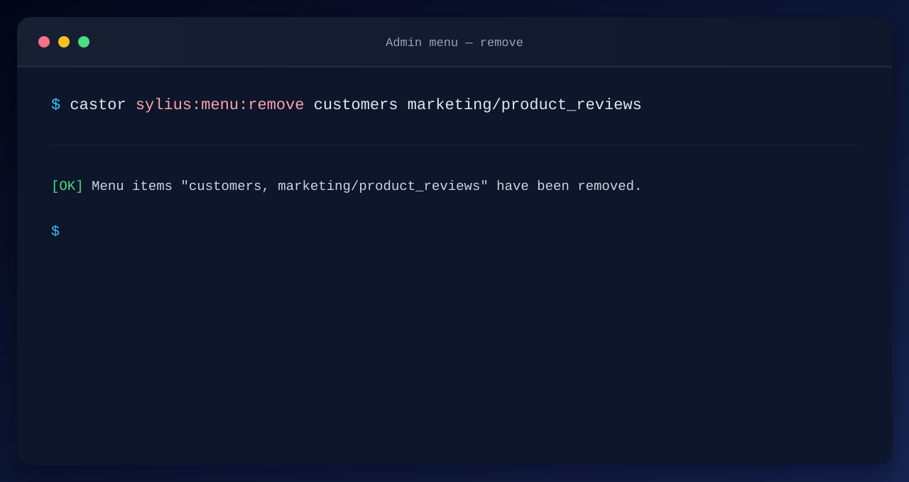
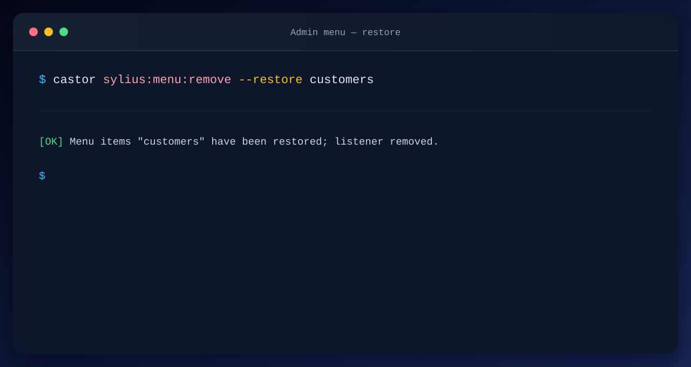

Provided by `sylius-starter/menu`. Clean up the Sylius Admin panel by removing menu items you don't need.

This command generates `application/src/Menu/Admin/RemoveMenuItemsListener.php`, a Symfony
event listener that hides matching items from the admin main menu. Subsequent runs
automatically merge new items into the existing list without prompting.

Pass one or more menu item names as arguments. Use `parent/child` syntax for sub-items.

```bash
castor sylius:menu:remove official_support sylius.ui.administration
castor sylius:menu:remove marketing/product_reviews
```



## Available options

| Option    | Shortcut | Description                                                                        |
|-----------|----------|------------------------------------------------------------------------------------|
| --replace | -r       | Replace the full removed-items list instead of merging with existing items         |
| --restore | -b       | Restore previously removed menu items; deletes the listener when the list is empty |

**Replace the removed-items list:**

```bash
castor sylius:menu:remove customers orders --replace
```

**Restore previously removed items:**

```bash
castor sylius:menu:remove --restore customers
castor sylius:menu:remove -b customers orders
```



**Example workflow:**

```bash
# Hide customers and orders from the admin menu
castor sylius:menu:remove customers orders

# Later, hide product reviews too (auto-merged)
castor sylius:menu:remove marketing/product_reviews

# Restore the customers menu item
castor sylius:menu:remove -b customers
```

## Default menu items

Top-level items:

| Name                     | Description      |
|--------------------------|------------------|
| dashboard                | Dashboard        |
| catalog                  | Catalog          |
| sales                    | Sales            |
| customers                | Customers        |
| marketing                | Marketing        |
| configuration            | Configuration    |
| official_support         | Official Support |
| sylius.ui.administration | Administration   |

Sub-items (use `parent/child` syntax):

| Name                                   | Description           |
|----------------------------------------|-----------------------|
| catalog/taxons                         | Taxons                |
| catalog/products                       | Products              |
| catalog/inventory                      | Inventory             |
| catalog/attributes                     | Attributes            |
| catalog/options                        | Options               |
| catalog/association_types              | Association Types     |
| sales/orders                           | Orders                |
| sales/payments                         | Payments              |
| sales/shipments                        | Shipments             |
| customers/customers                    | Customers             |
| customers/groups                       | Groups                |
| marketing/promotions                   | Promotions            |
| marketing/catalog_promotions           | Catalog Promotions    |
| marketing/product_reviews              | Product Reviews       |
| configuration/channels                 | Channels              |
| configuration/countries                | Countries             |
| configuration/zones                    | Zones                 |
| configuration/currencies               | Currencies            |
| configuration/exchange_rates           | Exchange Rates        |
| configuration/locales                  | Locales               |
| configuration/payment_methods          | Payment Methods       |
| configuration/shipping_methods         | Shipping Methods      |
| configuration/shipping_categories      | Shipping Categories   |
| configuration/tax_categories           | Tax Categories        |
| configuration/tax_rates                | Tax Rates             |
| configuration/admin_users              | Admin Users           |
| official_support/sylius_plus           | Sylius Plus           |
| official_support/browse_plugins        | Browse Plugins        |
| official_support/professional_services | Professional Services |
| official_support/find_a_partner        | Find a Partner        |
| official_support/sylius_certification  | Sylius Certification  |
| sylius.ui.administration/roles         | Roles                 |
