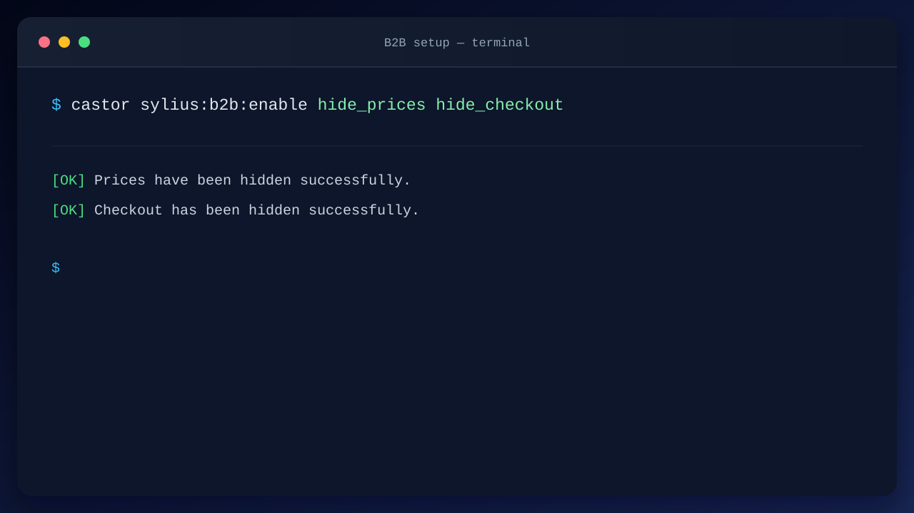
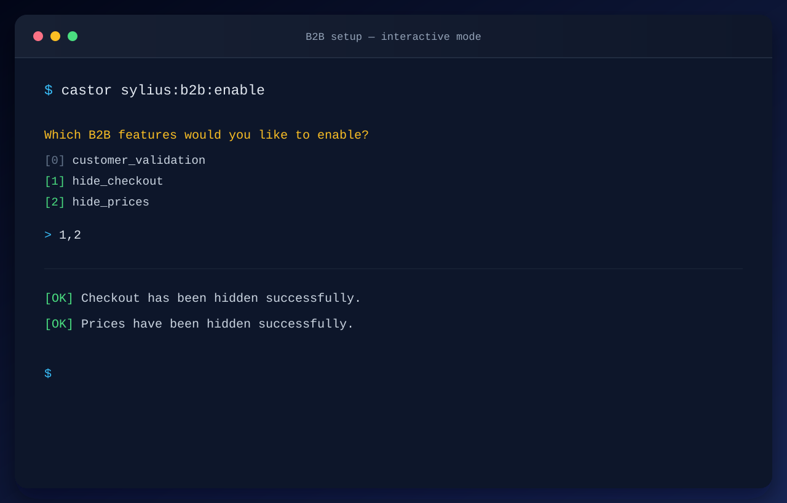

Provided by `sylius-starter/b2b`. Turn on B2B features for your Sylius shop. Pass one or more feature identifiers as arguments:

```bash
castor sylius:b2b:enable hide_prices hide_checkout customer_validation
```

If no arguments are provided, an interactive choice lets you select the features to enable.

> **Note:** The command copies the matching resources into your application.

## Examples





## Available features

| Feature               | Description                                         |
|-----------------------|-----------------------------------------------------|
| `hide_prices`         | Hide prices for anonymous users                     |
| `hide_checkout`       | Hide the checkout for anonymous users               |
| `customer_validation` | Require admin approval before customers can sign in |

## Hide prices for anonymous users

Hides product prices (product cards, product details page and lowest price before discount) from visitors who are not
logged in. Prices remain visible to logged-in customers.

## Hide checkout for anonymous users

Removes the "Add to cart" button on the product details page and hides the cart from the header for guests. Cart and
checkout routes return a 403 for them.

Both features rely on Twig Hooks hookable conditions (`condition: '@=is_granted("CAN_ACCESS_B2B_SHOP")'`) rather than
template overrides, so they require `sylius/twig-hooks` 0.14+ (the command upgrades it if needed). To change who can
see prices and checkout, adapt `App\Security\CanAccessB2bShopVoter`.

## Admin validation for new users

Require an administrator to approve new customers before they can sign in. Enable the feature with:

```bash
castor sylius:b2b:enable customer_validation
```

New customers are created **disabled** and start in the `customer_validation` workflow (`new` → `accepted` /
`rejected`). After registration, customers receive an email explaining that their account is awaiting administrator
approval. The same message is shown on the registration confirmation page and as the registration success notification.
These messages are available in English and French. The standard Sylius registration email remains suppressed until a
customer is accepted.

In the Admin panel, this feature:

- adds `state`, `localeCode` and `registrationChannel` fields to the `Customer` entity;
- displays the validation state in the customer grid, with a filter for `new`, `accepted` and `rejected`;
- adds **Accept** / **Reject** actions to the customer grid and customer show page;
- displays a count of customers waiting for validation in the dashboard pending actions;
- generates a Doctrine migration for the new columns and prompts you to run it (you can run it later if you decline);
- enables the user and sends the standard Sylius registration email when a customer is **accepted**;
- leaves the user disabled when a customer is **rejected**.
