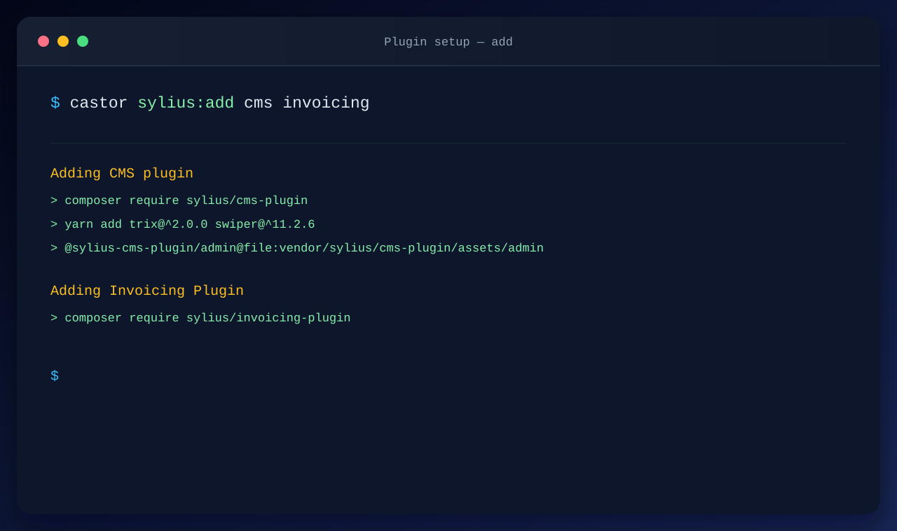
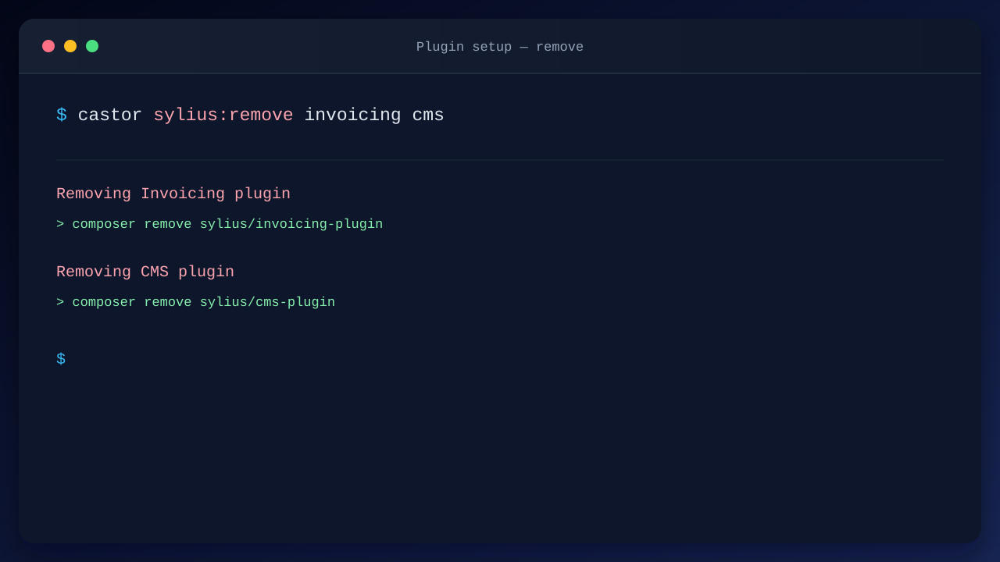

Install or uninstall Sylius plugins with simple commands. Provided by `sylius-starter/plugins`.

## Add plugins

A single command to add all the Sylius plugins you need (`sylius:add` is an alias of `sylius:plugin:add`):

```bash
castor sylius:add cms invoicing refund
```



| Plugin         | Description                                        |
|----------------|----------------------------------------------------|
| ai_dev_tools   | Dev-only AI tooling for Sylius                     |
| altcha         | ALTCHA captcha to customer registration            |
| bugsnag        | Official BugSnag notifier for Symfony applications |
| cms            | CMS plugin for Sylius applications                 |
| gdpr           | Synolia sylius GDPR plugin                         |
| invoicing      | Invoicing plugin for Sylius                        |
| media          | Media management bundle for Symfony applications   |
| product_bundle | Product bundle for Sylius                          |
| refund         | Basic refunds functionality for Sylius             |
| recaptcha      | Google reCAPTCHA v3 to customer registration       |
| wishlist       | Wishlist plugin for Sylius                         |

These descriptions are the ones displayed next to each plugin in the interactive prompt.

## Remove plugins

A single command to remove the Sylius plugins you do not need anymore (`sylius:remove` is an alias of
`sylius:plugin:remove`):

```bash
castor sylius:remove invoicing cms
```



| Plugin       | Description                                        |
|--------------|----------------------------------------------------|
| ai_dev_tools | Dev-only AI tooling for Sylius                     |
| altcha       | ALTCHA captcha to customer registration            |
| api          | Sylius API and its test tooling                    |
| bugsnag      | Official BugSnag notifier for Symfony applications |
| cms          | CMS plugin for Sylius applications                 |
| gdpr         | Synolia sylius GDPR plugin                         |
| invoicing    | Invoicing plugin for Sylius                        |
| recaptcha    | Google reCAPTCHA v3 to customer registration       |
| wishlist     | Wishlist plugin for Sylius                         |

## Your own plugins

You can [register your own plugins](../extending/index.md) with the `AsPluginInstaller` and `AsPluginRemover`
attributes.
