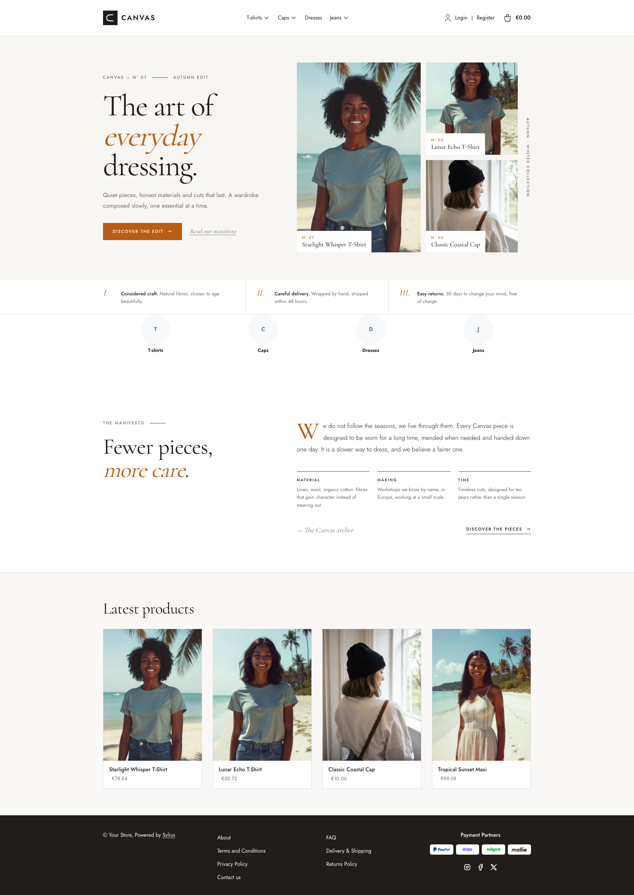
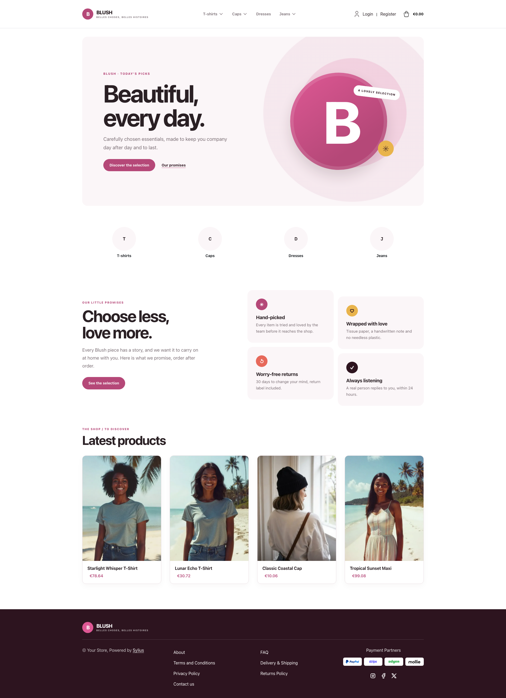
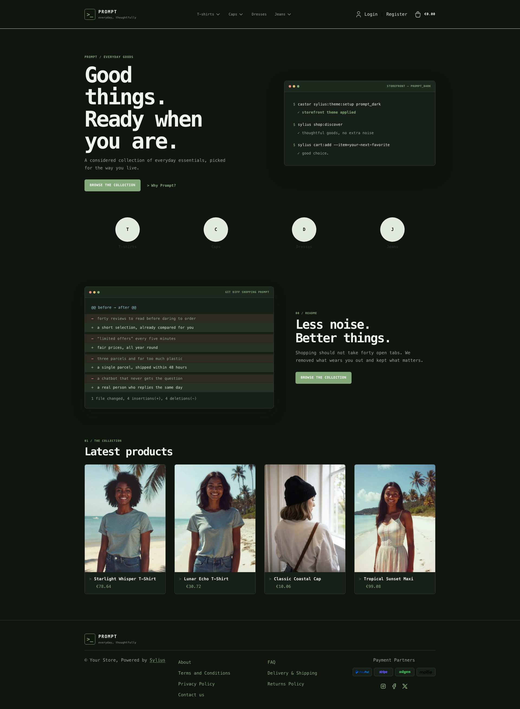
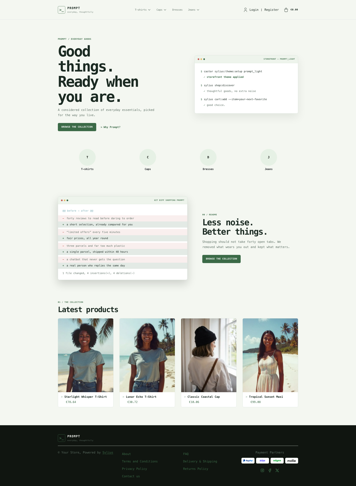
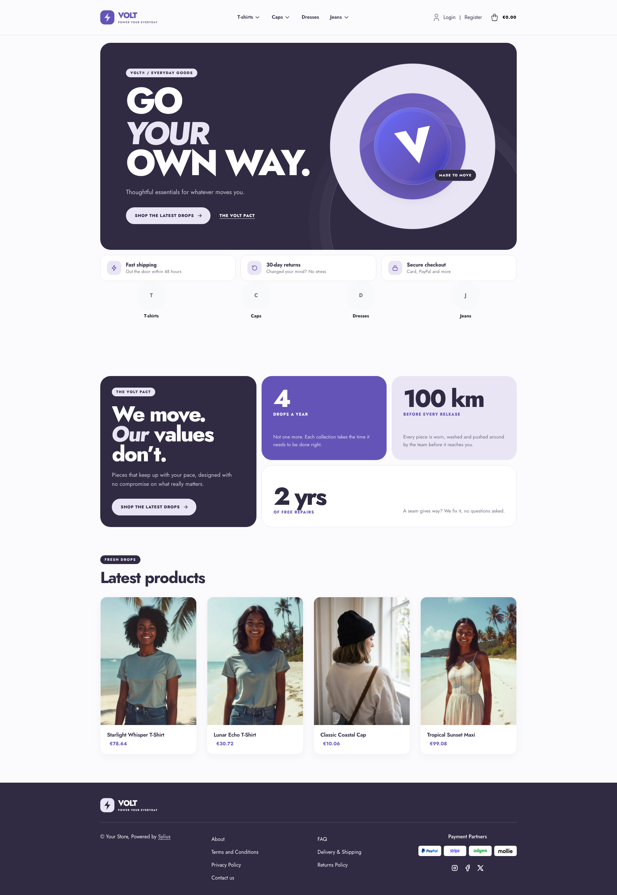
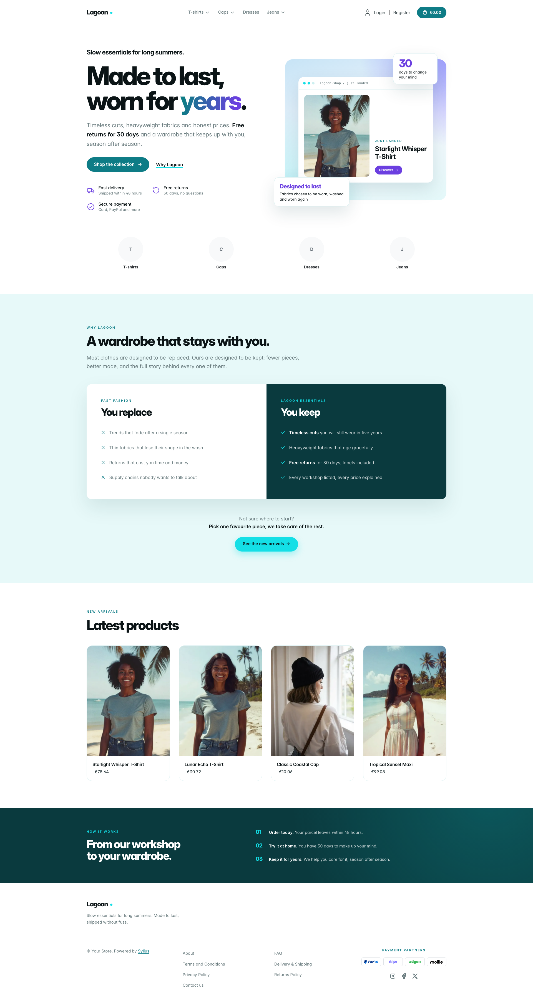
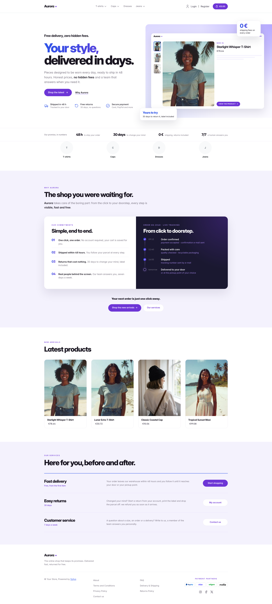
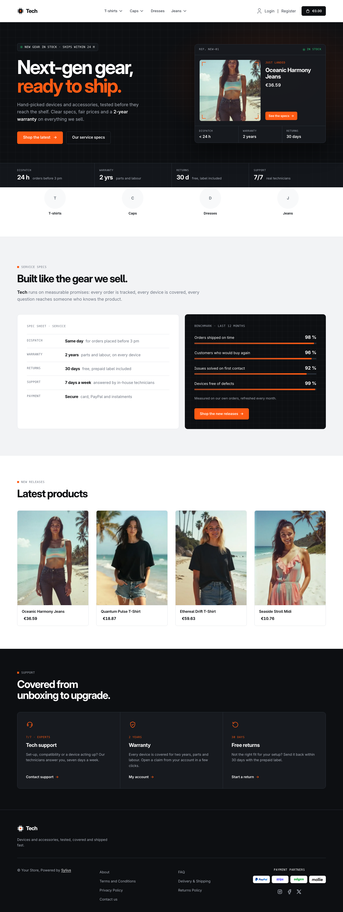

Install a storefront theme in your Sylius application. Provided by `sylius-starter/themes`. Only one theme can be
active: installing a theme automatically removes any other previously installed theme.

If no argument is provided, an interactive prompt asks you to choose the theme.

```bash
castor sylius:theme:setup canvas
```

## Available themes

| Preview                                                                                                                                  | Theme                                    | Description                                                    |
|------------------------------------------------------------------------------------------------------------------------------------------|------------------------------------------|----------------------------------------------------------------|
| <a href="../themes/canvas.md"></a>                 | [Canvas](../themes/canvas.md)             | Clean, editorial look with warm neutrals                       |
| <a href="../themes/blush.md"></a>                    | [Blush](../themes/blush.md)               | White canvas, raspberry accents and a plum footer                                            |
| <a href="../themes/prompt_dark.md"></a>  | [Prompt Dark](../themes/prompt_dark.md)   | Terminal-inspired dark workspace with green accents                                   |
| <a href="../themes/prompt_light.md"></a> | [Prompt Light](../themes/prompt_light.md) | Terminal-inspired layout on soft green paper                                  |
| <a href="../themes/volt.md"></a>                       | [Volt](../themes/volt.md)                 | High-energy sport-tech look in electric violet                                                |
| <a href="../themes/lagoon.md"></a>                 | [Lagoon](../themes/lagoon.md)             | Airy, product-led look in teal and aqua                                |
| <a href="../themes/aurora.md"></a>                 | [Aurora](../themes/aurora.md)             | Lagoon's violet sibling, with a blue-to-violet gradient                                    |
| <a href="../themes/tech.md"></a>                     | [Tech](../themes/tech.md)                 | Electronics-store look in carbon, aluminium and signal orange                              |
| —                                                                                                                                        | default                                  | No theme applied; rebuilds the application assets              |

## Your own themes

You can [register your own themes](../extending/index.md) with the `AsThemeInstaller` and `AsThemeRemover` attributes.
A theme reads the shared [hero](../storefront/hero.md) and [brand](../storefront/brand.md) slots, so the data other
packages contribute (an imported shop's logo, for instance) shows up in it.
