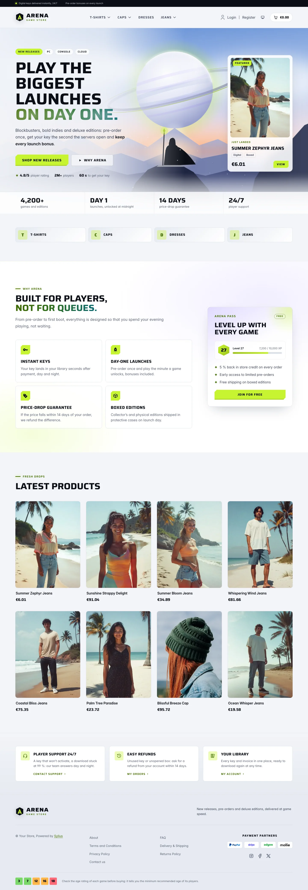
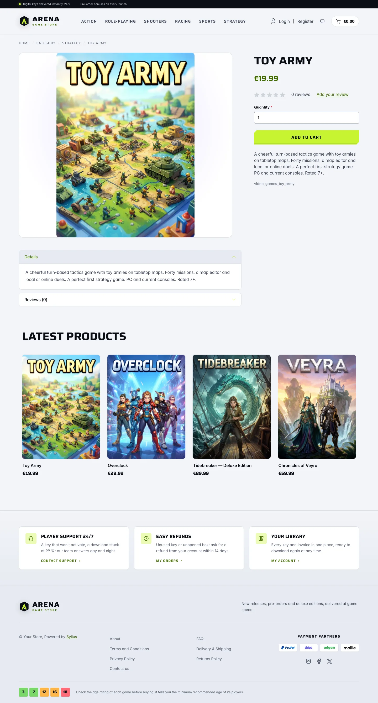
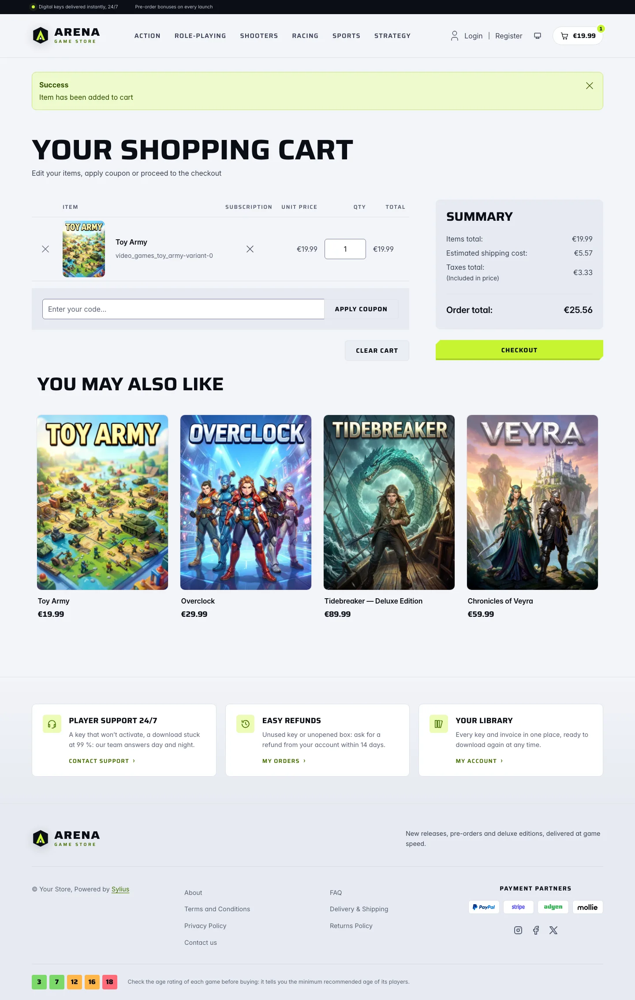
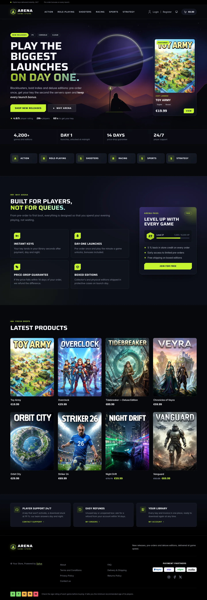
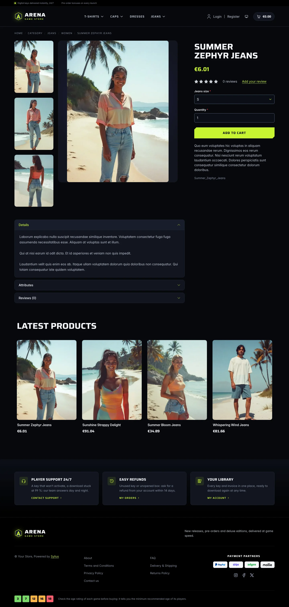
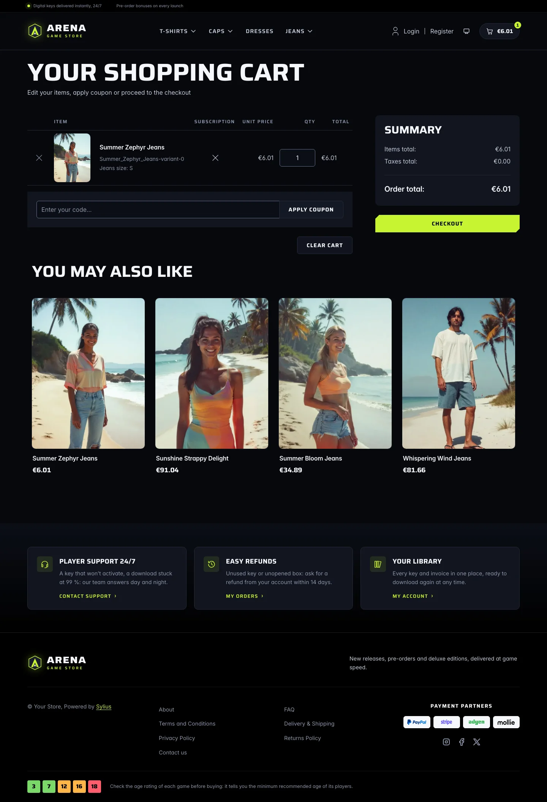
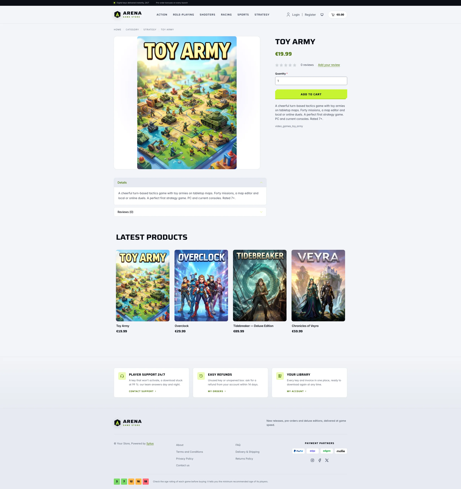
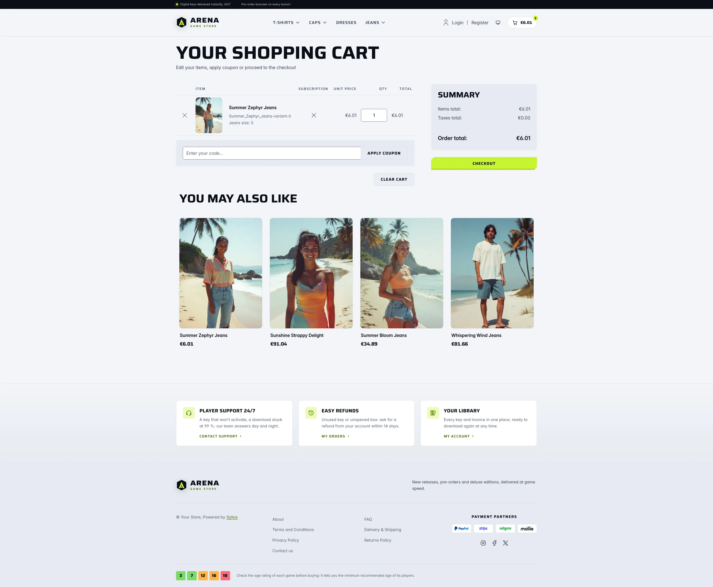
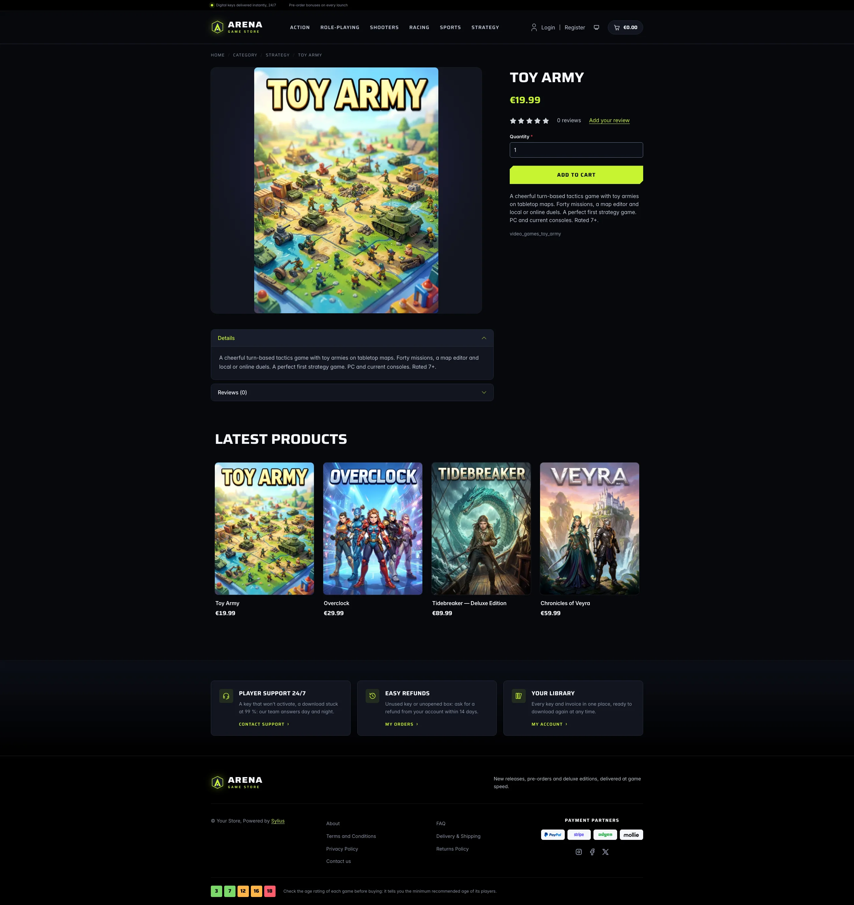
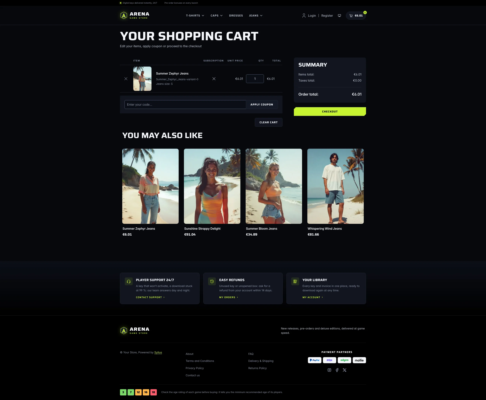

Arena is built for stores selling today's AAA and AA video games: new releases, pre-orders and
deluxe editions. It borrows the codes of current console and PC launchers — glass panels, wide
uppercase display type, one acid-lime signal colour and chamfered calls to action — and opens on
a cinematic key art, like a featured launch. The dark scheme is an immersive night launcher of
blue-black glass; the light scheme sets it in daylight, with frost-white glass panels, ink type
and a sunrise cut of the key art. Visitors switch between both [color schemes](color-schemes.md)
from the header.

**Desktop** (1440 px)

| Scheme | Homepage | Product page | Cart |
|---|---|---|---|
| Light |  |  |  |
| Dark |  |  |  |

**Wide screen** (2560 px)

| Scheme | Homepage | Product page | Cart |
|---|---|---|---|
| Light |  |  |  |
| Dark |  |  |  |

**Mobile** (390 px)

| Scheme | Homepage | Product page | Cart |
|---|---|---|---|
| Light |  |  |  |
| Dark |  |  |  |

- **Palette** — void (`#07080D`), deep (`#0B0E16`) and panel (`#11151F`) blue-blacks with
  white display type (`#F5F7FB`), a single acid lime (`#C6F432`) for calls to action, prices
  and focus rings, and violet (`#7C5CFF`) and ember (`#FF8A4C`) glows in the key art and panels.
  In the light scheme: frost page (`#F2F4F8`), white surfaces and cool grey panels (`#E6EAF1`),
  ink headings (`#0B0E16`) and slate body copy (`#3A4255`); the acid lime only fills buttons,
  chips, badges and counters under ink text, while links, eyebrows, focus rings and checked boxes
  use a deep olive of the same hue (`#3F6B00`). The top bar stays an ink band and the footer
  turns cool grey, with the player services on white tiles.
- **Typography** — *Saira* (SIL Open Font License, variable width and weight, shipped in
  `assets/shop/fonts/`) for headings, navigation, buttons, prices and labels, set wide and in
  capitals; *Inter* (already shipped by the Sylius shop) for body copy. No pixel or retro face:
  the look is the one of a current game launcher.
- **Components** — lime buttons with chamfered corners (the focus ring is drawn inside them),
  frosted glass secondary buttons, platform chips, product cards presented like box art in a
  library: the 3:4 cover fills a rounded tile that lifts, glows in lime and catches a light sheen
  on hover (the whole card is clickable, on the homepage and on category pages alike); a glass
  cart pill with a lime counter.
- **Header** — a black top bar with a live status dot, the key-delivery promise and the locale /
  currency switchers, then a faceted crest and the wide *Arena* wordmark, and the category
  navigation in display capitals with a glowing lime bar on hover.
- **Homepage** — a full-bleed **key art** (an original illustration: a hooded wanderer on a rocky
  spur, facing an eclipsed ringed planet over a hazy range at dusk) behind the headline,
  platform chips, two calls to action and player figures. On the right, the newest product is
  presented as a **featured release** on a frosted glass card (cover, edition chips, price).
  A glass band of store figures closes the hero, and the category links become launcher-style
  genre tiles. The promise block (`theme_promise` hookable) lists four player services (instant
  keys, day-one launches, price-drop guarantee, boxed editions) next to an **Arena Pass**
  membership card (level badge, XP bar, perks, sign-up link). Then come the eight latest
  products; the deals and new collection blocks are hidden.
- **Footer** — black, with three player services (support, refunds, library) linking to the
  contact page and the customer account, the wordmark, the Sylius links and an **age-rating
  guide** drawn with original square badges (3, 7, 12, 16, 18).
- **Product page** — the main picture is contained on a dark panel and its height follows the
  screen, so it never blows up on wide screens; the price sits directly below the product name,
  before reviews.
- **Checkout** — the checkout header uses the Arena wordmark and responsive category
  navigation, the current step glows in lime.
- **Translations** — every Arena-specific text lives in its own `arena` translation domain
  (`translations/arena.en.yaml` and `arena.fr.yaml`), so it can be edited or translated without
  touching the templates.
- **Accessibility** — every text and colour pair meets WCAG AA in both schemes (dark: ink on
  lime 15.6:1, lime on the page 15.6:1, muted text 5.6:1 or more; light: ink on lime 15:1, olive
  accent and muted text 4.7:1 or more on every surface, the hero glass included; form field
  outlines 3.4:1 or more), visible focus rings, a text alternative for each cut of the key art,
  and no motion for visitors who prefer reduced motion.

Product thumbnails are cut to 3:4 by the Sylius image filters (`sylius_shop_product_thumbnail`,
`outbound` mode): upload covers in portrait 3:4, the usual box-art ratio, so they reach the page
uncropped.

## Demo catalog

The screenshots above show a demo catalog of sixteen fictional video games in six genres (Action,
Role-Playing, Shooters, Racing, Sports, Strategy), from day-one blockbusters and collector's editions to small indies,
shipped as the `video-games` dataset of `sylius-starter/datasets` (`src/Datasets/datasets/video-games/`:
`products.yaml`, `collections.yaml`, and in `media/` the cover of each game: a 3:4 key art generated with Ollama, with
its title printed on it). Descriptions carry what a player looks for: platforms, modes, edition contents, pre-order
bonuses and age rating. The dataset stays generic, so it suits any store selling video games. Create a shop from it
with the [import package](../import/datasets.md), into the default channel:

```bash
castor sylius:import:shop:create video-games
castor sylius:import:fixtures:generate --project=video-games --subdomain=""
castor sylius:import:fixtures:load --project=video-games
```

No AI call is made: `products.yaml` points at the covers of the dataset `media/`. The shop menu then lists the six
genres; `castor sylius:import:delete video-games` removes the catalog. The import keeps the products already in the
channel and gives the games creation dates in the past, so on a store loaded with the default fixtures the latest
products may still show clothing: run `castor app:db:fixtures app` first to start from a store without products.

Install it with:

```bash
castor sylius:theme:setup arena
```
