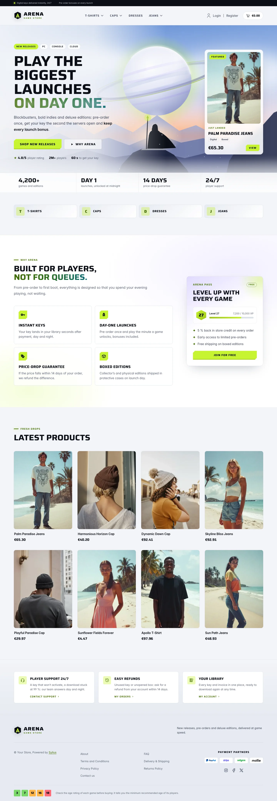
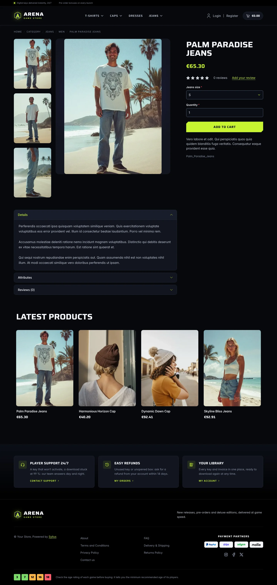
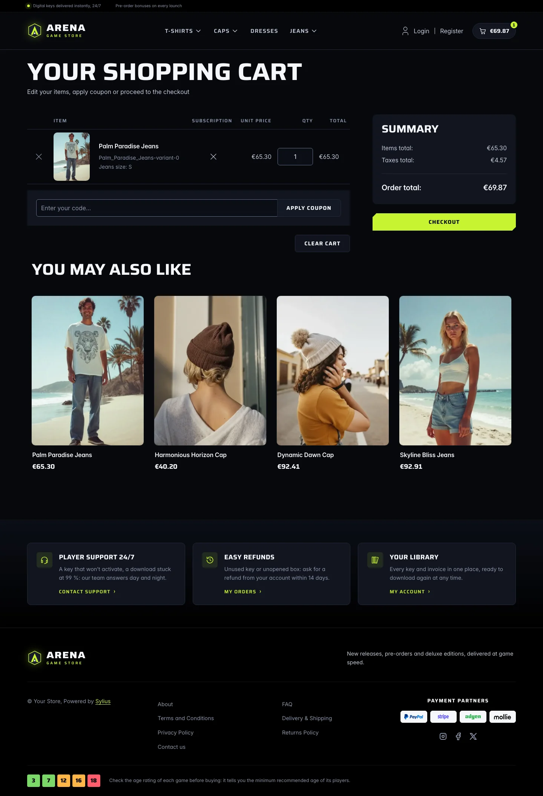
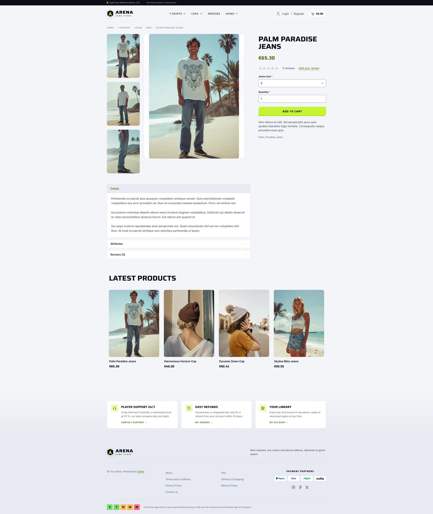
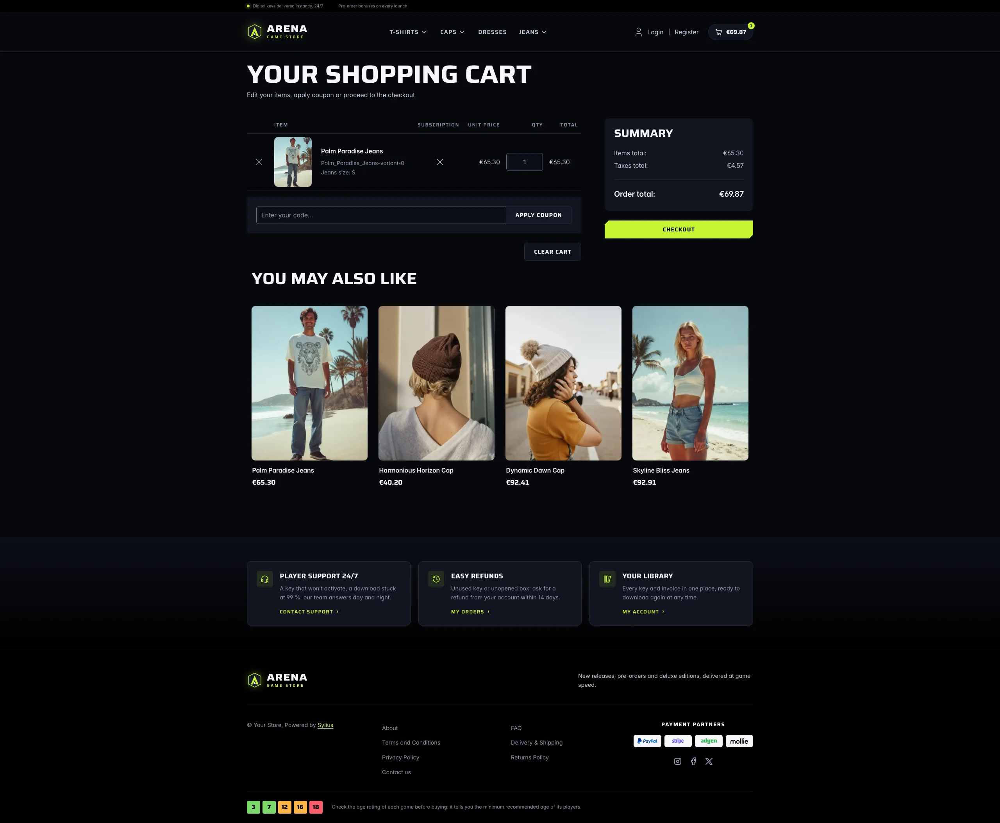
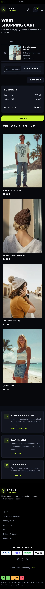

Arena Dark is built for stores selling today's AAA and AA video games: new releases, pre-orders and
deluxe editions. It borrows the codes of current console and PC launchers — a dark, immersive
storefront of blue-black glass panels, wide uppercase display type, one acid-lime signal colour
and chamfered calls to action — and opens on a cinematic key art, like a featured launch. Its daylight sibling is
[Arena Light](arena_light.md).

**Desktop** (1440 px)

| Homepage | Product page | Cart |
|---|---|---|
|  |  |  |

**Wide screen** (2560 px)

| Homepage | Product page | Cart |
|---|---|---|
|  |  |  |

**Mobile** (390 px)

| Homepage | Product page | Cart |
|---|---|---|
|  |  |  |

- **Palette** — void (`#07080D`), deep (`#0B0E16`) and panel (`#11151F`) blue-blacks with
  white display type (`#F5F7FB`), a single acid lime (`#C6F432`) for calls to action, prices
  and focus rings, and violet (`#7C5CFF`) and ember (`#FF8A4C`) glows in the key art and panels.
- **Typography** — *Saira* (SIL Open Font License, variable width and weight, shipped in
  `assets/shop/fonts/`) for headings, navigation, buttons, prices and labels, set wide and in
  capitals; *Inter* (already shipped by the Sylius shop) for body copy. No pixel or retro face:
  the look is the one of a current game launcher.
- **Components** — lime buttons with chamfered corners (the focus ring is drawn inside them),
  frosted glass secondary buttons, platform chips, product cards presented like box art in a
  library: the 3:4 cover fills a rounded tile that lifts, glows in lime and catches a light sheen
  on hover (the whole card is clickable, on the homepage and on category pages alike); a glass
  cart pill with a lime counter.
- **Header** — a black top bar with a live status dot, the key-delivery promise and the locale /
  currency switchers, then a faceted crest and the wide *Arena* wordmark, and the category
  navigation in display capitals with a glowing lime bar on hover.
- **Homepage** — a full-bleed **key art** (an original illustration: a hooded wanderer on a rocky
  spur, facing an eclipsed ringed planet over a hazy range at dusk) behind the headline,
  platform chips, two calls to action and player figures. On the right, the newest product is
  presented as a **featured release** on a frosted glass card (cover, edition chips, price).
  A glass band of store figures closes the hero, and the category links become launcher-style
  genre tiles. The promise block (`theme_promise` hookable) lists four player services (instant
  keys, day-one launches, price-drop guarantee, boxed editions) next to an **Arena Pass**
  membership card (level badge, XP bar, perks, sign-up link). Then come the eight latest
  products; the deals and new collection blocks are hidden.
- **Footer** — black, with three player services (support, refunds, library) linking to the
  contact page and the customer account, the wordmark, the Sylius links and an **age-rating
  guide** drawn with original square badges (3, 7, 12, 16, 18).
- **Product page** — the main picture is contained on a dark panel and its height follows the
  screen, so it never blows up on wide screens; the price sits directly below the product name,
  before reviews.
- **Checkout** — the checkout header uses the Arena wordmark and responsive category
  navigation, the current step glows in lime.
- **Translations** — every Arena-specific text lives in its own `arena` translation domain (shared with Arena Light)
  (`translations/arena.en.yaml` and `arena.fr.yaml`), so it can be edited or translated without
  touching the templates.
- **Accessibility** — every text and colour pair meets WCAG AA (ink on lime 15.6:1, lime on
  the page 15.6:1, muted text 5.6:1 or more, form field outlines 3.4:1 or more), visible lime
  focus rings, a text alternative for the key art, and no motion for visitors who prefer
  reduced motion.

Product thumbnails are cut to 3:4 by the Sylius image filters (`sylius_shop_product_thumbnail`,
`outbound` mode): upload covers in portrait 3:4, the usual box-art ratio, so they reach the page
uncropped.

Install it with:

```bash
castor sylius:theme:setup arena_dark
```
