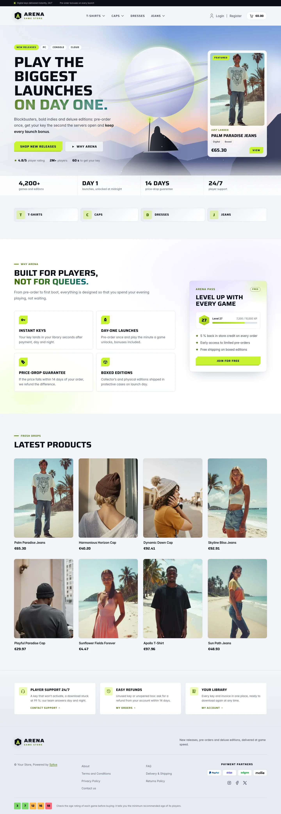
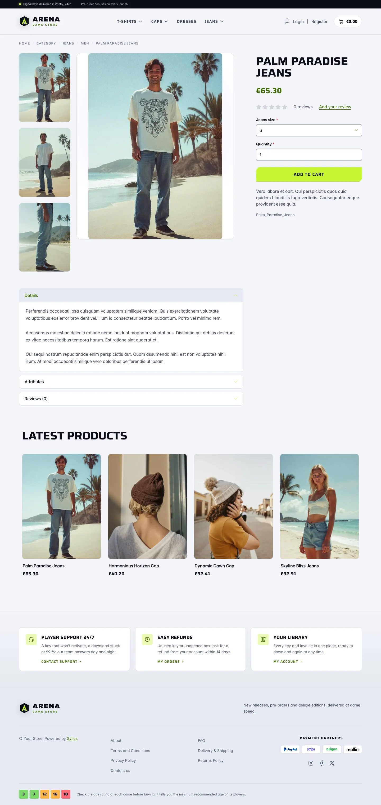
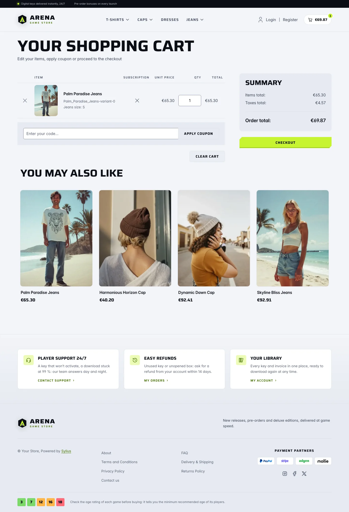
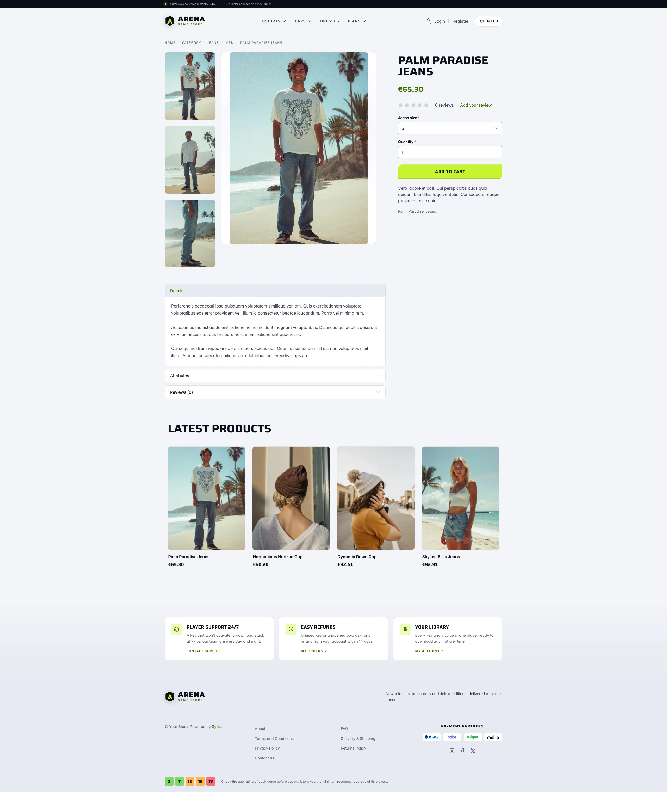
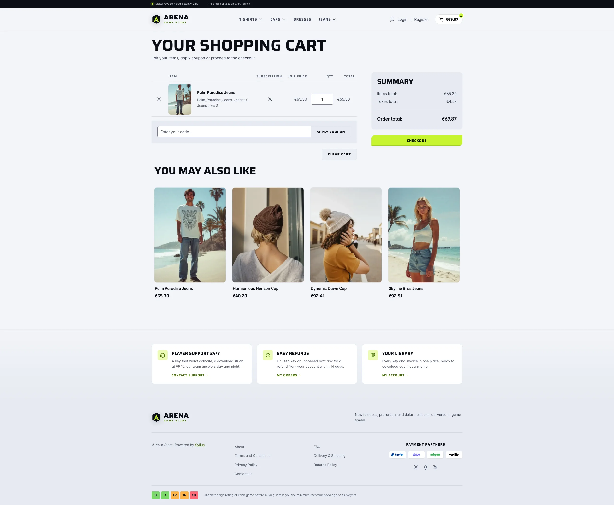
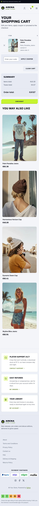

Arena Light keeps the identity of [Arena Dark](arena_dark.md) — the modern AAA and AA game
store with wide display capitals, chamfered calls to action, box-art cards and a cinematic
key art — and sets it in daylight: frost-white glass panels, ink type, the acid lime kept as
a fill under ink text, and a deep olive of the same hue wherever the accent has to be read.

**Desktop** (1440 px)

| Homepage | Product page | Cart |
|---|---|---|
|  |  |  |

**Wide screen** (2560 px)

| Homepage | Product page | Cart |
|---|---|---|
|  |  |  |

**Mobile** (390 px)

| Homepage | Product page | Cart |
|---|---|---|
|  |  |  |

- **Palette** — frost page (`#F2F4F8`), white surfaces and cool grey panels (`#E6EAF1`),
  ink headings (`#0B0E16`) and slate body copy (`#3A4255`). The acid lime (`#C6F432`) only
  fills buttons, chips, badges and counters under ink text; links, prices on sale, eyebrows,
  focus rings and checked boxes use the deep olive accent (`#3F6B00`).
- **Typography** — the same *Saira* (wide display capitals) and *Inter* as Arena Dark.
- **Components** — lime chamfered buttons grounded by an ink underline, white glass secondary
  buttons, white box-art cards with a lime ring on hover, white form fields outlined in slate,
  an ink crest with the lime blade for the logo.
- **Header** — an ink top bar (key-delivery promise, locale and currency switchers) above a
  white header; the category navigation gets an olive bar on hover.
- **Homepage** — the same composition as Arena Dark, at sunrise: the hooded wanderer stands in
  ink against a peach horizon, under a pale ringed giant and ranges fading in atmospheric
  perspective. The featured release and the store figures sit on white frosted glass, the
  genre tiles carry an olive initial on a lime tint, the promise block and the **Arena Pass**
  card take a soft violet and lime wash.
- **Footer** — cool grey, with the player services on white tiles, the store links and the
  age-rating guide.
- **Product page, cart and checkout** — white panels, the main picture capped to the screen
  height, the checkout summary on a grey panel and the current step marked in lime.
- **Translations** — the texts share the `arena` translation domain with Arena Dark.
- **Accessibility** — every text and colour pair meets WCAG AA, including the bright accents:
  ink on lime 15:1, olive accent and muted text 4.7:1 or more on every surface (the hero
  glass included), form field outlines 3.4:1 or more and an olive focus ring; no
  motion for visitors who prefer reduced motion.

Product thumbnails are cut to 3:4 by the Sylius image filters (`sylius_shop_product_thumbnail`,
`outbound` mode): upload covers in portrait 3:4, the usual box-art ratio, so they reach the page
uncropped.

Install it with:

```bash
castor sylius:theme:setup arena_light
```
