Bloom is built for beauty and wellness shops selling skincare, makeup, fragrance, hair care and beauty
tools: a luminous storefront in milk and peony, inked in fig and set with the soft DM Serif Display, where
every shelf has its own pastel. Its house flower is made of five round petals, one per colour of the
garden. Playful details (stickers on the mirror, falling petals, a flower that blooms on the product cards)
keep it fresh rather than clinical, and the page speaks of rituals, textures and skin types.

**Desktop** (1440 px)

| Scheme | Homepage | Product page | Cart |
|---|---|---|---|
| Light | 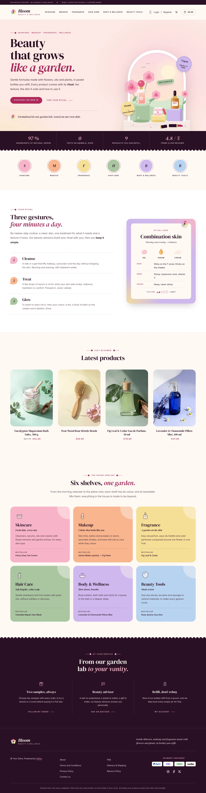 | 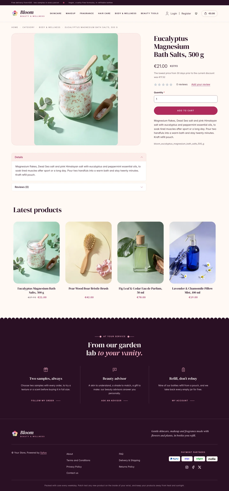 | 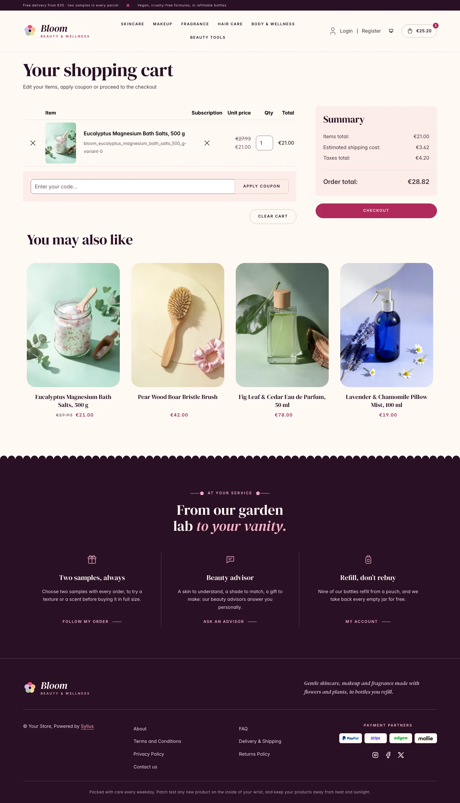 |
| Dark | 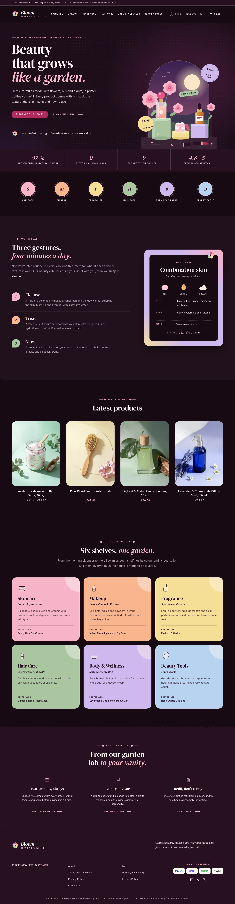 | 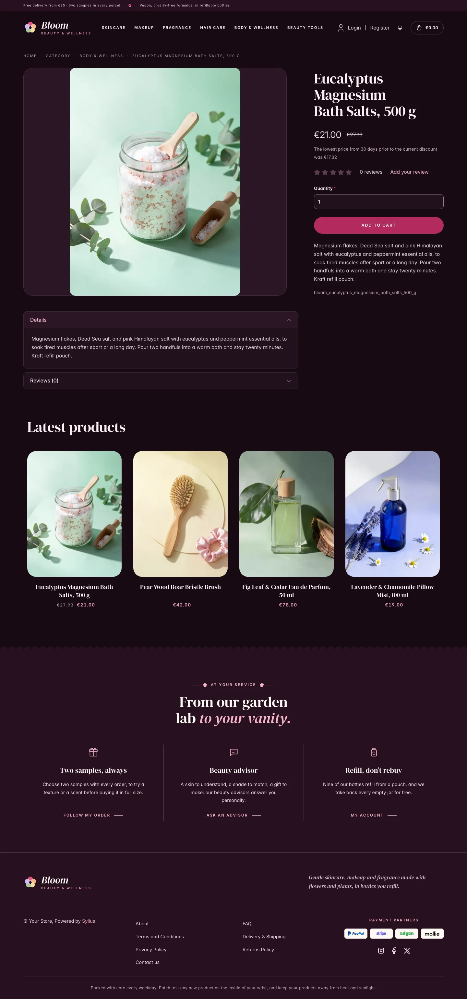 | 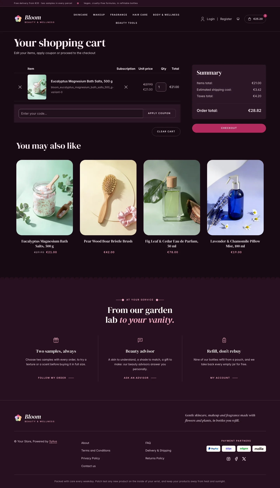 |

**Wide screen** (2560 px)

| Scheme | Homepage | Product page | Cart |
|---|---|---|---|
| Light | 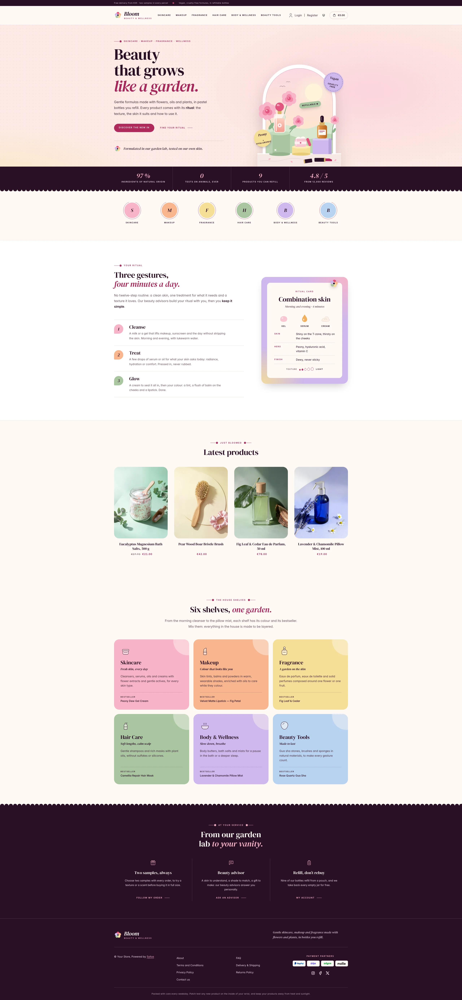 | 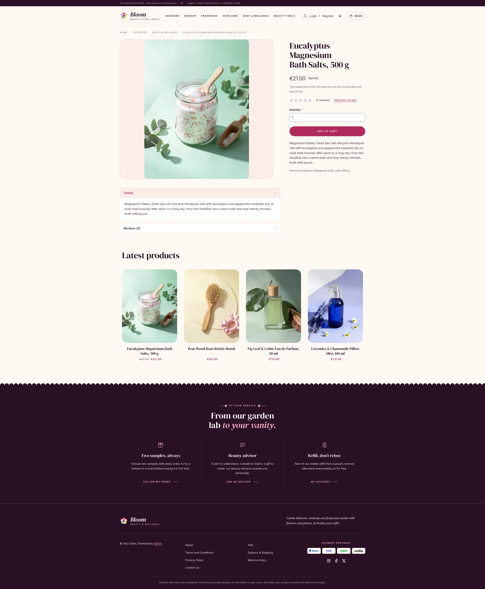 | 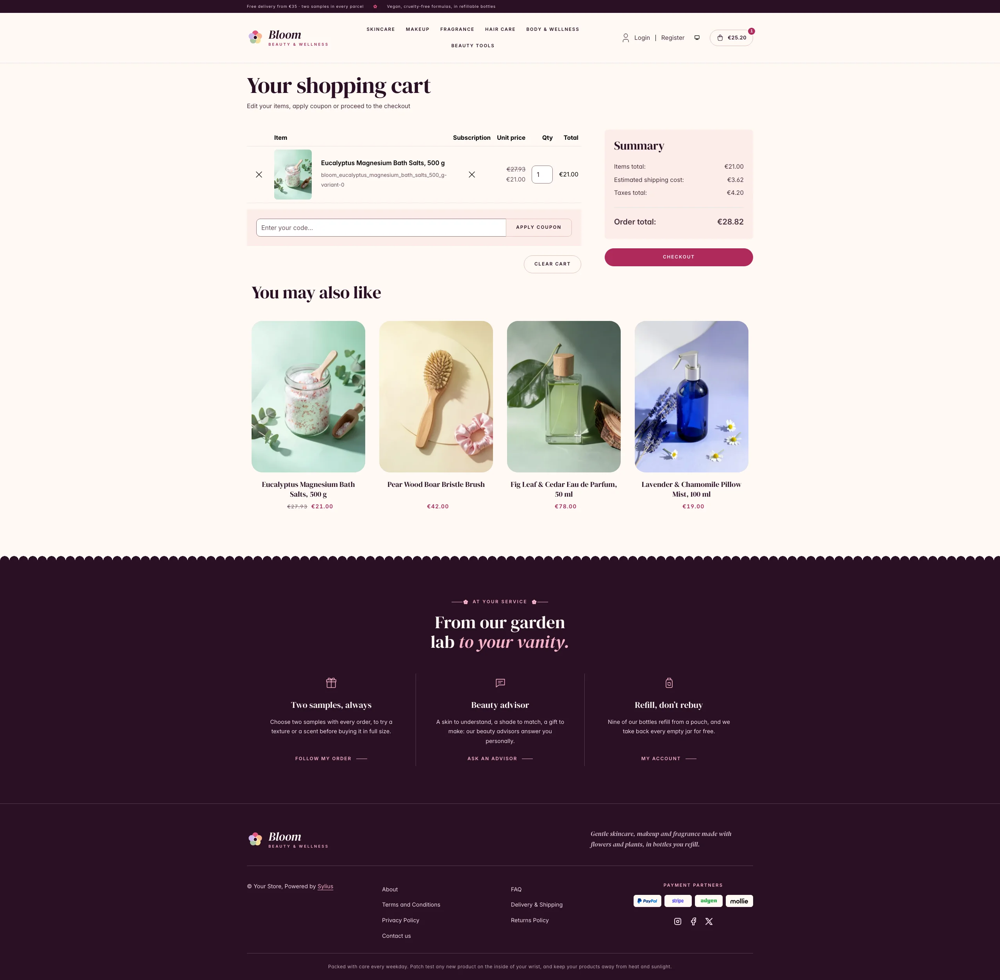 |
| Dark | 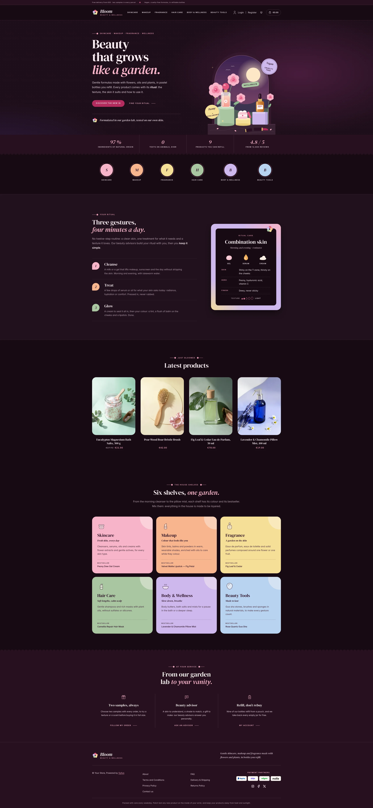 | 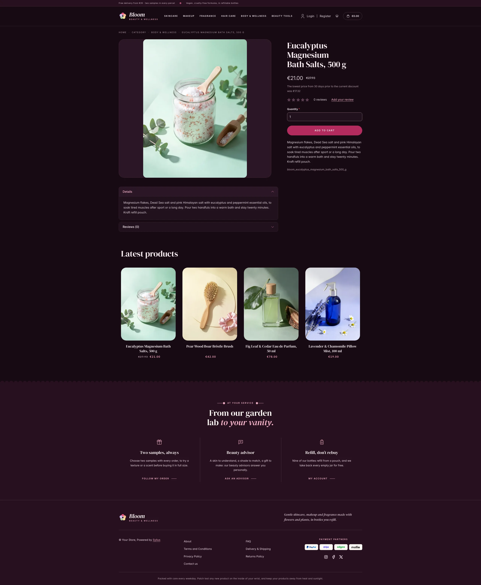 | 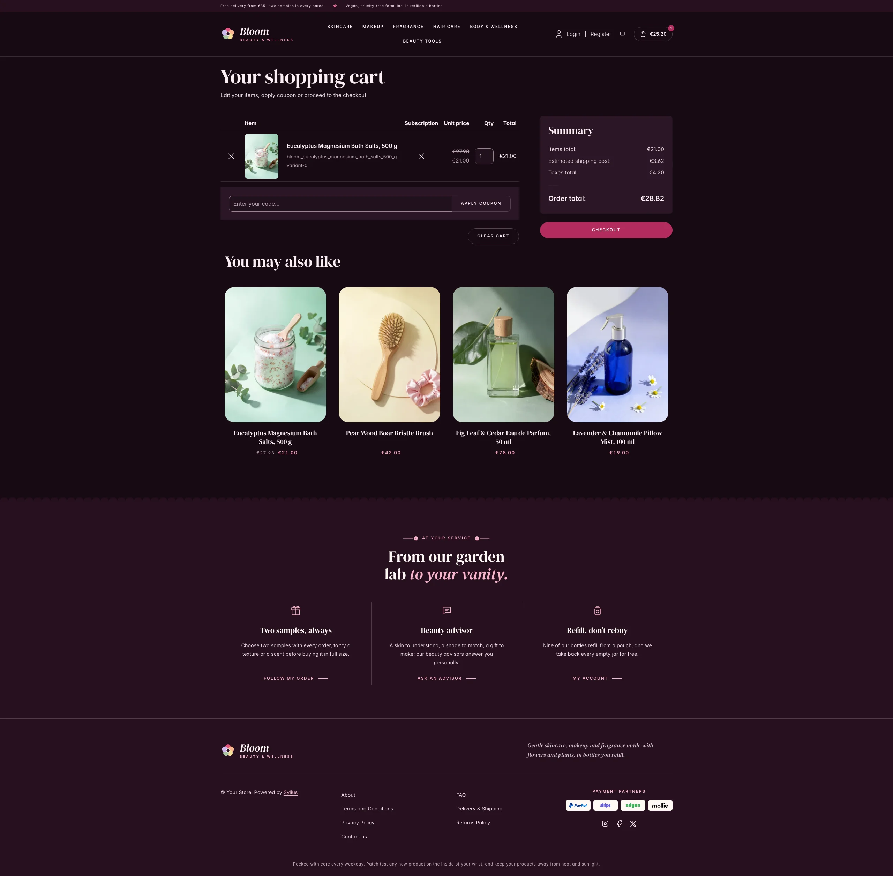 |

**Mobile** (390 px)

| Scheme | Homepage | Product page | Cart |
|---|---|---|---|
| Light |  |  |  |
| Dark |  |  |  |

- **Palette** — fig night (`#2A1024`, `#3B1733`) on milk (`#FFF8F4`), white and rose powder (`#FCEDE8`),
  with a peony (`#B02A5B` for buttons, `#A6275A` as text) for the calls to action, eyebrows and prices, and a
  garden of pastels that stays the same in both schemes: pink (`#F8B4C8`), apricot (`#F7B58E`), butter
  (`#F6DF97`), sage (`#A9C6A2`), lilac (`#CDB8EC`) and sky (`#B9D3F0`).
- **Dark scheme** — the bathroom by candlelight: night fig (page `#170B14`, surfaces `#20111C`), milk type,
  a deep peony (`#B32C5E`) for buttons and a pale pink (`#F8B4C8`) for accent text; the hero turns to a lilac
  dusk lit by a candle.
- **Typography** — *DM Serif Display* (SIL Open Font License, roman and italic, shipped in
  `assets/shop/fonts/`) for headings, product names and figures, with round peony italics; *Inter* (already
  shipped by the Sylius shop) for body copy, and spaced uppercase small capitals for eyebrows, navigation,
  buttons and breadcrumbs.
- **House motif** — a row of round petals: the fig bands (figures, footer) end in a scalloped petal edge,
  like the lace of a powder puff. Eyebrows are ruled by a fine stem ending in a five-petal flower.
- **Components** — pill-shaped peony buttons with a soft glow on hover, product cards in a pebble-rounded
  niche where the **house flower** spins open on hover, an outlined cart pill with a peony counter, petal
  numerals and a **texture scale**: five drops growing from a bead to a dollop.
- **Header** — a fig top bar with the delivery and sample promise, then the **house flower** and the
  *Bloom* wordmark (its petals turn on hover), centered category navigation with a peony dot under the
  hovered link.
- **Homepage** — a blush hero: an eyebrow, a DM Serif headline ending in peony italic, two calls to action and
  a signature with the flower. On the right, the **vanity**: a photograph in an arched mirror of pastel
  pedestals on a marble vanity holding a perfume with a peony cap, a pot of pink cream and an amber dropper
  serum, among pink and coral peonies and fallen petals, in the morning sun; in the dark scheme the same
  vanity at a lilac dusk, by candlelight. Each scheme only downloads its own photograph
  (`assets/shop/images/`). Three tilted **stickers** (vegan, key ingredient, refillable) are printed over it.
  A fig band of **house figures** (natural origin, no animal testing, refills, reviews) closes the hero.
  Category roundels take a pastel each. The ritual block (`theme_promise` hookable) presents the routine in
  three steps on petal numerals (cleanse, treat, glow), next to a **ritual card** for one skin type on a
  pastel board (texture swatches of a gel, a serum and a cream, skin, key ingredients, finish and texture).
  After the four latest products, the **shelves** block (`theme_shelves` hookable) shows the six shelves of
  the house (skincare, makeup, fragrance, hair care, body & wellness, beauty tools), each on its pastel with a
  drawing, a promise and its bestseller. The deals and new collection blocks are hidden.
- **Footer** — fig, with three **house services** (two samples always, beauty advisor, refills) linking to
  the contact page and the customer account, the wordmark, the Sylius links and a patch test notice.
- **Checkout** — the checkout header uses the Bloom wordmark and responsive category navigation, the current
  step is ruled in peony.
- **Translations** — every Bloom-specific text lives in its own `bloom` translation domain
  (`translations/bloom.en.yaml` and `bloom.fr.yaml`).
- **Accessibility** — visible peony focus rings, text alternatives for the hero photograph and the
  texture levels, decorative stickers hidden from assistive technologies, and no motion (sparkles, falling
  petals, swaying peonies) for visitors who prefer reduced motion.

## Demo catalog

The screenshots above show a demo catalog of eighteen beauty products and tools from a fictional beauty
house, on six shelves (Skincare, Makeup, Fragrance, Hair Care, Body & Wellness, Beauty Tools), shipped as the
`bloom` dataset of `sylius-starter/datasets` (`src/Datasets/datasets/bloom/`: `products.yaml`,
`collections.yaml`, and in `media/` a photo of each product generated with Ollama, each one on its own pastel
paper with the flowers or fruits of its formula). The products are the ones of the homepage (the bestsellers
of the six shelves and the textures of the ritual card), and descriptions carry what a beauty shopper looks
for: texture, key ingredients, skin type and how to use it.
Create a shop from it with the [import package](../import/datasets.md), into the default channel:

```bash
castor sylius:import:shop:create bloom
castor sylius:import:fixtures:generate --project=bloom --subdomain=""
castor sylius:import:fixtures:load --project=bloom
```

No AI call is made: `products.yaml` points at the photos of the dataset `media/`. The shop menu then lists the
six shelves; `castor sylius:import:delete bloom` removes the catalog. The import keeps the products already in
the channel and gives the items creation dates in the past, so on a store loaded with the default fixtures
the latest products may still show clothing: run `castor app:db:fixtures app` first to start from a store
without products.

Install it with:

```bash
castor sylius:theme:setup bloom
```
