Canvas gives the storefront a clean, editorial look, with warm neutral colors,
squared corners and a refined pairing of *Jost* (body) and *Cormorant Garamond*
(headings).

**Desktop** (1440 px)

| Scheme | Homepage | Product page | Cart |
|---|---|---|---|
| Light | 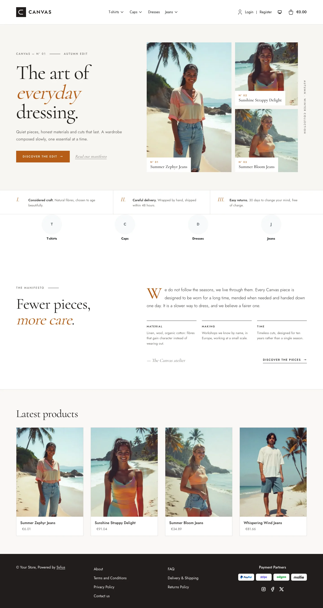 | 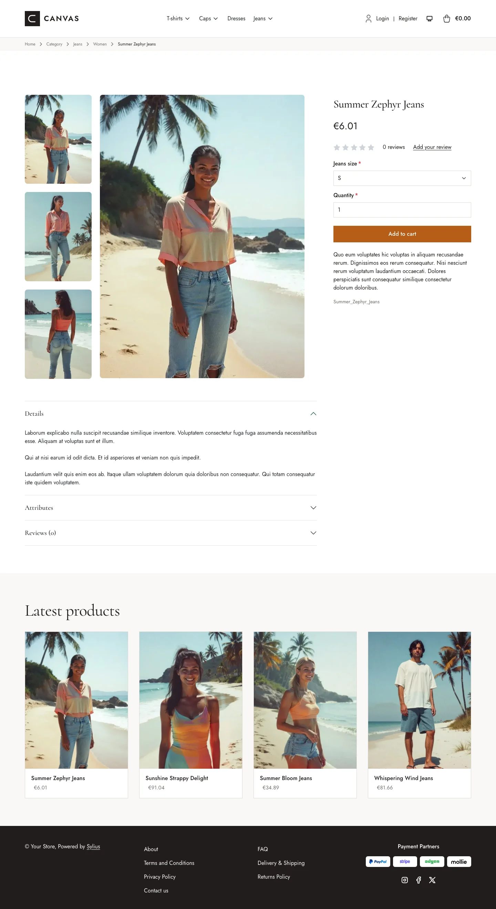 | 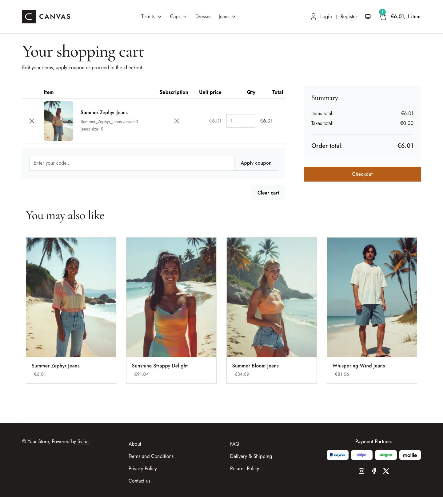 |
| Dark | 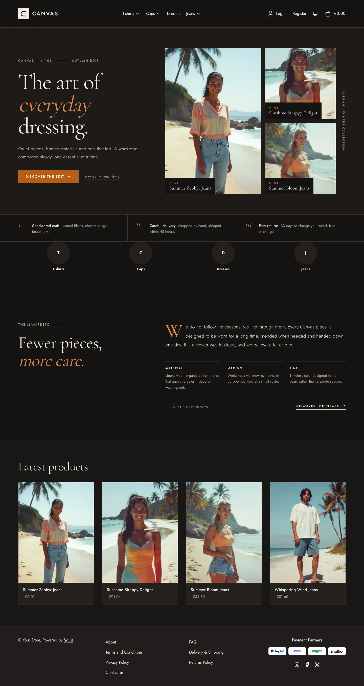 | 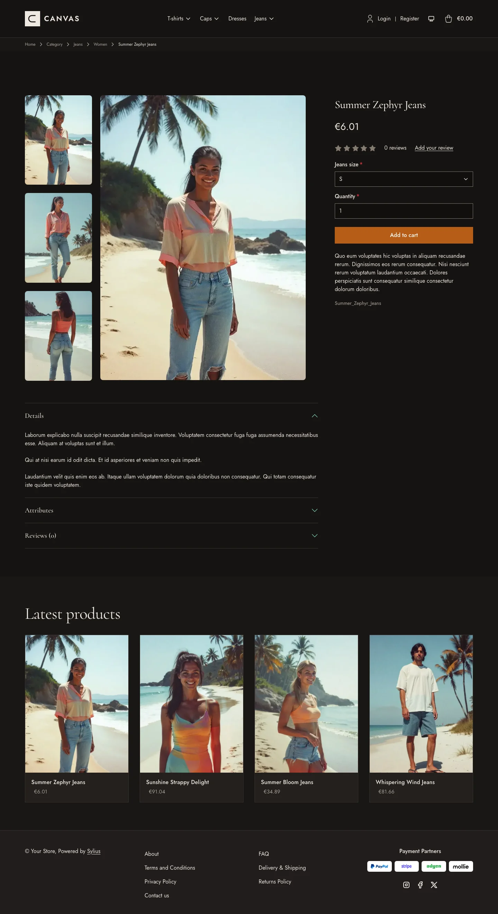 | 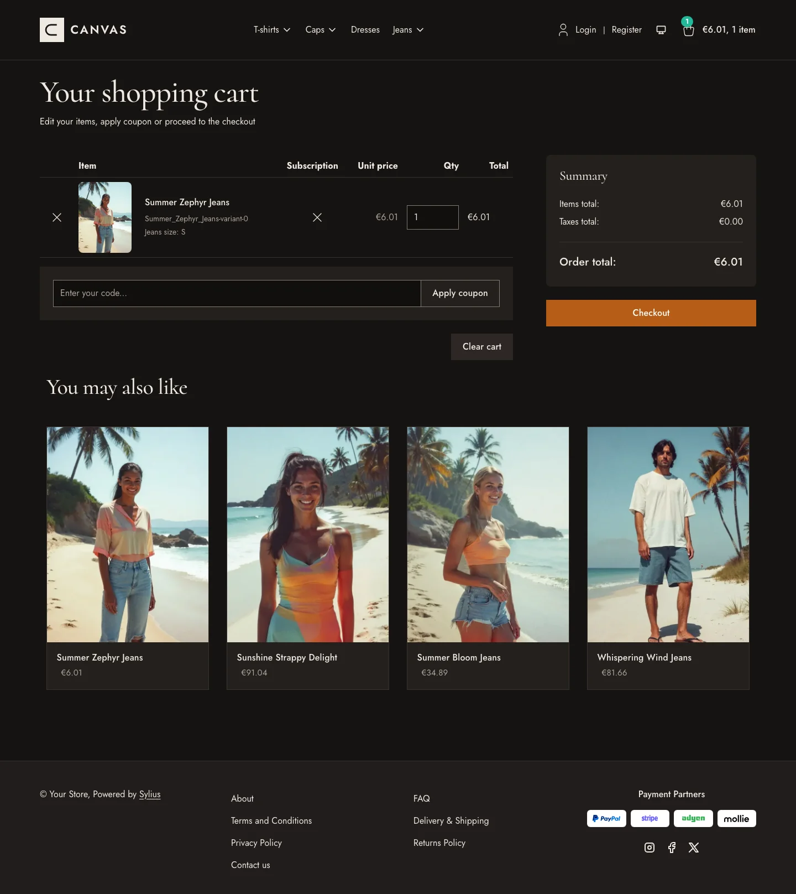 |

**Wide screen** (2560 px)

| Scheme | Homepage | Product page | Cart |
|---|---|---|---|
| Light |  | 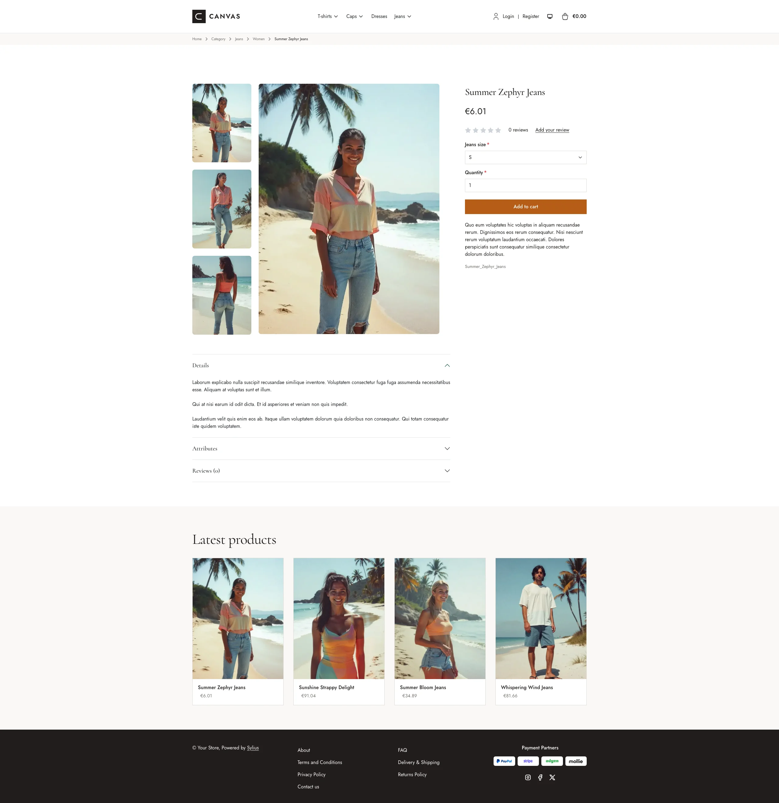 | 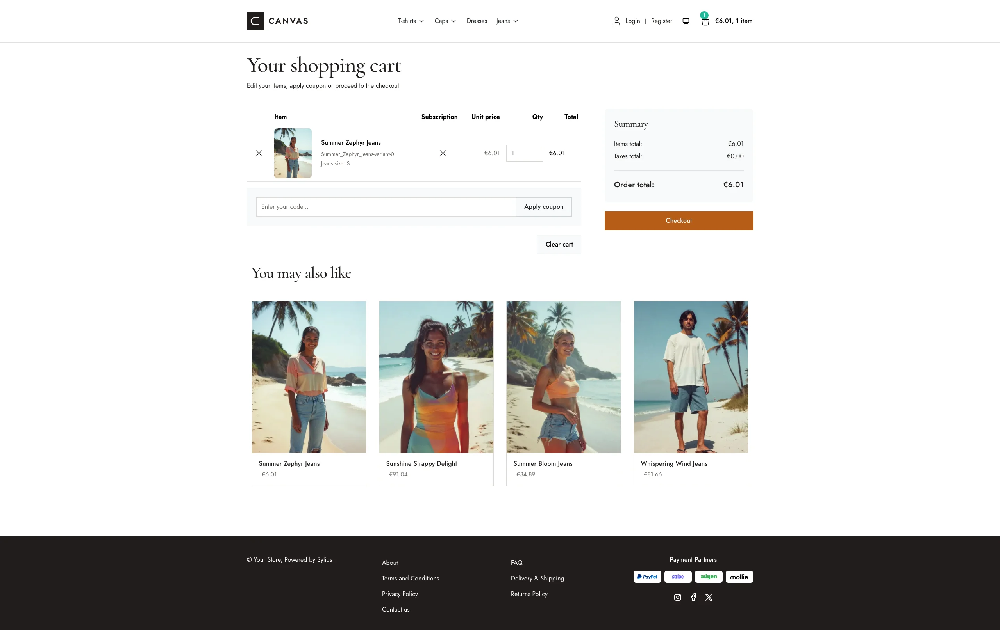 |
| Dark |  | 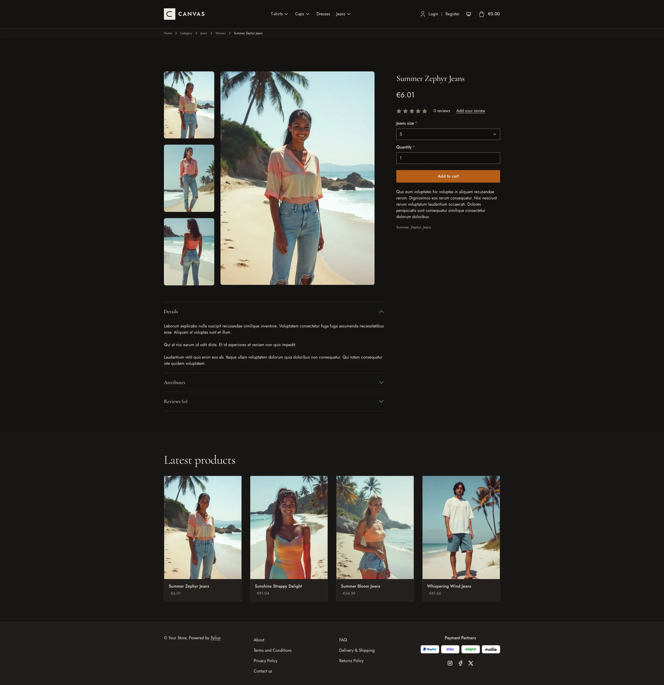 | 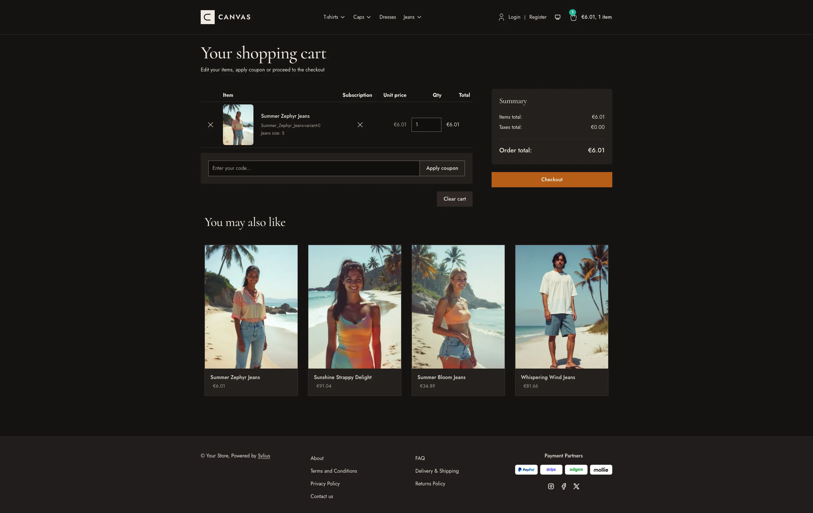 |

**Mobile** (390 px)

| Scheme | Homepage | Product page | Cart |
|---|---|---|---|
| Light |  |  | 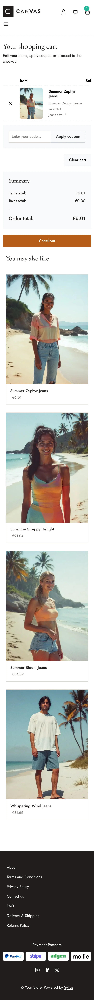 |
| Dark |  |  | 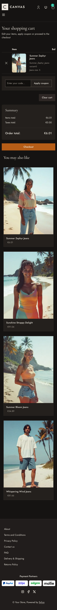 |

The theme restyles the shop through SCSS overrides and Sylius Twig hooks:

- **Palette** — charcoal (`#211D1B`), paper (`#F7F6F3`) and off-white (`#FAF8F6`)
  neutrals, with a terracotta accent (`#B75D17`) for primary buttons.
- **Dark scheme** — the gallery after hours: warm umber surfaces one step lighter per level (page
  `#161311`, cards `#24201D`), ivory ink (`#EFE9E1`), terracotta buttons kept and a lighter terracotta
  (`#DB8650`) for accented words; the charcoal footer becomes a lighter band than the page.
- **Layout** — squared corners everywhere (no border radius), minimal borders and
  generous spacing; the footer is rendered in dark charcoal.
- **Product cards** — square, hairline-bordered cards without shadow, the image
  flush to the top and a slow zoom; the border turns charcoal and the name
  terracotta on hover. The whole card is clickable, on the homepage and on
  category pages alike.
- **Header** — the default top bar and navbar are replaced by a single taxon navigation.
- **Checkout** — the checkout header uses the Canvas wordmark and category navigation.
- **Branding** — a dedicated Canvas wordmark appears in the header; the footer has no logo,
  and breadcrumbs stay text-only.
- **Homepage** — an editorial "magazine cover" hero: a large Cormorant headline
  with a terracotta italic accent, a call to action, and a collage of the
  **three latest products of the channel** (real images, numbered captions, no
  external image); then a strip of three numbered commitments, an editorial
  manifesto with a drop cap and three notes (the promise block, through the
  `theme_promise` hookable, linked from the hero) and the four latest products
  with squared pictures. The deals and collection blocks are
  removed.
- **Product page** — a full-width breadcrumb band, the price directly below the
  product name and before reviews, a full-width add-to-cart button, and a listing
  of associated products (or latest products when there are none).
- **Typography** — Cormorant Garamond (300–700) and Jost (100–900) are loaded
  as variable fonts, so every weight is the real one.
- **Translations** — the homepage texts live in a `canvas` translation domain
  (`translations/canvas.en.yaml` and `canvas.fr.yaml`).
- **Login page** — a split-screen layout with a full-height image beside the
  login/register panel.

Install it with:

```bash
castor sylius:theme:setup canvas
```
