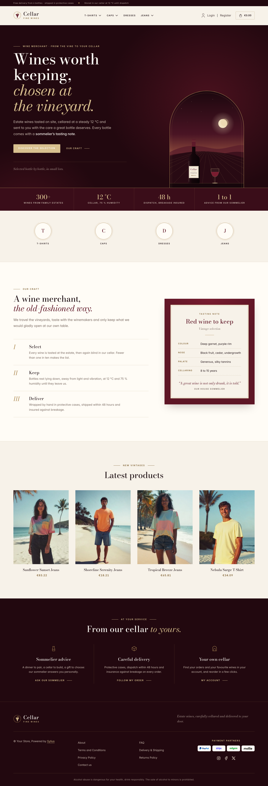
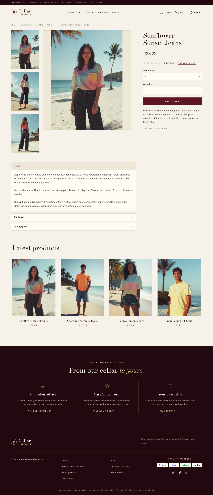
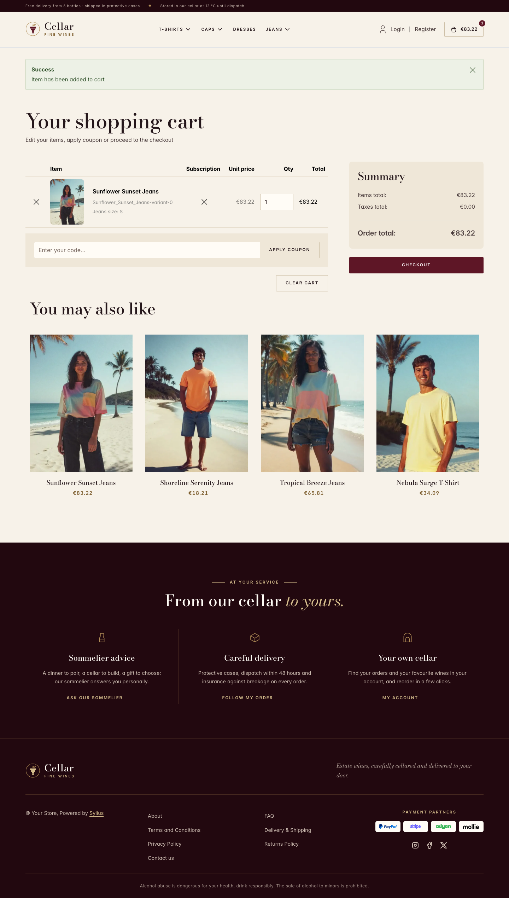

Cellar is built for wine merchants and estate shops selling bottles: a quiet, editorial
storefront in night bordeaux and cream paper, set with a high-contrast Didone and lined
with antique gold fillets, like a château label. Generous whitespace, spaced small
capitals and portrait product niches keep the bottles at the centre.

| Homepage                                                     | Product page                                          | Cart                                                         |
|--------------------------------------------------------------|-------------------------------------------------------|--------------------------------------------------------------|
|  |  |  |

- **Palette** — night bordeaux (`#22080F`), bordeaux (`#5E1626`) and claret
  (`#7A1C30`) on cream paper (`#F7F2E9`) and ivory (`#FFFCF6`), with an antique
  gold (`#B08D57`, `#D8C08F`) for fillets, numerals and accents.
- **Typography** — *Bodoni Moda* (SIL Open Font License, variable 400–900, roman
  and italic, shipped in `assets/shop/fonts/`) for headings, product names and
  figures, with italic accents in gold; *Inter* (already shipped by the Sylius shop)
  for body copy, and spaced uppercase small capitals for eyebrows, navigation,
  buttons and breadcrumbs.
- **Components** — square bordeaux buttons with spaced capitals (gold leaf on the
  dark panels), product cards presented like bottles on a shelf: the picture stands
  whole on a parchment niche (`object-fit: contain`, never cropped or stretched by
  the theme), a gold fillet drawn inside it on hover, the name in Didone and the
  price in spaced figures (the whole card is clickable, on the homepage and on
  category pages alike); an outlined cart button with a bordeaux counter.
- **Header** — a night-bordeaux top bar carrying the delivery promise and the
  locale / currency switchers, then a grape-cluster seal and the *Cellar*
  wordmark, centered category navigation underlined in gold.
- **Homepage** — a night-bordeaux hero: an eyebrow ruled in gold, a Didone headline
  ending in gold italic, two calls to action and a signature line. On the right,
  the **view from the cellar window**: a vaulted arch with a double gold fillet,
  opening on a vineyard at dusk (rows running to the horizon, a full moon), a
  bottle and a glass of red on the stone sill. A band of **house figures**
  (estates, cellar temperature, dispatch, sommelier advice) closes the hero.
  The promise block (`theme_promise` hookable) presents the merchant's craft in
  three steps numbered in roman capitals (select, keep, deliver), next to a
  **tasting note** printed like a wine label (colour, nose, palate, cellaring and
  the sommelier's quote). Then come the four latest products; the deals and new
  collection blocks are hidden.
- **Footer** — night bordeaux, with three **house services** (sommelier advice,
  careful delivery, your own cellar) linking to the contact page and the customer
  account, the wordmark, the Sylius links and the legal notice on alcohol
  consumption.
- **Product page** — the main picture is contained on a parchment niche and its
  height follows the screen, so a tall bottle stays whole and never blows up on
  wide screens; the price sits directly below the product name, before reviews.
- **Checkout** — the checkout header uses the Cellar wordmark and responsive
  category navigation, the current step is ruled in gold.
- **Translations** — every Cellar-specific text lives in its own `cellar`
  translation domain (`translations/cellar.en.yaml` and `cellar.fr.yaml`), so it
  can be edited or translated without touching the templates.
- **Accessibility** — visible gold focus rings, a text alternative for the hero
  illustration, and no motion for visitors who prefer reduced motion.

Product thumbnails are cut to 3:4 by the Sylius image filters
(`sylius_shop_product_thumbnail`, `outbound` mode) before the theme displays them:
shoot bottles in portrait 3:4, or switch these filters to `inset` mode in the
application, so the whole bottle reaches the page.

Install it with:

```bash
castor sylius:theme:setup cellar
```
