Culture (*Culture & Co* on the storefront) is built for culture, games and entertainment shops selling books,
comics and manga, board games, video games, musical instruments and collectibles: a bright, modern store in
white and warm light grey, with ink type in Plus Jakarta Sans, a sunny yellow for the calls to action and the
badges, and photographs everywhere. The homepage is built for merchandising: shelves as photo tiles, offer
banners with their discount and themed selections from the booksellers.

**Desktop** (1440 px)

| Scheme | Homepage | Product page | Cart |
|---|---|---|---|
| Light | 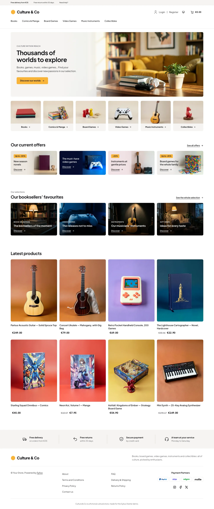 | 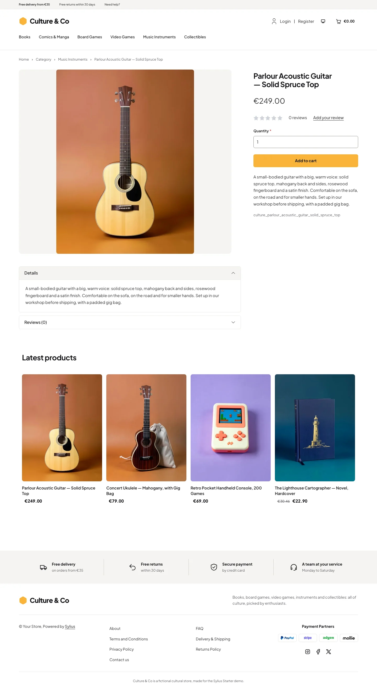 | 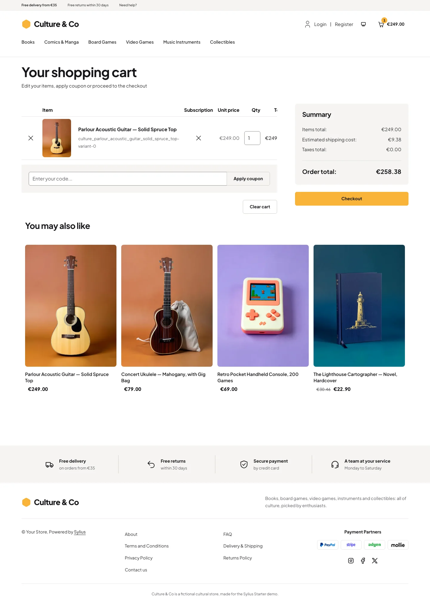 |
| Dark | 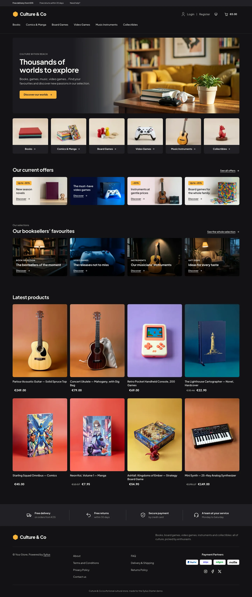 | 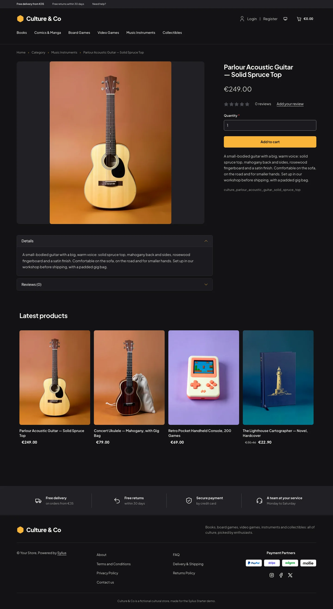 | 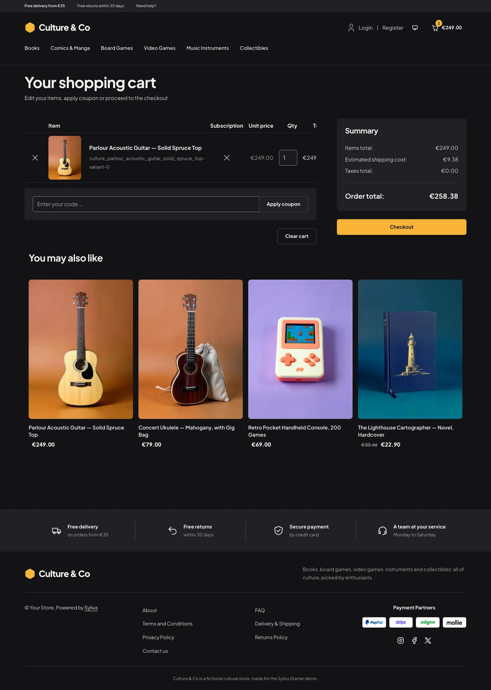 |

**Wide screen** (2560 px)

| Scheme | Homepage | Product page | Cart |
|---|---|---|---|
| Light | 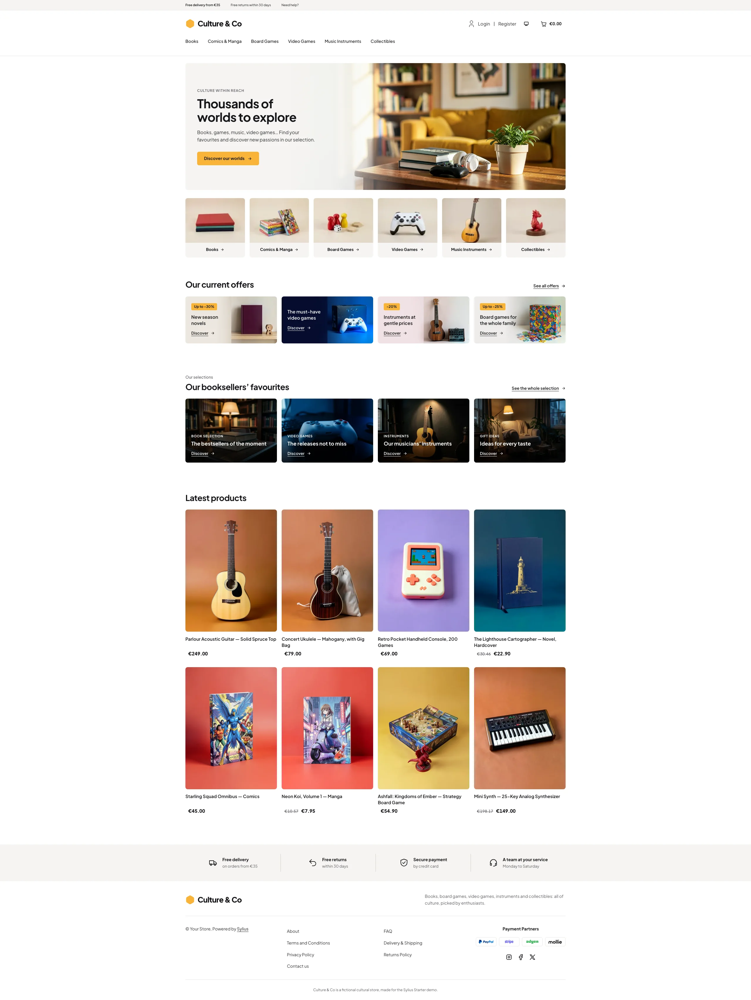 | 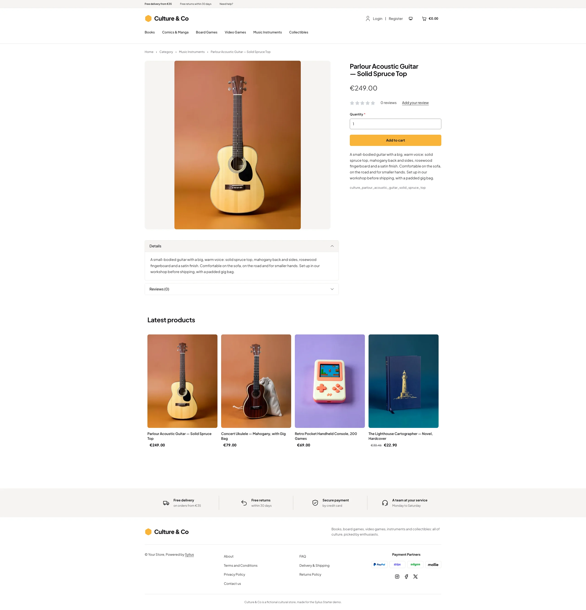 | 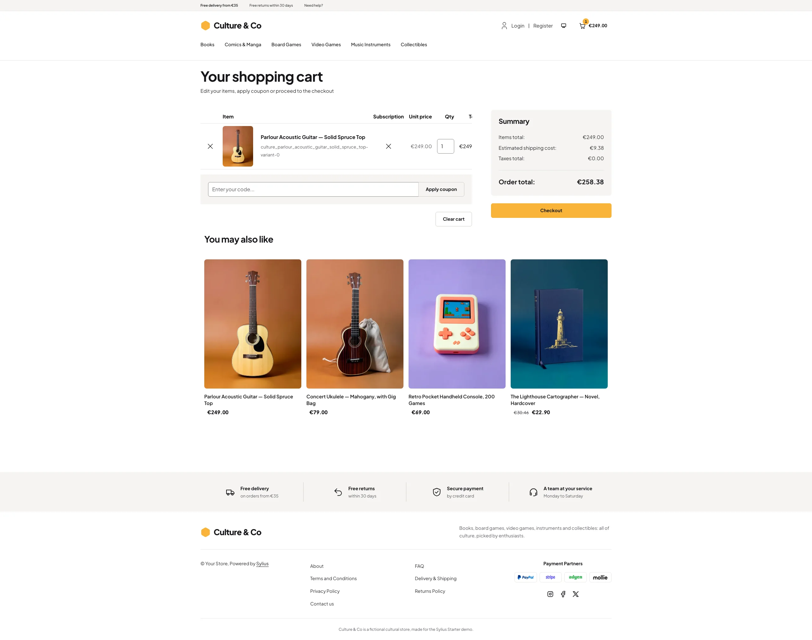 |
| Dark | 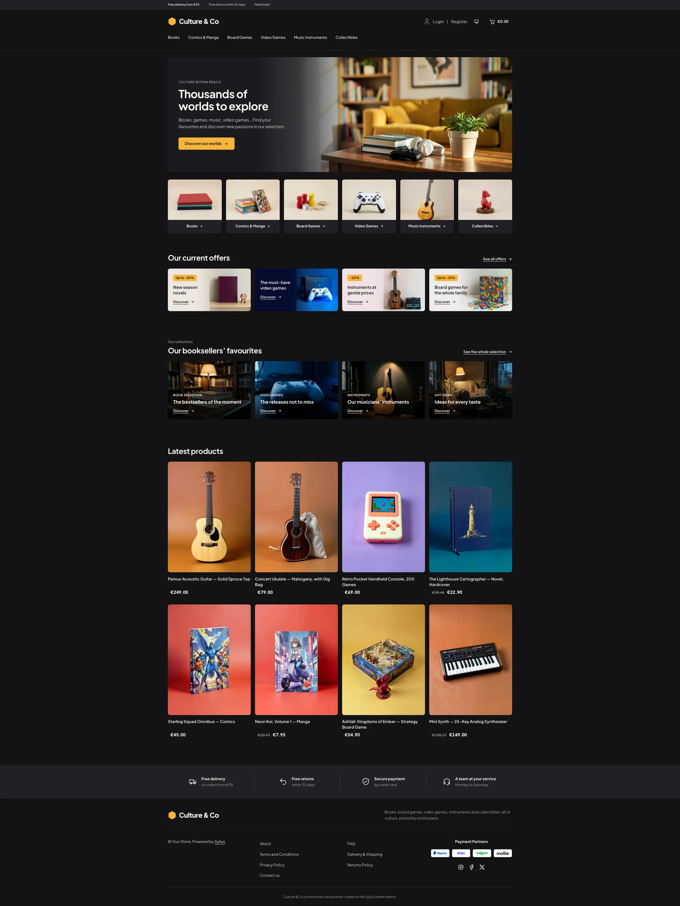 | 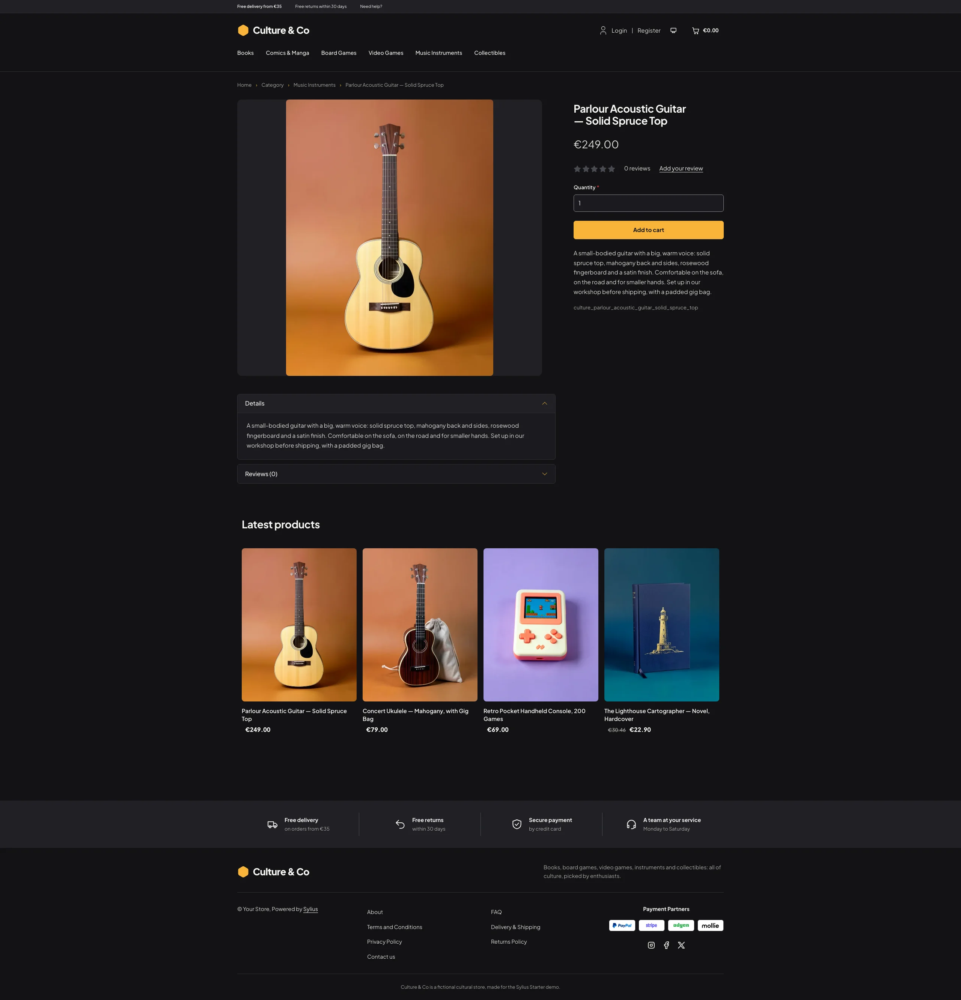 | 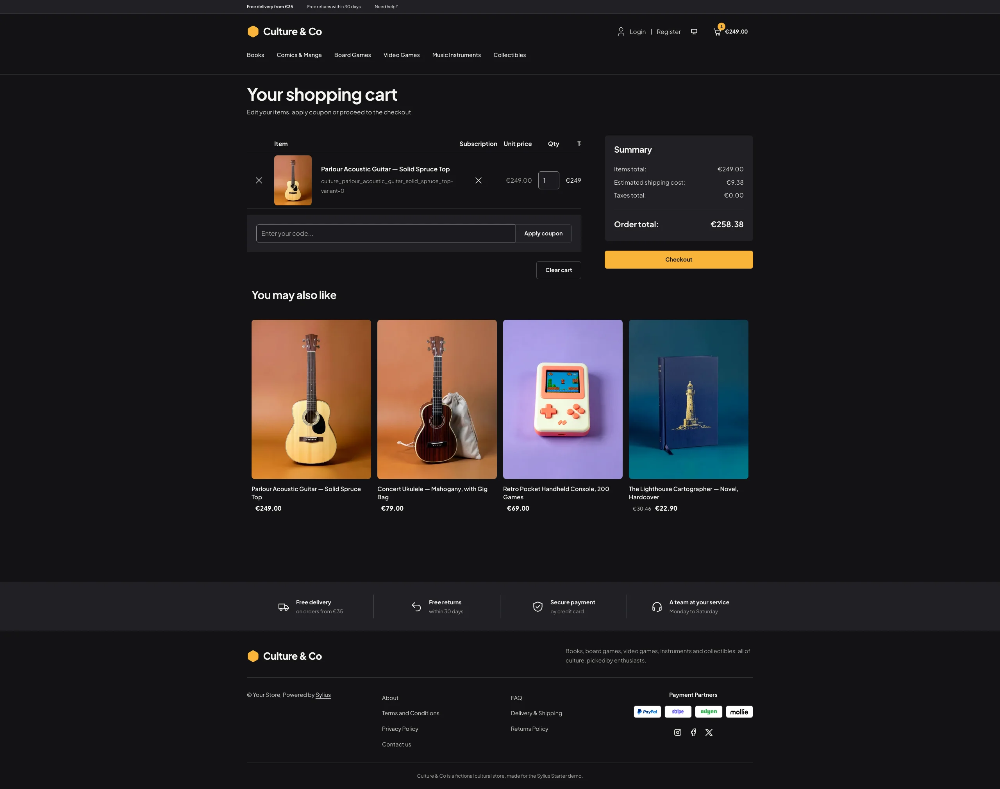 |

**Mobile** (390 px)

| Scheme | Homepage | Product page | Cart |
|---|---|---|---|
| Light |  | 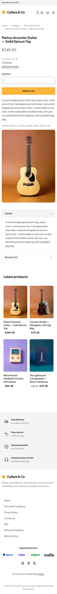 | 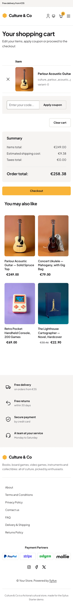 |
| Dark |  | 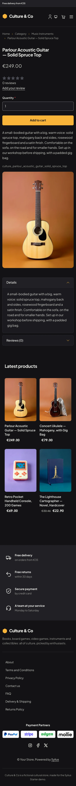 | 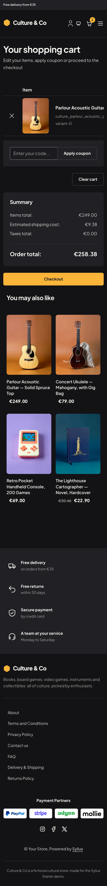 |

- **Palette** — white (`#FFFFFF`) and warm light grey (`#F5F4F1`, `#EFEEEA`) with ink type (`#16161A`), a
  sunny yellow (`#F9B43A`) behind dark text for buttons, badges, the cart counter and the logo mark, ink links
  underlined and turning amber (`#8A5300`) on hover, and a deep blue (`#0B1E3D`) for the video games offer.
- **Dark scheme** — the store after closing time: charcoal (page `#121214`, surfaces `#1A1A1E`), paper type
  and the same yellow, which also becomes the colour of hovered links and focus rings.
- **Typography** — *Plus Jakarta Sans* (SIL Open Font License, variable weight, shipped in
  `assets/shop/fonts/`) for the logo, headings and body copy alike: bold headings, small grey eyebrows in
  spaced capitals.
- **Photographs** — the hero, the offer banners and the selection cards ship with the theme
  (`assets/shop/images/`), generated with Ollama (x/flux2-klein) and stored as WebP. A contributed hero image
  replaces the theme photograph.
- **Header** — a light grey top bar (free delivery, free returns, a link to the contact page), then the yellow
  hexagon mark and the *Culture & Co* wordmark on the left, the account links and the cart (with a yellow
  counter) on the right, and the category menu on a row of its own, underlined in yellow when hovered.
- **Homepage** — a hero banner the width of the page: the copy on the left (eyebrow, headline, lead, a yellow
  call to action) over a veil fading into the photograph of a sunlit living room with books, headphones and a
  game controller. The **category tiles** (import collections) show the photograph of each shelf with its
  name and an arrow. The **offers of the moment** (`theme_offers` hookable) are four banners with a yellow
  discount badge, a title and a *Discover* link over their photograph, and the **booksellers' picks**
  (`theme_promise` hookable) four dark photo cards with a tag, a title and a *Discover* link. Banners and
  cards lead to the shelves of the store menu (through the taxon menu component), so they follow the
  catalog. The eight latest products close the page; the deals and new collection blocks are hidden.
- **Product cards** — the picture stands whole on a light grey tile, the name and the price in bold below; two
  products per row on phones.
- **Footer** — a light grey reassurance band (free delivery, free returns, secure payment, a team at your
  service), then the wordmark, the Sylius links and a notice.
- **Checkout** — the checkout header uses the Culture & Co wordmark and responsive category navigation.
- **Translations** — every Culture-specific text lives in its own `culture` translation domain
  (`translations/culture.en.yaml` and `culture.fr.yaml`).
- **Accessibility** — visible focus rings (ink, yellow in the dark scheme), text alternatives for the hero
  photograph, white text on darkened photographs, and yellow only behind dark text.

## Demo catalog

The screenshots above show a demo catalog of eighteen books, comics, board games, video games, instruments and
collectibles from a fictional cultural store, on six shelves (Books, Comics & Manga, Board Games, Video Games,
Music Instruments, Collectibles), shipped as the `culture` dataset of `sylius-starter/datasets`
(`src/Datasets/datasets/culture/`: `products.yaml`, `collections.yaml`, and in `media/` a photo of each product
on the coloured paper of its shelf and a photo of each shelf, generated with Ollama). Three house universes run
across the shelves, for thematic merchandising: the Ashfall saga (the novel, the strategy game and the
collectible dragon), Neon Koi (the manga and its enamel pins) and Starfall Odyssey (the collector's edition and
its art print). Create a shop from it with the [import package](../import/datasets.md), into the default
channel:

```bash
castor sylius:import:shop:create culture
castor sylius:import:fixtures:generate --project=culture --subdomain=""
castor sylius:import:fixtures:load --project=culture
```

No AI call is made: `products.yaml` and `collections.yaml` point at the photos of the dataset `media/`. The shop
menu then lists the six shelves; `castor sylius:import:delete culture` removes the catalog. The import keeps the
products already in the channel and gives the items creation dates in the past, so on a store loaded with the
default fixtures the latest products may still show clothing: run `castor app:db:fixtures app` first to start
from a store without products.

Install it with:

```bash
castor sylius:theme:setup culture
```
