Depot is built for business-to-business shops selling office supplies, packaging, industrial equipment,
catering equipment and consumables: a clear, efficient storefront that reads like a trade catalogue, in white
and steel blue-grey with a navy ink and a teal call to action. Every page speaks to professional buyers:
prices excluding VAT, stock and references on every product, **price breaks** by quantity, trade accounts
paid on invoice and quotes for volume orders.

**Desktop** (1440 px)

| Scheme | Homepage | Product page | Cart |
|---|---|---|---|
| Light | 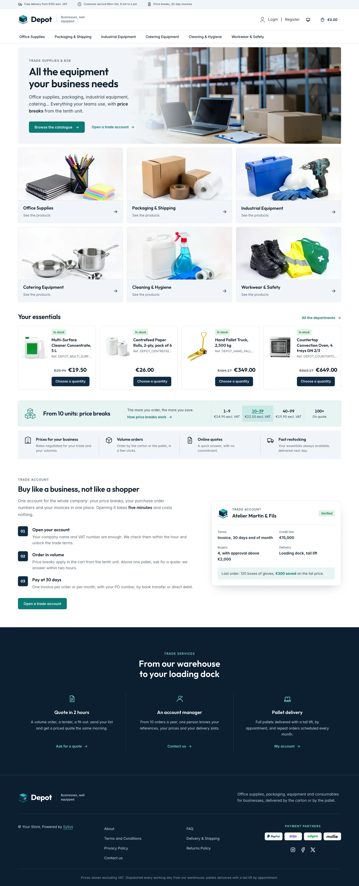 | 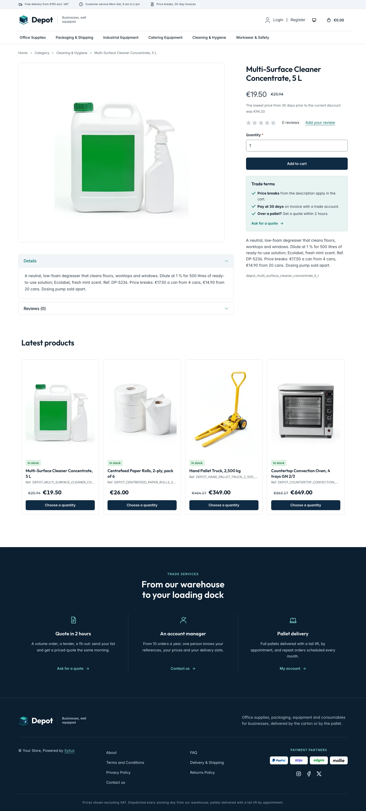 | 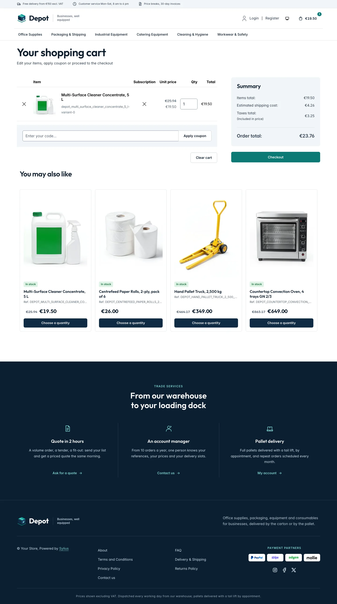 |
| Dark | 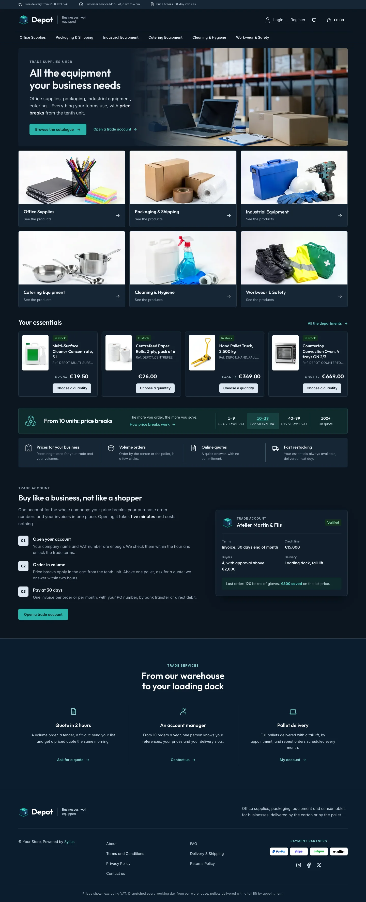 | 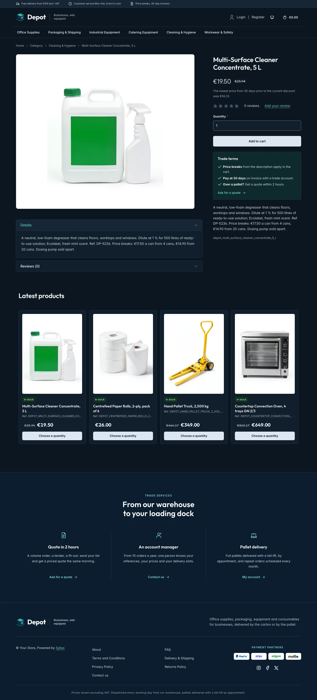 | 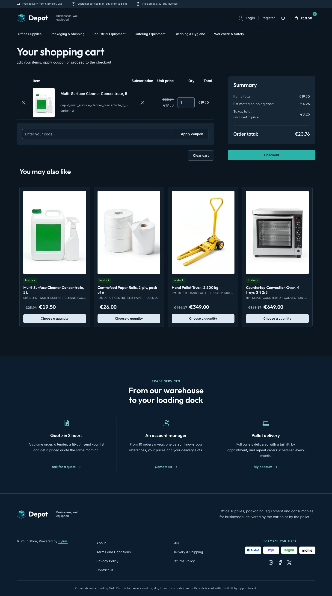 |

**Wide screen** (2560 px)

| Scheme | Homepage | Product page | Cart |
|---|---|---|---|
| Light | 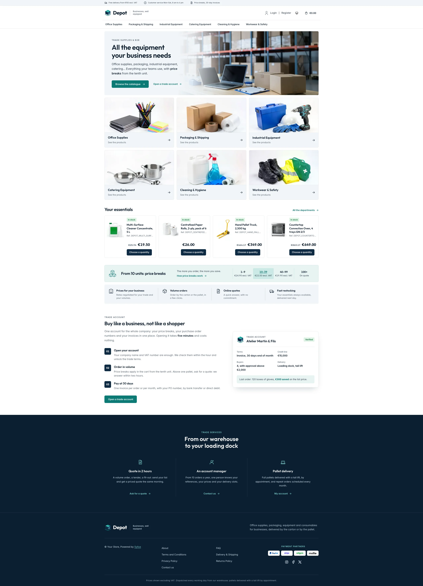 | 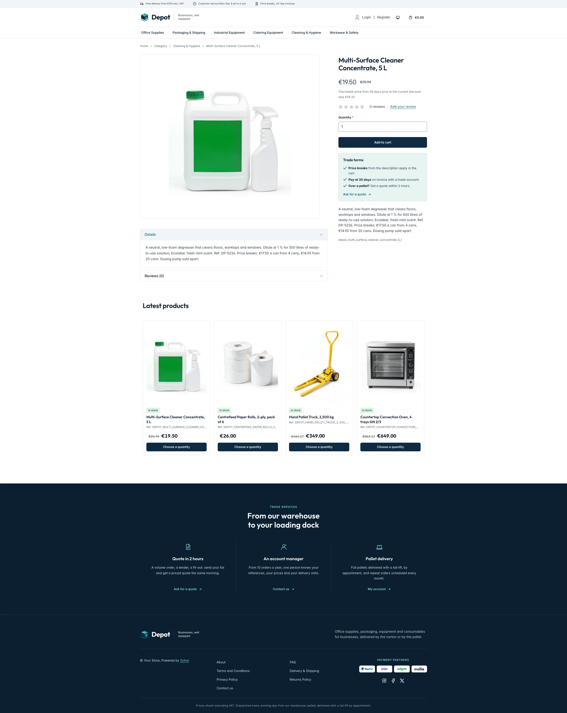 | 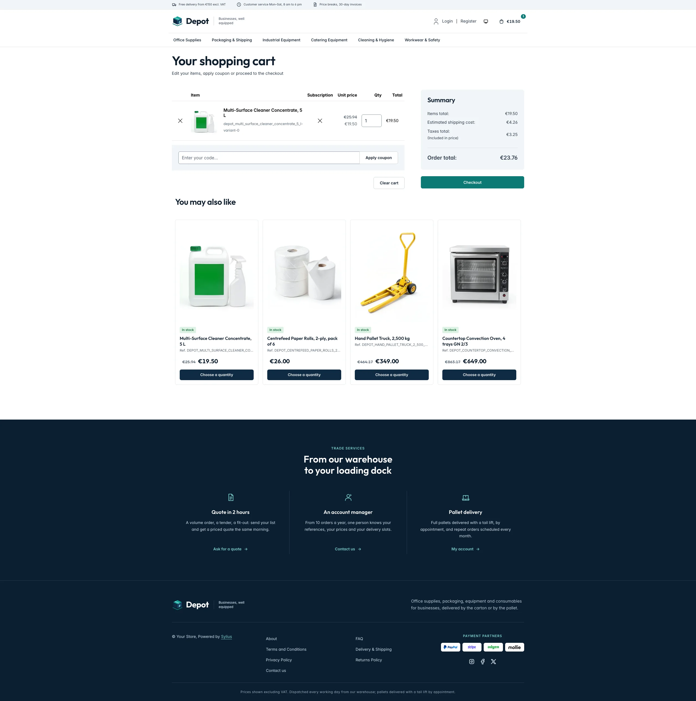 |
| Dark | 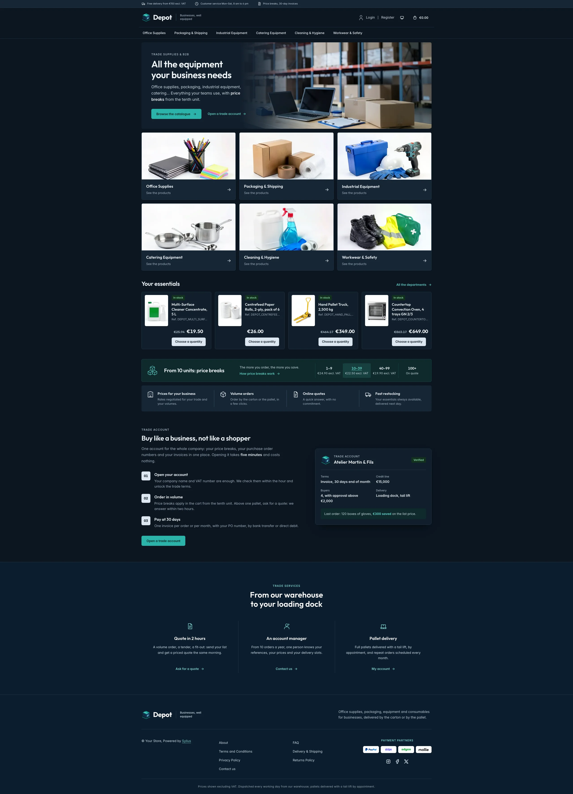 | 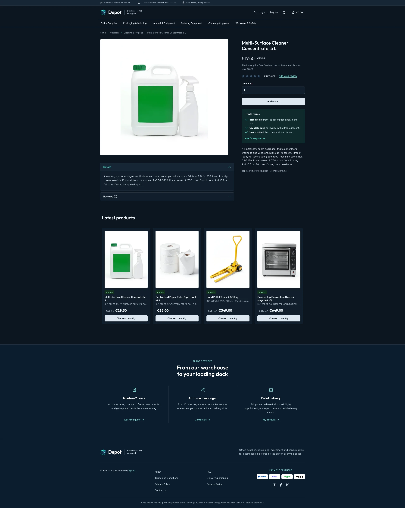 | 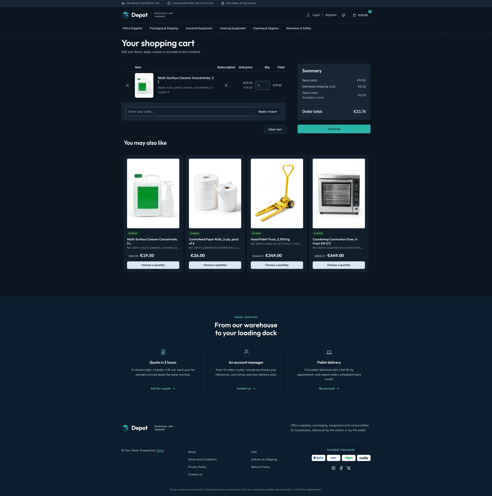 |

**Mobile** (390 px)

| Scheme | Homepage | Product page | Cart |
|---|---|---|---|
| Light |  |  |  |
| Dark |  |  |  |

- **Palette** — white pages and steel blue-grey panels (`#F2F5F8`), a navy ink (`#0F2A44`) for the order
  buttons and the footer (`#0A1E31`), a teal (`#0B7A75`) for the calls to action, links and focus rings, a
  pale teal (`#E8F4F3`) for the price break band and a green stock badge (`#DDF3E4`).
- **Dark scheme** — the warehouse at night: navy surfaces (page `#0B1520`, surfaces `#111E2B`), pale steel
  type, a bright teal (`#2BB3AA`) with a navy ink for the calls to action and pale steel order buttons;
  product photos keep their white ground.
- **Typography** — *Outfit* (SIL Open Font License, 500 to 700, shipped in `assets/shop/fonts/`) for the
  headings, the wordmark, product names and prices; *Inter* (already shipped by the Sylius shop) for body
  copy.
- **House motif** — the **house crate**: a navy carton with a teal top on its pallet, in the logo and on the
  trade account card.
- **Header** — a steel top bar with the delivery, customer service and trade promises, then the crate and the
  *Depot* wordmark next to its tagline, the account links and the cart on the first row, and the category
  navigation on a row of its own, underlined in teal on hover.
- **Homepage** — a **photo banner** in the container: the eyebrow, the headline, the lead and a teal call
  to action on a pale steel panel fading into a photo of a warehouse packing table. The **department
  cards** (`theme_aisles` hookable, the `sylius_shop:common:taxon_menu` component) show the first six menu
  taxons with their image (or the house crate) and link to their page; they replace the roundels of the
  imported collections (`import_collections` is disabled), which list the same taxons. The four latest products are
  presented as **your essentials**, catalogue lines with the picture beside the details. The **price break
  band** (`theme_promise` hookable) shows the unit price of a reference at each quantity step (1–9, 10–39,
  40–99, 100+), followed by four **trade benefits** (prices for your business, volume orders, online quotes,
  fast restocking). The **trade account** block (`theme_account` hookable) explains it in three steps next to
  the account card of a customer (terms, credit line, buyers, delivery and savings on the last order). The
  deals and new collection blocks are hidden.
- **Product cards** — a framed tile with the picture on white, a **stock badge** (in stock, or on order when
  a tracked variant runs out), the name, the **reference** (product code), a large price and a navy **order
  button**; the hookables are added to `sylius_shop.shared.product.card`, so every list shows them.
- **Product page** — the picture on white and, under the add to cart button, the **trade terms** (price
  breaks, payment at 30 days, quotes above a pallet) with a link to the contact page.
- **Footer** — navy, with three **trade services** (quote in 2 hours, an account manager, pallet delivery)
  linking to the contact page and the customer account, the wordmark, the Sylius links and a VAT notice.
- **Checkout** — the checkout header uses the Depot wordmark and responsive category navigation, the current
  step is ruled in teal.
- **Translations** — every Depot-specific text lives in its own `depot` translation domain
  (`translations/depot.en.yaml` and `depot.fr.yaml`).
- **Accessibility** — visible teal focus rings, the price break band as a table with a caption, decorative
  photos and icons hidden from assistive technologies.

## Demo catalog

The screenshots above show a demo catalog of eighteen trade supplies from a fictional business supplier, in
six aisles (Office Supplies, Packaging & Shipping, Industrial Equipment, Catering Equipment, Cleaning &
Hygiene, Workwear & Safety), shipped as the `depot` dataset of `sylius-starter/datasets`
(`src/Datasets/datasets/depot/`: `products.yaml`, `collections.yaml`, and in `media/` a photo of each product and of
each aisle, generated with Ollama on white, like a trade catalogue: the aisle photos become the taxon images
of the department cards). Products are sold by the pack (a box of 5 reams, a
pack of 25 cartons, a box of 100 gloves) and descriptions carry what a professional buyer looks for: the
pack size, a reference, the **price breaks** by quantity and the delivery terms.
Create a shop from it with the [import package](../import/datasets.md), into the default channel:

```bash
castor sylius:import:shop:create depot
castor sylius:import:fixtures:generate --project=depot --subdomain=""
castor sylius:import:fixtures:load --project=depot
```

No AI call is made: `products.yaml` points at the photos of the dataset `media/`. The shop menu then lists the
six aisles; `castor sylius:import:delete depot` removes the catalog. The import keeps the products already in
the channel and gives the items creation dates in the past, so on a store loaded with the default fixtures
the latest products may still show clothing: run `castor app:db:fixtures app` first to start from a store
without products.

Install it with:

```bash
castor sylius:theme:setup depot
```
