Drive is built for grocery stores and click-and-collect ("drive") shops: a dense,
efficient and friendly storefront that uses the **whole width of the screen**,
like the shelves of a supermarket. Basil-green aisles, lemon price stickers and
tomato promo badges sit on a light shelf-grey background. It is set in heavy
*Inter* (already shipped by the Sylius shop), so no extra font file is needed.

**Desktop** (1440 px)

| Scheme | Homepage | Product page | Cart |
|---|---|---|---|
| Light | 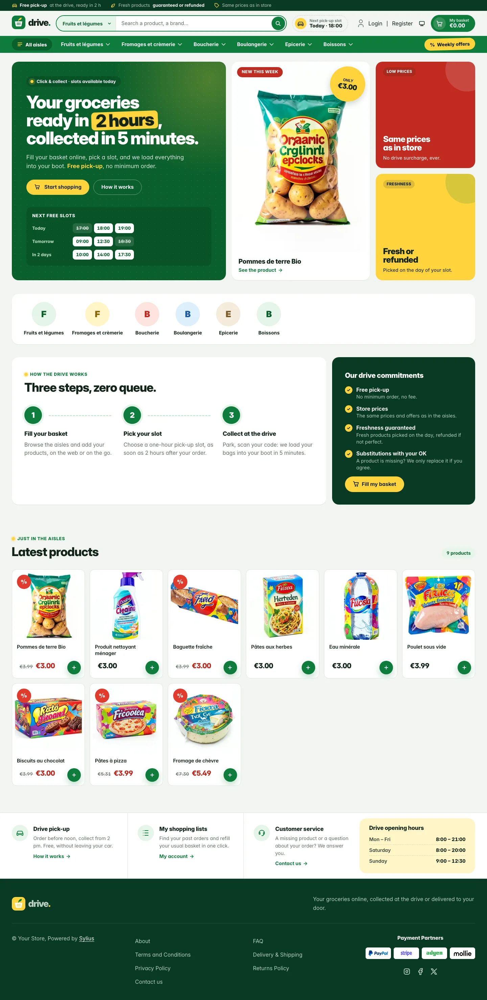 | 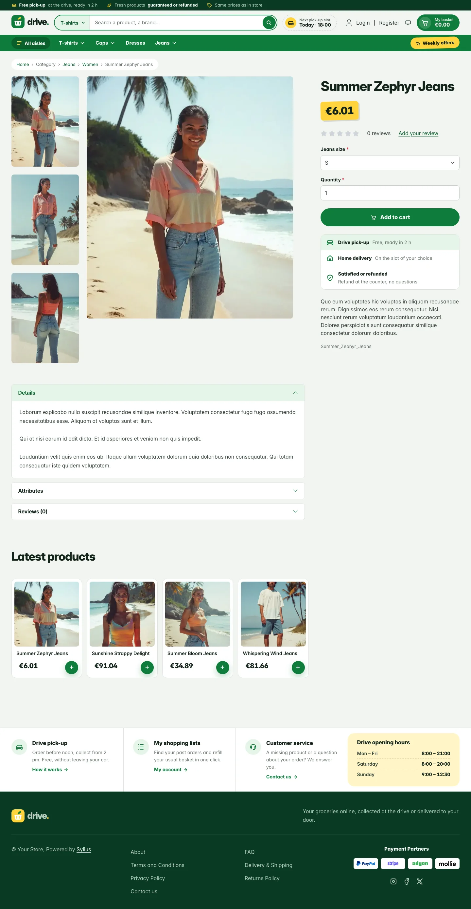 | 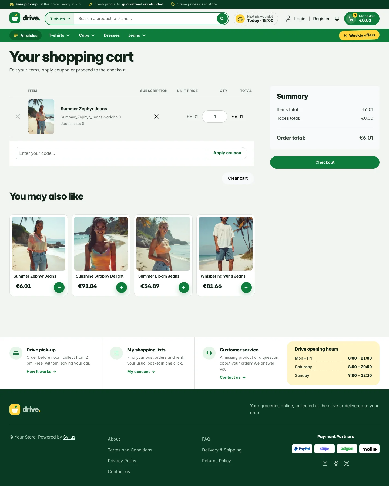 |
| Dark | 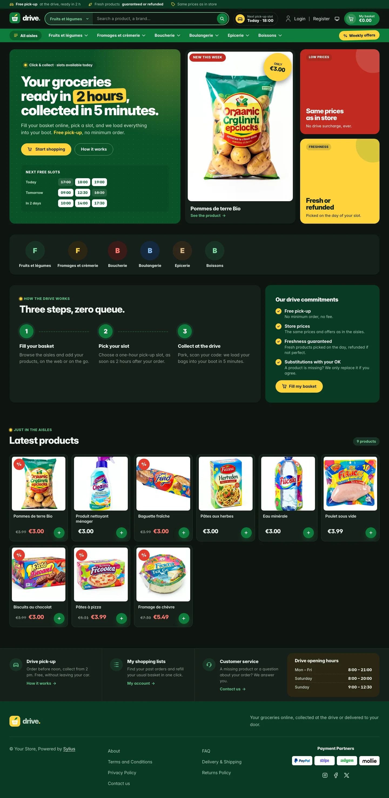 | 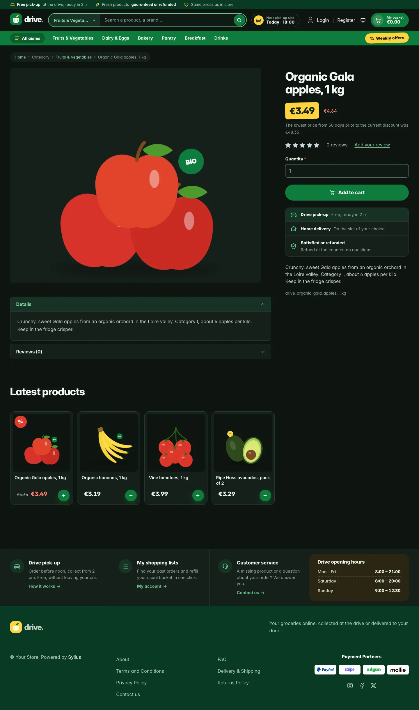 | 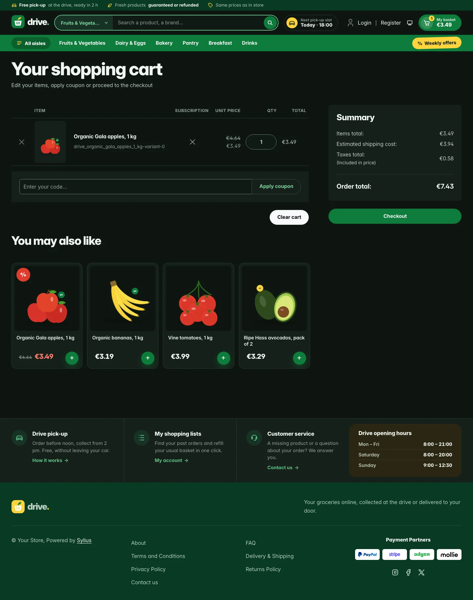 |

**Wide screen** (2560 px)

| Scheme | Homepage | Product page | Cart |
|---|---|---|---|
| Light |  | 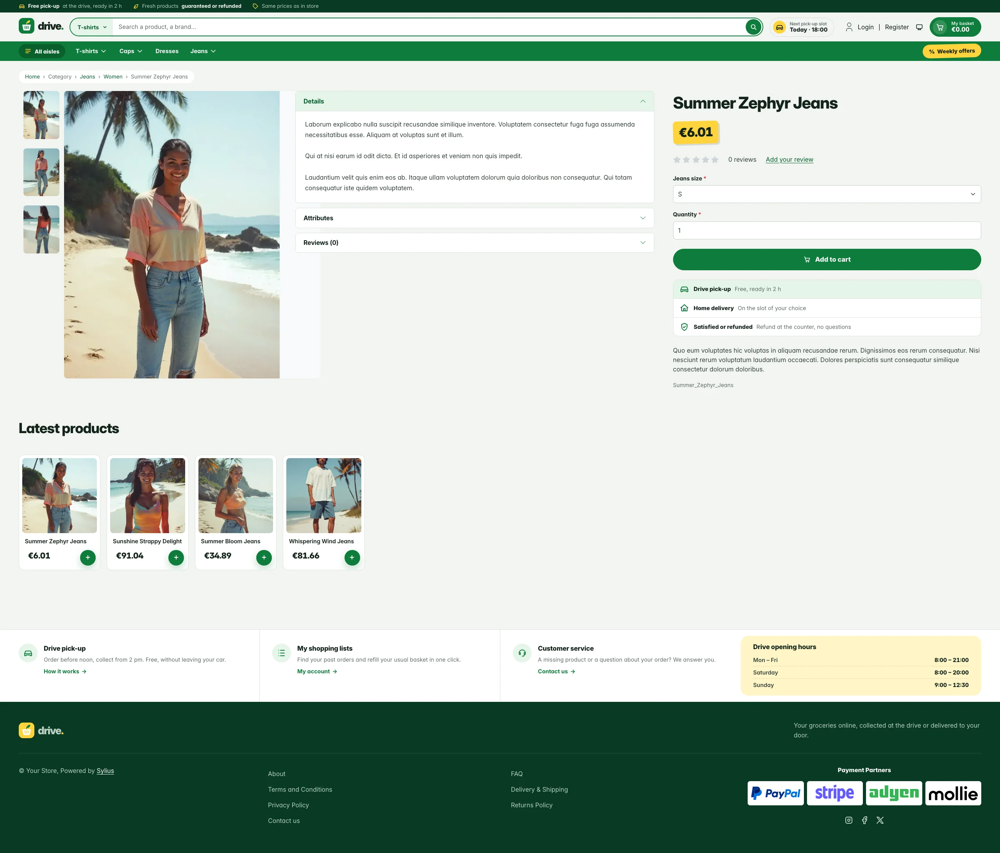 | 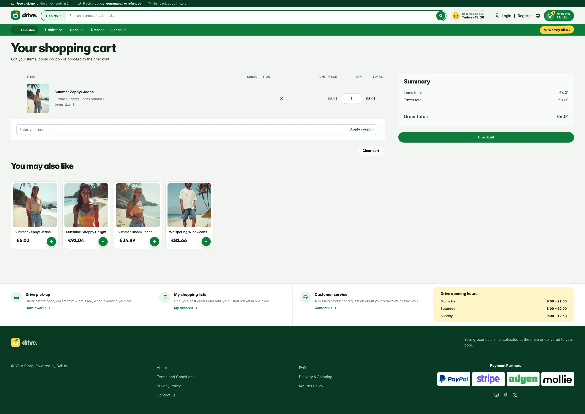 |
| Dark |  | 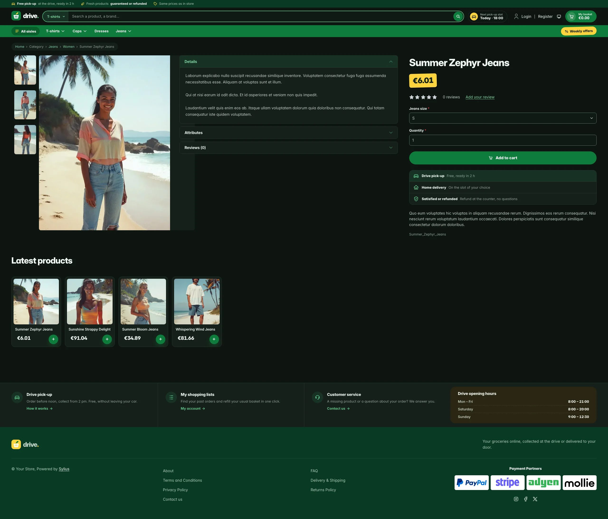 | 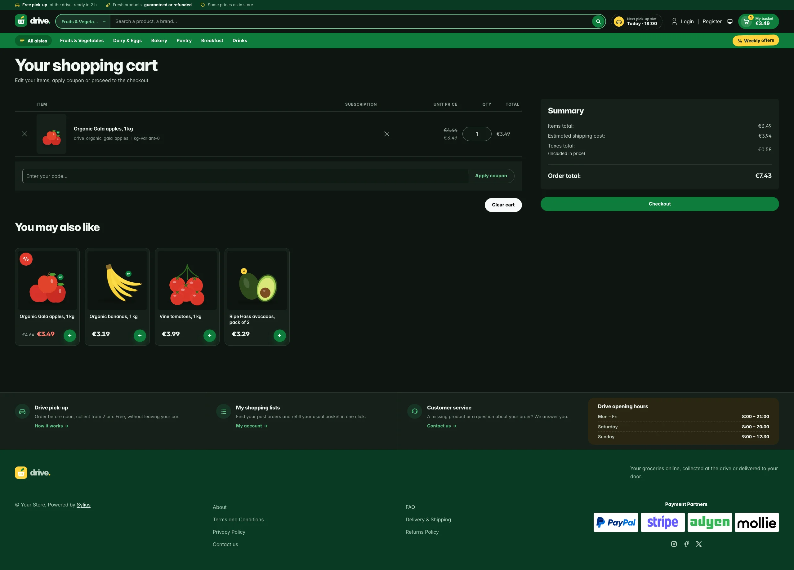 |

**Mobile** (390 px)

| Scheme | Homepage | Product page | Cart |
|---|---|---|---|
| Light |  |  | 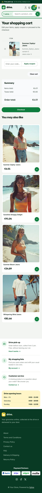 |
| Dark |  |  | 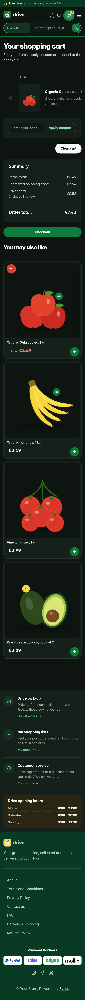 |

- **Layout** — full screen: every container spans the viewport with a fluid
  gutter (`$gutter`), and the pages are built from white "shelves" on a
  shelf-grey background, so wide screens show more products per row instead of
  empty margins.
- **Palette** — basil green (`#0E7C3A`), forest (`#083A22`), lemon
  (`#FFD43B`) and tomato (`#E23B2E`) on shelf grey (`#F2F4F1`), with mint
  (`#E5F4E9`) for soft highlights.
- **Dark scheme** — the drive after closing time: green-tinted night grey (page `#0E1511`, panels
  `#16201A`), the pastel tints turned into deep washes of the same hues, a lighter leaf green
  (`#5DC98A`) for green text and links, and the basil, lemon and tomato fills kept as they are.
- **Typography** — heavy, tightly-tracked *Inter* (800–900) for headings and
  prices, like a weekly flyer; tabular figures for prices and pick-up times.
- **Header** — a forest service strip (free pick-up, freshness, store prices)
  above the locale and currency switchers; a white row with the basket-and-leaf
  wordmark, a large **search** field with an aisle selector (Sylius searches
  inside one category: the current one by default), a **next pick-up slot**
  chip, the account links and a basil **basket button** showing the item count
  and the basket total; then a full-width basil **aisles bar** with the
  category menu and a lemon "weekly offers" sticker. On mobile, the aisles open
  in an offcanvas panel from the menu button.
- **Homepage** — the hero puts three blocks side by side: a basil panel with
  the headline, two calls to action and a **slot board** of the next pick-up
  slots (illustrative, not a booking form); the newest product of the channel as
  the **weekly flyer** with a lemon price sticker; and two promo tiles (store
  prices, freshness). The promise block (`theme_promise` hookable) explains the
  drive in **three steps** next to the store's commitments. Then come sixteen
  latest products in a dense grid; the deals and new collection blocks are
  hidden.
- **Product tiles** — compact white tiles with a square image, a two-line name,
  a big price and a round basil "+" basket button; a tomato "%" sticker marks
  discounted products (the whole tile is clickable, on the homepage and on
  category pages alike).
- **Category page** — the sub-categories are listed in a white sidebar card.
- **Product page** — the price sits right below the product name as a lemon
  shelf label, a full-width basil add-to-cart button, and a **pick-up promise**
  under it (drive pick-up, home delivery, satisfied or refunded). The main
  image never grows past the screen height; from 1600 px the page reads as
  three columns (gallery, details, buy box) instead of one oversized image.
- **Cart and checkout** — basil side-basket header, white summary panels; the
  checkout header uses the Drive wordmark and responsive category navigation.
- **Footer** — a white band of drive services (pick-up, shopping lists,
  customer service) with the **drive opening hours**, above a forest footer
  with the wordmark and the Sylius links.
- **Translations** — every Drive-specific text lives in its own `drive`
  translation domain (`translations/drive.en.yaml` and `drive.fr.yaml`), so the
  promises, slots and opening hours can be adapted without touching the
  templates.
- **Accessibility** — visible lemon focus rings, labelled search fields, "full"
  slots announced to assistive technologies, and no motion for visitors who
  prefer reduced motion.

Install it with:

```bash
castor sylius:theme:setup drive
```
