Groove is built for independent record stores with a premium catalogue: new releases, rare first pressings,
audiophile reissues, coloured vinyl and the turntables to play them. It aims for the energy of a record shop and the
finish of a high-end store: ink bands and warm paper, the saturated colours of the sleeves on the brand and the
calls to action, a heavy narrowed grotesque answered by a serif italic, and a lot of room. Sleeves are the heroes:
large cover compositions, and every product is a sleeve with its record tucked behind it, which slides out and
turns on hover. Its homepage puts forward what Sylius does well for a record shop: genres as taxons, new arrivals,
pressing references as attributes, editions as variants and the gear to play them as associations.

**Desktop** (1440 px)

| Scheme | Homepage | Product page | Cart |
|---|---|---|---|
| Light | 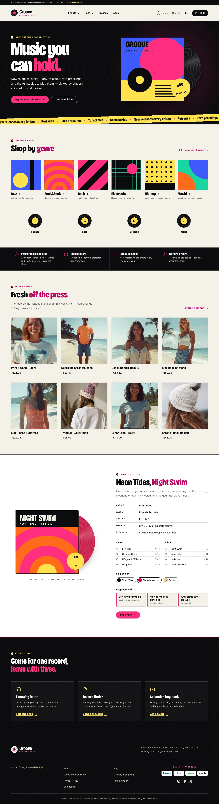 | 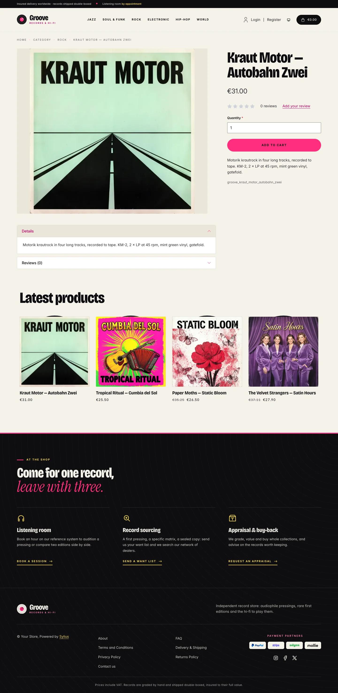 | 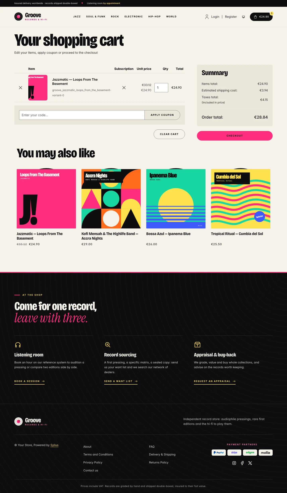 |
| Dark | 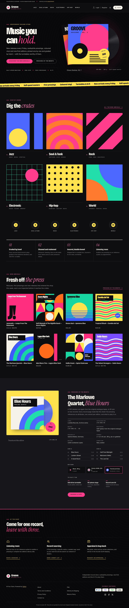 | 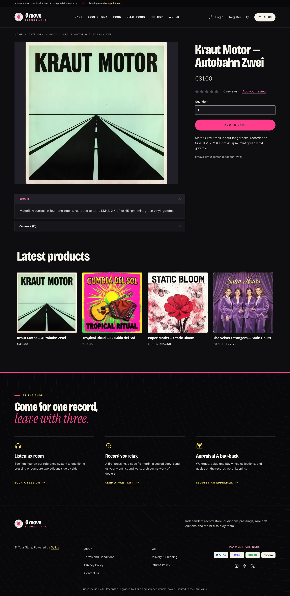 | 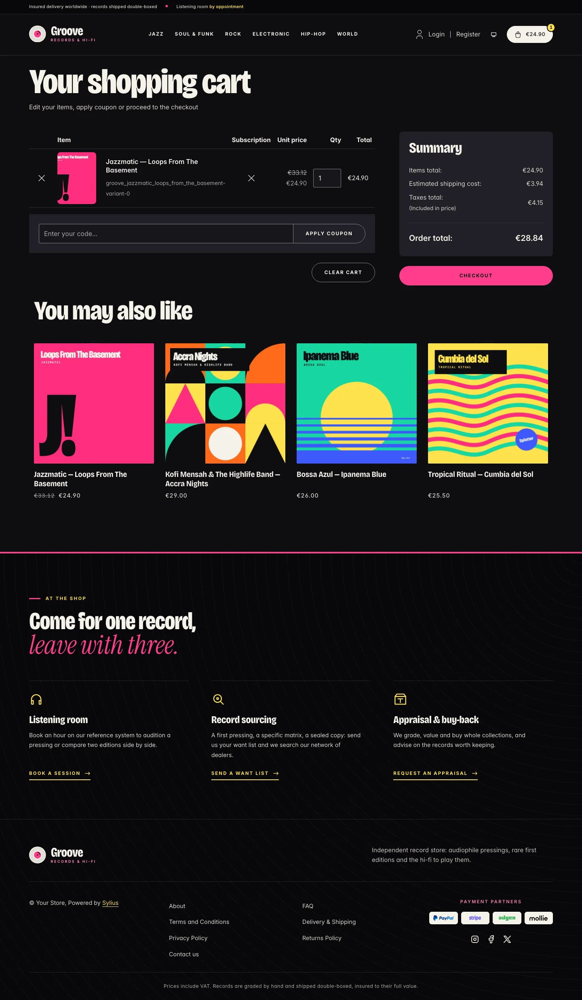 |

**Wide screen** (2560 px)

| Scheme | Homepage | Product page | Cart |
|---|---|---|---|
| Light | 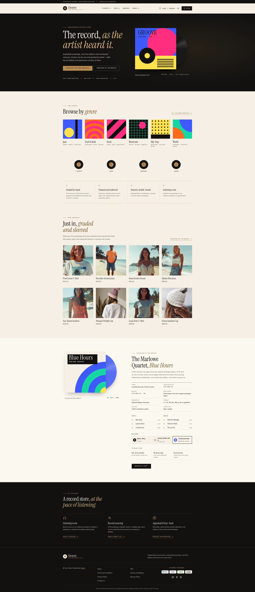 | 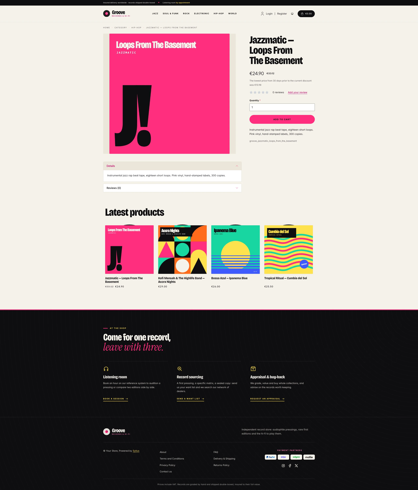 | 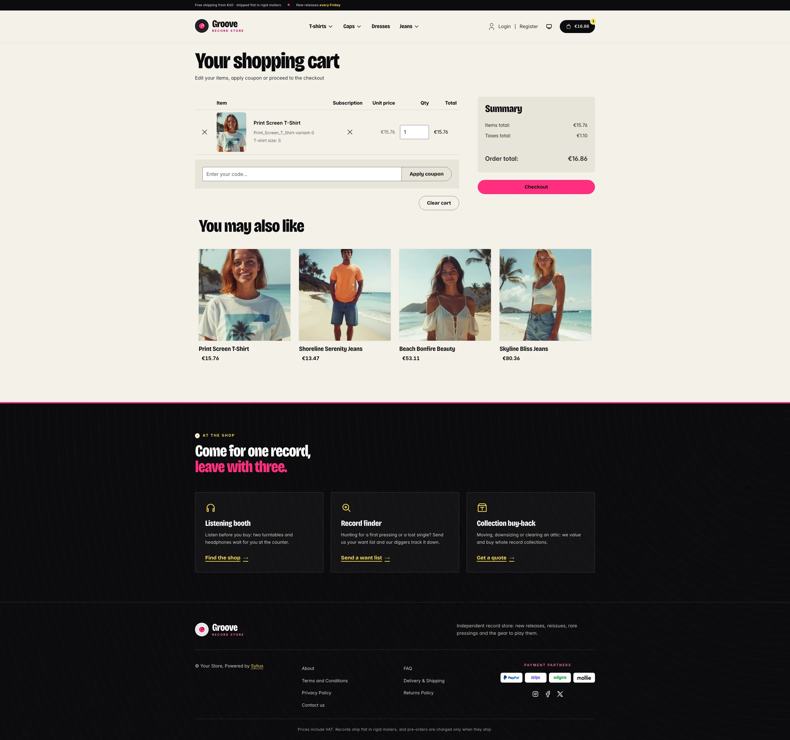 |
| Dark | 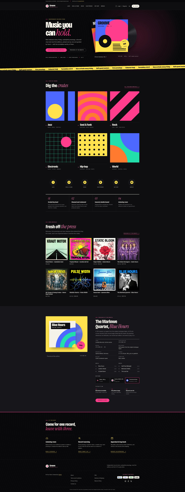 | 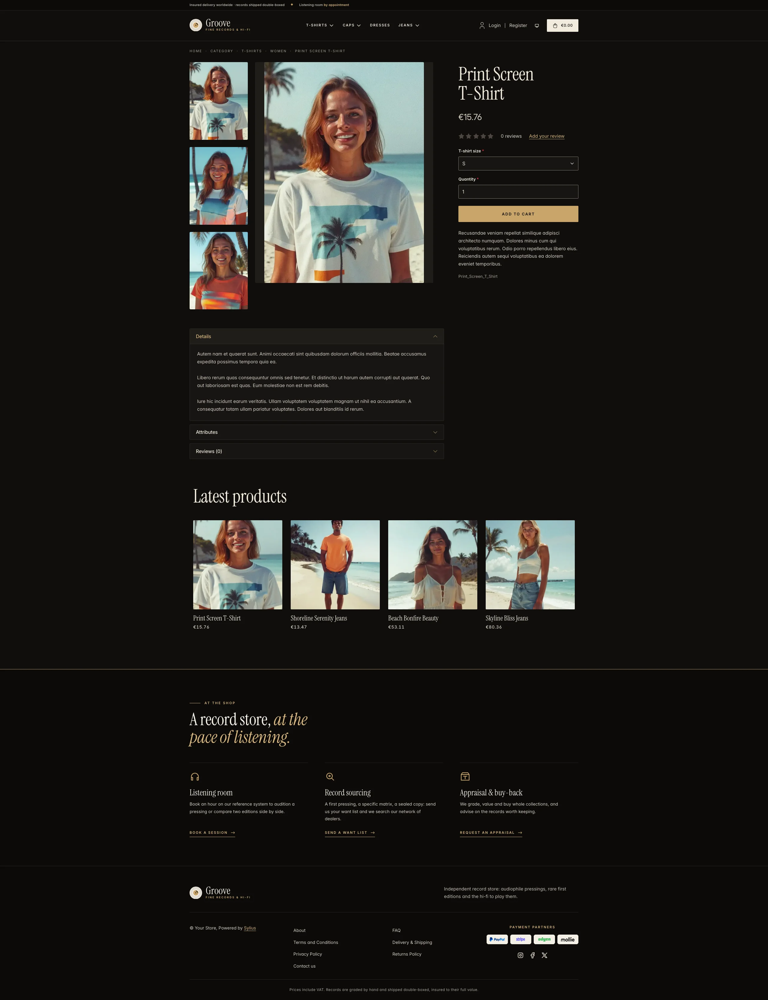 | 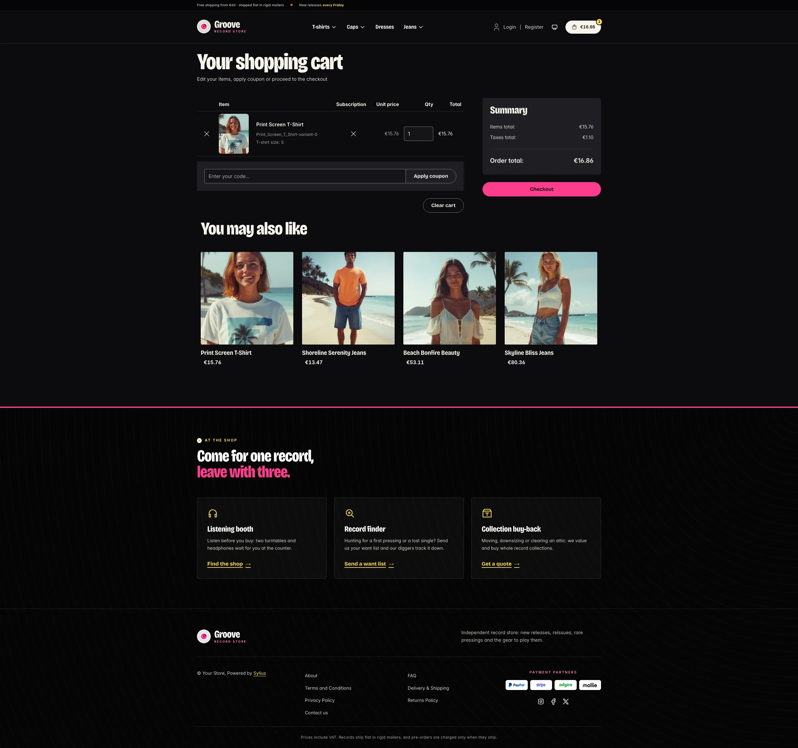 |

**Mobile** (390 px)

| Scheme | Homepage | Product page | Cart |
|---|---|---|---|
| Light |  |  |  |
| Dark |  |  |  |

- **Palette** — ink (`#0E0D10`) on warm paper (`#F6F2EA`, `#ECE6DA`) and white, with the sleeve colours hot pink
  (`#FF2E7E`), acid yellow (`#FFE14D`), electric blue (`#3D5AFE`), tangerine (`#FF6B1A`) and mint (`#18D6A0`).
  Hot pink fills the calls to action (ink text on it, 5.6:1) and turns acid yellow on hover; a deep magenta
  (`#C1005E`) for links, italic accents and focus rings. The brand carries the colour too: the logo label, the
  eyebrow rules, the ticker, the cart counter, the record labels.
- **Dark scheme** — the shop after closing time: ink page (`#0E0D10`, surfaces `#17161B`), warm paper type, neon
  pink links (`#FF7DB6`) and acid yellow focus rings; the ink bands are ruled in hot pink. The cover art keeps its
  colours in both schemes.
- **Typography** — *Bricolage Grotesque* (SIL Open Font License, variable weight, width and optical size), narrowed
  and heavy for headings, product names and the wordmark, answered inside the headings by *Instrument Serif* italic
  (SIL Open Font License), like a handwritten line on the liner notes; both shipped in `assets/shop/fonts/`.
  *Inter* (already shipped by the Sylius shop) for body copy and, in spaced small capitals, for eyebrows, labels,
  buttons and navigation; the system monospace for catalogue numbers, matrices and timings.
- **Components** — hot pink pill buttons in small capitals, lifted by a small offset shadow on hover; outlined ink
  buttons; links in small capitals over a hot pink bar. Product cards are **square sleeves** with a black record
  tucked behind them: a thin arc of it shows at rest, and on hover it slides out of the top and turns while the
  sleeve lifts; the record labels cycle through the sleeve colours, card after card.
- **Header** — an ink top bar with the shipping promise, the listening room and the locale / currency switchers,
  then a record logo with a hot pink label and the *Groove* wordmark, and category navigation in small capitals over
  a hot pink bar.
- **Homepage** — an ink **hero** ringed with grooves: a headline answered by a serif italic, a lead, a hot pink call
  to action, a link to the pressing of the month and the formats the shop is known for; on the right, two fanned
  sleeves drawn in SVG, the front one with its record pulled out (it slides further out and turns on hover) and a
  “500 copies” sticker, captioned like a catalogue entry; a tilted acid yellow ticker closes the band. Then **dig
  the crates** (`theme_genres` hookable): six large sleeves with flat cover art (jazz, soul & funk, rock,
  electronic, hip-hop, world), numbered, each with its record peeking out. The promise block (`theme_promise`
  hookable) numbers four commitments in serif italic figures (graded by hand, cleaned and resleeved, insured and
  double-boxed, listening room). Then the **new arrivals**, eight latest products as a wall of sleeves, and the
  **pressing of the month** (`theme_release` hookable), a collector's sheet: the sleeve and its translucent blue
  record on a large acid yellow panel with a numbered sticker, the pressing references (label, catalogue number,
  matrix, mastering, plant, format, edition, condition), the tracklist side by side, the editions in stock and what
  to play it on. The deals and new collection blocks are hidden.
- **Footer** — ink ringed with grooves under a hot pink rule, with three shop services (listening room, record
  sourcing, appraisal and buy-back) linking to the contact page, the wordmark, the Sylius links and the notice.
- **Product page** — the cover stands whole on a paper tile; the attributes table reads like a collector's sheet,
  with small-capital labels and zebra rows; the price sits directly below the product name.
- **Square thumbnails** — sleeves are square, so the theme crops the `sylius_shop_product_thumbnail` image filter
  square (600 × 600) instead of the shop's 3:4 portrait (`config/packages/groove_imagine.yaml`).
- **Checkout** — the checkout header uses the Groove wordmark and responsive category navigation, the current
  step is ruled in hot pink.
- **Translations** — every Groove-specific text lives in its own `groove` translation domain
  (`translations/groove.en.yaml` and `groove.fr.yaml`).
- **Accessibility** — ink text on the hot pink and acid yellow fills, deep magenta text at 5:1 on paper, focus rings
  at 3:1 in both schemes, text alternatives for the hero and pressing of the month illustrations, a static ticker,
  and records that only turn on hover and never for visitors who prefer reduced motion.

The genre crates and the pressing of the month link to the latest products: point them at your genre taxons and a
real release in `templates/shop/homepage/genres.html.twig` and `release.html.twig`. A hero image contributed
through the core hero slot replaces the drawn sleeves, with its record still pulled out behind it.

## Demo catalog

The screenshots above show a demo catalog of sixteen fictional records in six genres (Jazz, Soul & Funk, Rock,
Electronic, Hip-Hop, World), shipped as the `groove` dataset of `sylius-starter/datasets`
(`src/Datasets/datasets/groove/`: `products.yaml`, `collections.yaml`, and in `media/` the cover of each record: a
square sleeve generated with Ollama, in the style of its genre and era, from a 1961 hard bop photo to a chicha poster,
with its title or artist printed on it). Descriptions carry the pressing details: label, catalogue number, weight,
colour and edition. Create a shop from it with the [import package](../import/datasets.md), into the default channel:

```bash
castor sylius:import:shop:create groove
castor sylius:import:fixtures:generate --project=groove --subdomain=""
castor sylius:import:fixtures:load --project=groove
```

No AI call is made: `products.yaml` points at the covers of the dataset `media/`. The shop menu then lists the six
genres; `castor sylius:import:delete groove` removes the catalog. The import keeps the products already in
the channel and gives the records creation dates in the past, so on a store loaded with the default fixtures the
latest products may still show clothing: run `castor app:db:fixtures app` first to start from a store without
products.

Install the theme with:

```bash
castor sylius:theme:setup groove
```
