Hearth is built for home and living stores selling furniture, lighting, decoration, home linen, kitchenware and garden
furniture: a warm storefront in limewashed linen and terracotta clay, with garden sage and a ray of ochre sun, set with
the generous DM Serif Display. Its motif is the arch of a Mediterranean house: products stand in arched niches, the hero
opens an arch onto a living room, and the bands end in the fringe of a woven rug.

**Desktop** (1440 px)

| Scheme | Homepage | Product page | Cart |
|---|---|---|---|
| Light | 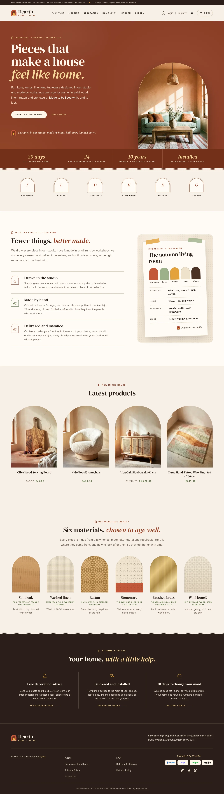 | 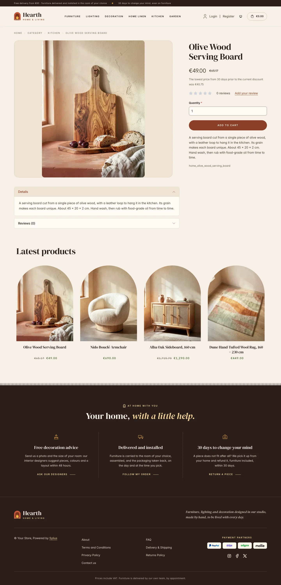 | 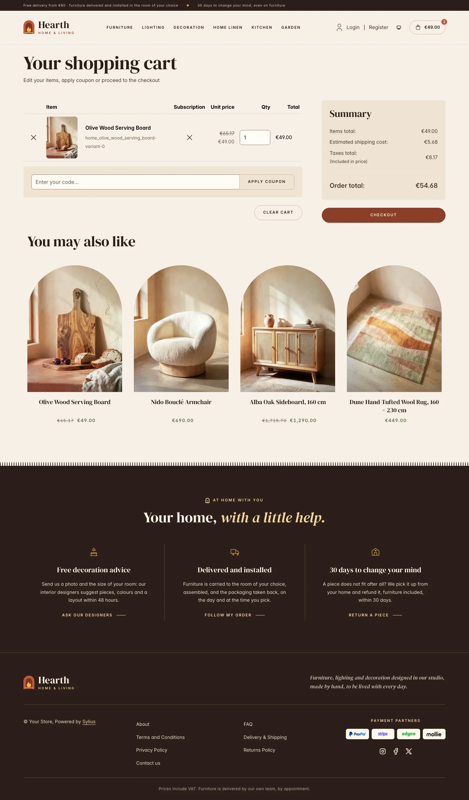 |
| Dark | 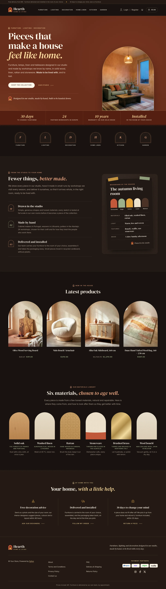 | 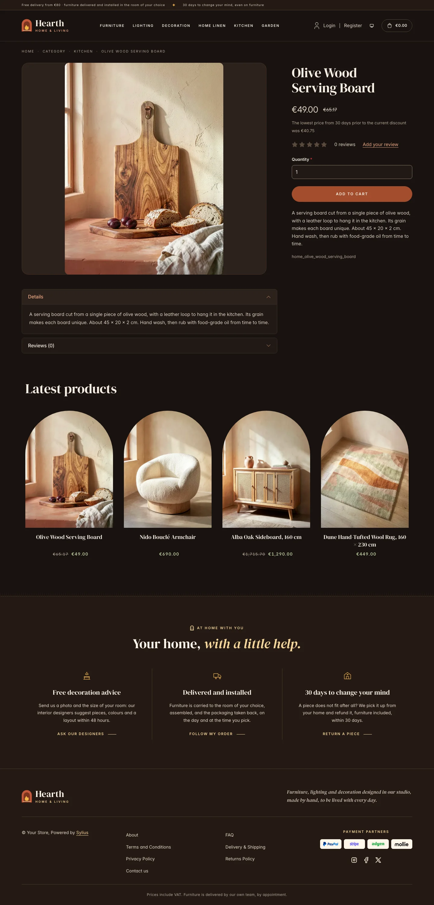 | 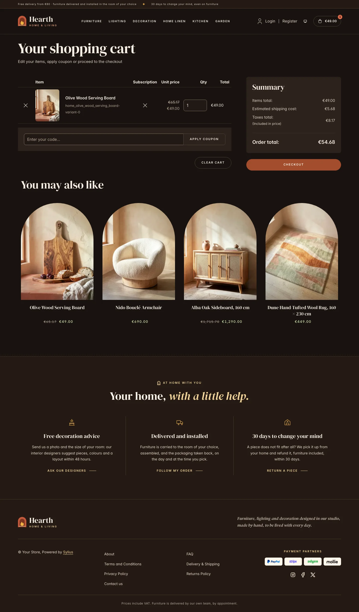 |

**Wide screen** (2560 px)

| Scheme | Homepage | Product page | Cart |
|---|---|---|---|
| Light | 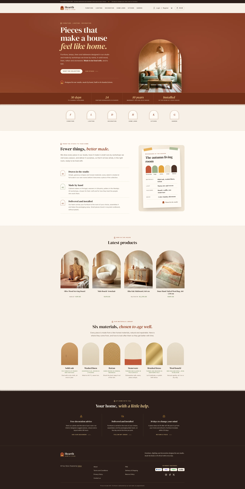 | 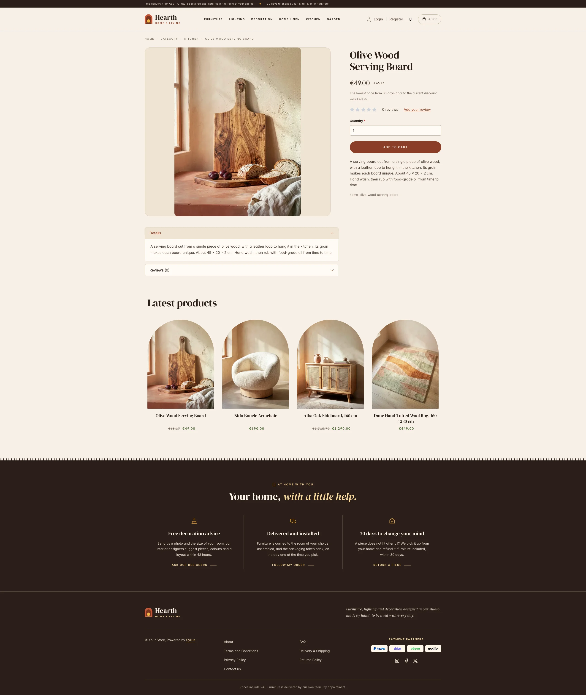 | 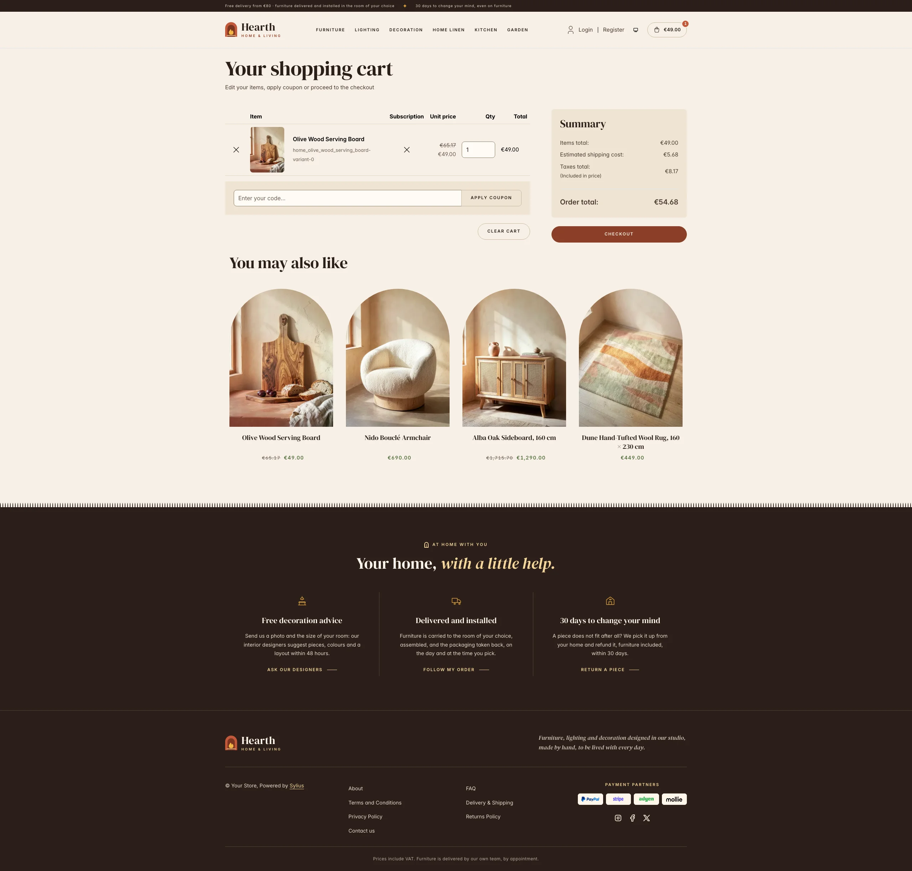 |
| Dark | 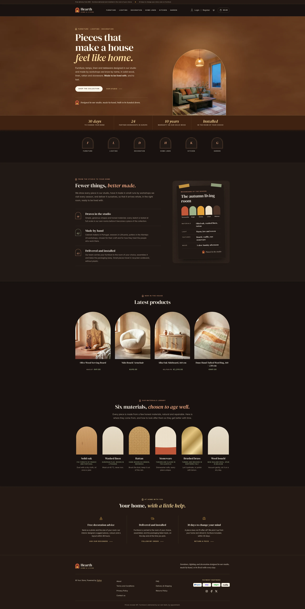 | 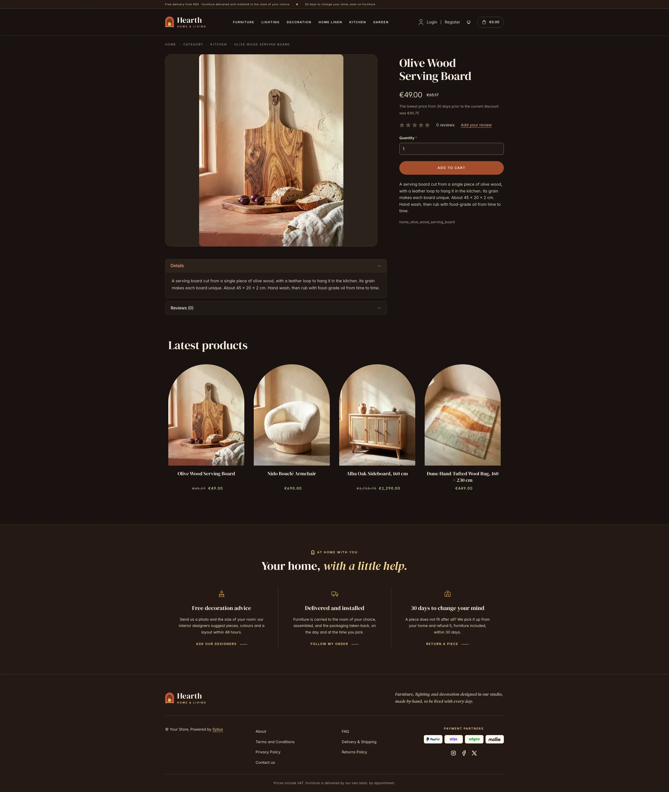 | 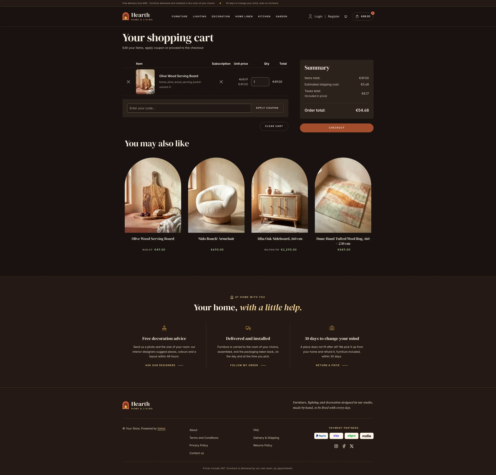 |

**Mobile** (390 px)

| Scheme | Homepage | Product page | Cart |
|---|---|---|---|
| Light |  |  |  |
| Dark |  |  |  |

- **Palette** — terracotta clay (`#94432A`, `#7A3520`) for the buttons, an ochre limewash sampled from the hero
  photograph (`#83471F`, sunlit `#B0703F`) for the hero wall, walnut (`#2B1F19`) for the top bar and the footer, on
  linen (`#F7F0E6`) and plaster (`#FFFBF5`), with garden sage (`#55703F` as text, `#9DB08A`), ochre (`#E3A33B`,
  `#F6D79B` on the dark bands) and a deep terracotta (`#96432A`) for eyebrows and accent text.
- **Dark scheme** — the living room at dusk: walnut shadows (page `#18120F`, surfaces `#211915`), lamp-lit linen type,
  a fired terracotta (`#A44D2E`) for buttons, a warm peach (`#F0A783`) for accent text and a pale sage (`#BACD9F`), with
  ochre hairlines on the walnut bands. The hero wall falls into the shadow of the evening (`#5A3119`), lit by the
  pendant of its living room.
- **Typography** — *DM Serif Display* (SIL Open Font License, roman and italic, shipped in `assets/shop/fonts/`) for
  headings, product names and figures, with ochre and terracotta italics; *Inter* (already shipped by the Sylius shop)
  for body copy, and spaced uppercase small capitals for eyebrows, navigation, buttons and breadcrumbs.
- **House motif** — the arch: product niches, category roundels, step numerals, paint chips and material samples are
  all arched, and eyebrows open on a small arched window. The hero figures band and the footer end in the fringe of a
  woven rug.
- **Components** — pill-shaped clay buttons (linen on the hero), product cards in an arched plaster niche where a rattan
  pendant lamp is lowered on hover, a plaster fillet inside the arch and sage prices, an outlined cart button with a
  terracotta counter.
- **Header** — a walnut top bar with the delivery and returns promises, then the **house mark** (a terracotta arch with
  the ochre flame of the hearth, which flickers on hover) and the *Hearth* wordmark, centered category navigation
  underlined in terracotta.
- **Homepage** — a hero that is the wall of the living room, in a limewash mottled like plaster: an eyebrow, a DM
  Serif Display headline ending in ochre italic, two calls to action and a signature with the house mark. On the
  right, a photograph of the **living room** in an arch: limewashed terracotta walls, a sage linen sofa with its ochre
  and rust cushions, an oak coffee table with a stoneware vase of olive branches, a rattan pendant and a striped wool
  rug, in the morning sun. In the dark scheme the same room is shown at dusk, lit by its pendant, with the evening sky
  in the window; each scheme only downloads its own photograph (`assets/shop/images/`). The sun casts the panes of a
  window on the wall above the arch, and at dusk the pendant casts a pool of lamp light there. A band of **house
  figures** (returns, partner workshops, solid wood warranty, installation) closes the hero. The promise block
  (`theme_promise` hookable) presents the studio in three steps numbered in arched windows (drawn, made by hand,
  delivered and installed), next to the **moodboard of the season**: a linen card taped askew to the studio wall, with
  five arched paint chips (terracotta, sage, ochre, linen, walnut) and its materials, light, textures and mood. After
  the four latest products, the **materials library** (`theme_materials` hookable) shows six arched samples drawn in
  CSS (solid oak, washed linen, rattan, stoneware, brushed brass and wool bouclé), crossed by a ray of light on hover,
  each with its origin and its care. The deals and new collection blocks are hidden.
- **Footer** — walnut, with three **house services** (free decoration advice, delivered and installed, 30 days to
  change your mind) linking to the contact page and the customer account, the wordmark, the Sylius links and the
  delivery notice.
- **Checkout** — the checkout header uses the Hearth wordmark and responsive category navigation, the current step is
  ruled in terracotta.
- **Translations** — every Hearth-specific text lives in its own `hearth` translation domain
  (`translations/hearth.en.yaml` and `hearth.fr.yaml`).
- **Accessibility** — visible terracotta focus rings, a text alternative for the living room illustration and the
  paint chips, and no motion (swaying pendant, sleeping cat, flickering flame, hover effects) for visitors who prefer
  reduced motion.

## Demo catalog

The screenshots above show a demo catalog of eighteen pieces from a fictional home studio, in six departments
(Furniture, Lighting, Decoration, Home Linen, Kitchen, Garden), shipped as the `home` dataset of
`sylius-starter/datasets` (`src/Datasets/datasets/home/`: `products.yaml`, `collections.yaml`, and in `media/` a photo
of each piece generated with Ollama, in the same sunlit room with limewashed walls). The pieces echo the homepage (the
materials of the library, the palette of the moodboard), and descriptions carry what a home buyer looks for:
dimensions, materials, delivery and care advice. Create a shop from it with the
[import package](../import/datasets.md), into the default channel:

```bash
castor sylius:import:shop:create home
castor sylius:import:fixtures:generate --project=home --subdomain=""
castor sylius:import:fixtures:load --project=home
```

No AI call is made: `products.yaml` points at the photos of the dataset `media/`. The shop menu then lists the six
departments; `castor sylius:import:delete home` removes the catalog. The import keeps the products already in the
channel and gives the pieces creation dates in the past, so on a store loaded with the default fixtures the latest
products may still show clothing: run `castor app:db:fixtures app` first to start from a store without products.

Install it with:

```bash
castor sylius:theme:setup hearth
```
