Pick a theme below to see what it changes and its screenshots on desktop, on a wide screen and on mobile, then
install it with [`castor sylius:theme:setup`](../commands/themes.md). Only one theme can be active at a time.

## Editorial

Refined typography and soft palettes, for lifestyle and fashion shops.

| Preview | Theme | Description |
|---------|-------|-------------|
| <a href="canvas.md">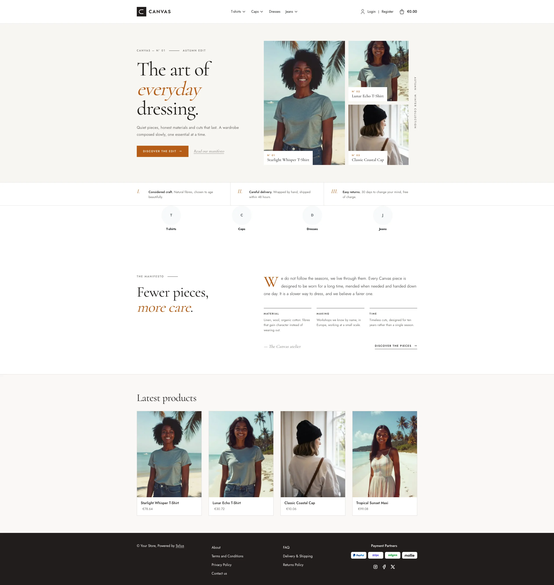</a> | [Canvas](canvas.md) | Clean, editorial look with warm neutrals |
| <a href="blush.md">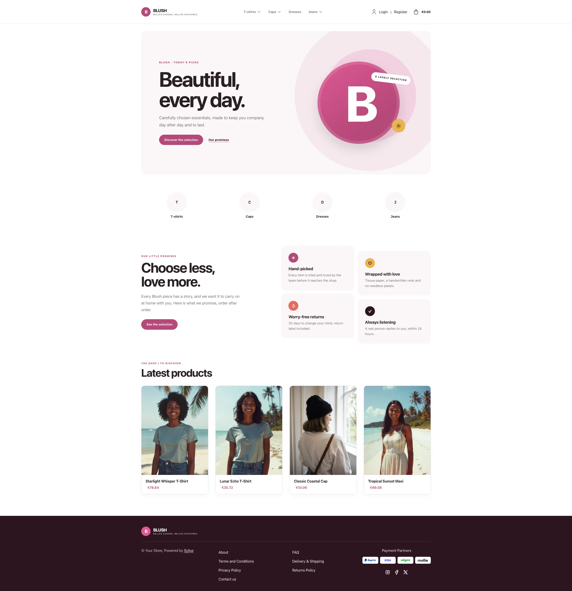</a> | [Blush](blush.md) | White canvas, raspberry accents and a plum footer |

## Vibrant

Bold colors and product-led pages, for sport and modern brands.

| Preview | Theme | Description |
|---------|-------|-------------|
| <a href="volt.md">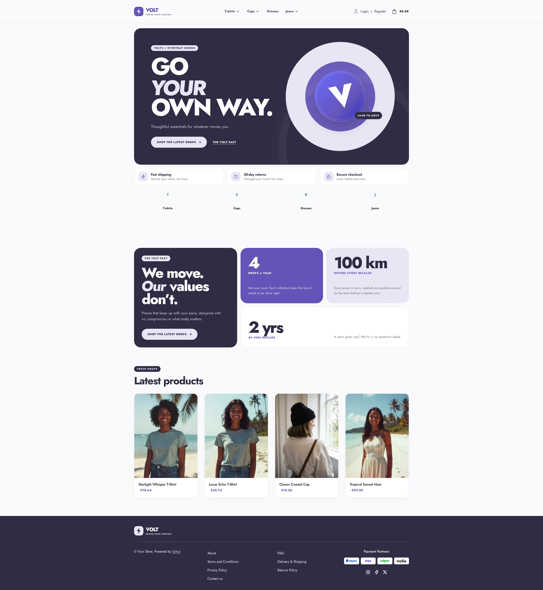</a> | [Volt](volt.md) | High-energy sport-tech look in electric violet |
| <a href="lagoon.md">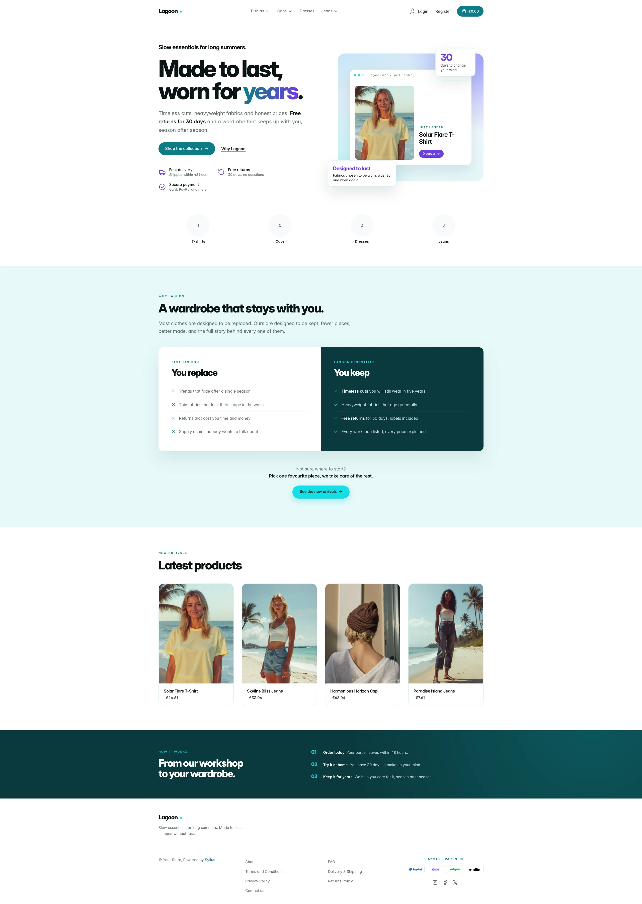</a> | [Lagoon](lagoon.md) | Airy, product-led look in teal and aqua |
| <a href="aurora.md">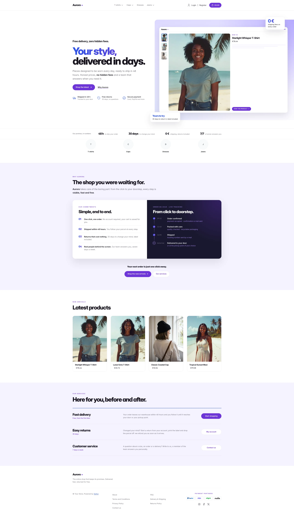</a> | [Aurora](aurora.md) | Lagoon's violet sibling, with a blue-to-violet gradient |

## Specialty stores

Looks built around one kind of shop, with their own typography and homepage.

| Preview | Theme | Description |
|---------|-------|-------------|
| <a href="tech.md">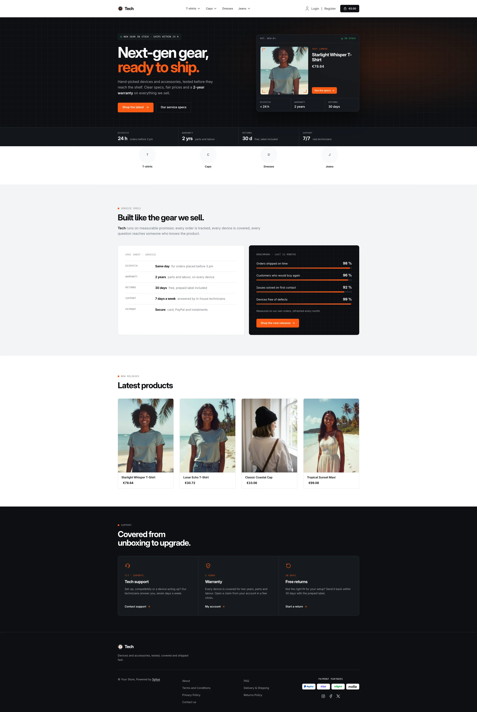</a> | [Tech](tech.md) | Electronics-store look in carbon, aluminium and signal orange |
| <a href="retro_gaming.md">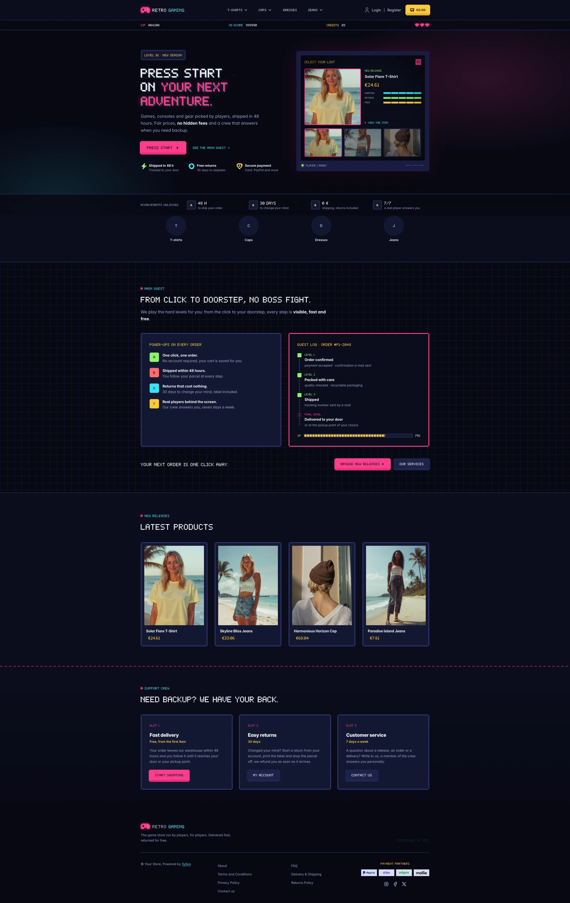</a> | [Retro Gaming](retro_gaming.md) | Night arcade gaming store: neon magenta and cyan, pixel font, HUD and CRT hero |
| <a href="drive.md">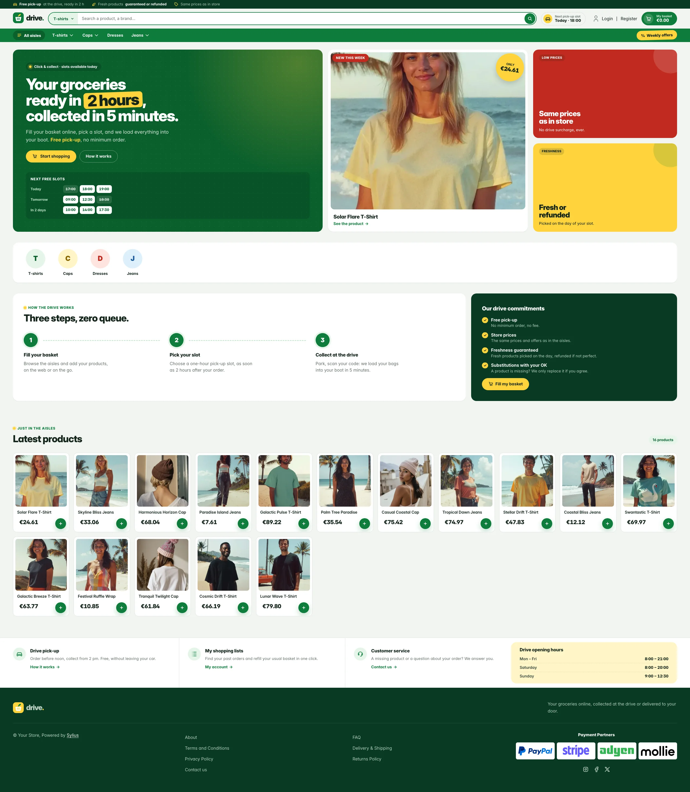</a> | [Drive](drive.md) | Full-screen grocery click-and-collect store: basil green, lemon price stickers and a pick-up slot hero |
| <a href="cellar.md">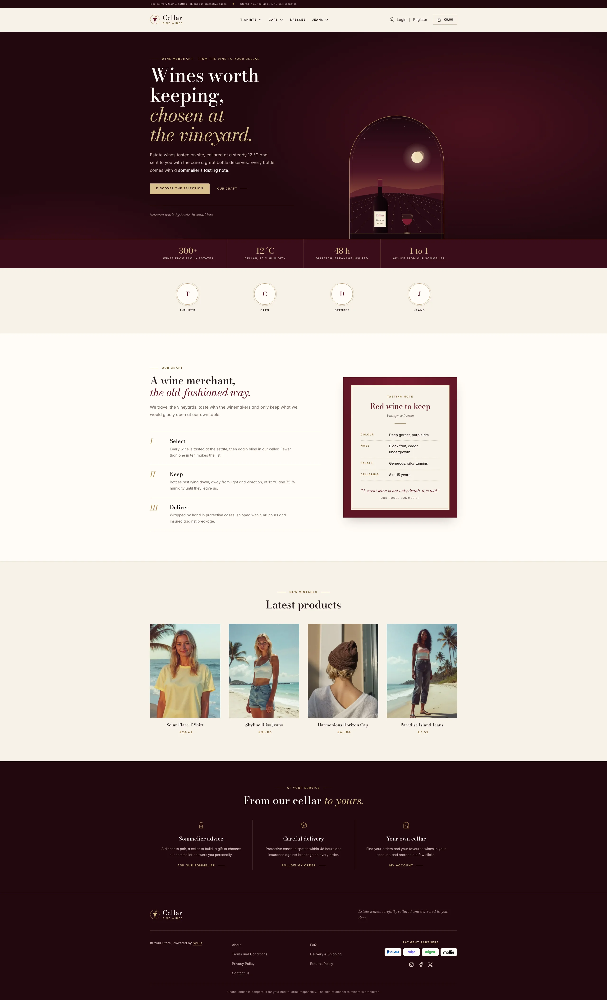</a> | [Cellar](cellar.md) | Fine wine merchant: night bordeaux, cream paper, Didone headings and a vaulted cellar-window hero |
| <a href="arena_dark.md">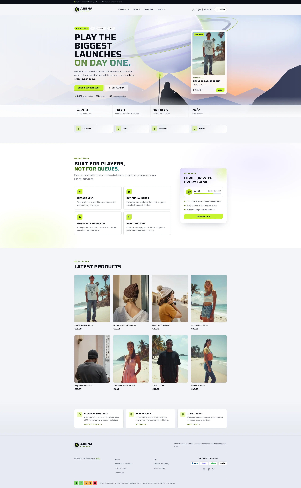</a> | [Arena Dark](arena_dark.md) | Modern video game store: night launcher, acid lime, wide display type and a cinematic key-art hero |
|  | [Arena Light](arena_light.md) | Arena's daylight variant: frost-white glass, ink type, lime fills with olive accents and a sunrise key art |

## Terminal

A developer-tool layout with monospaced accents, in a dark and a light variant.

| Preview | Theme | Description |
|---------|-------|-------------|
| <a href="prompt_dark.md">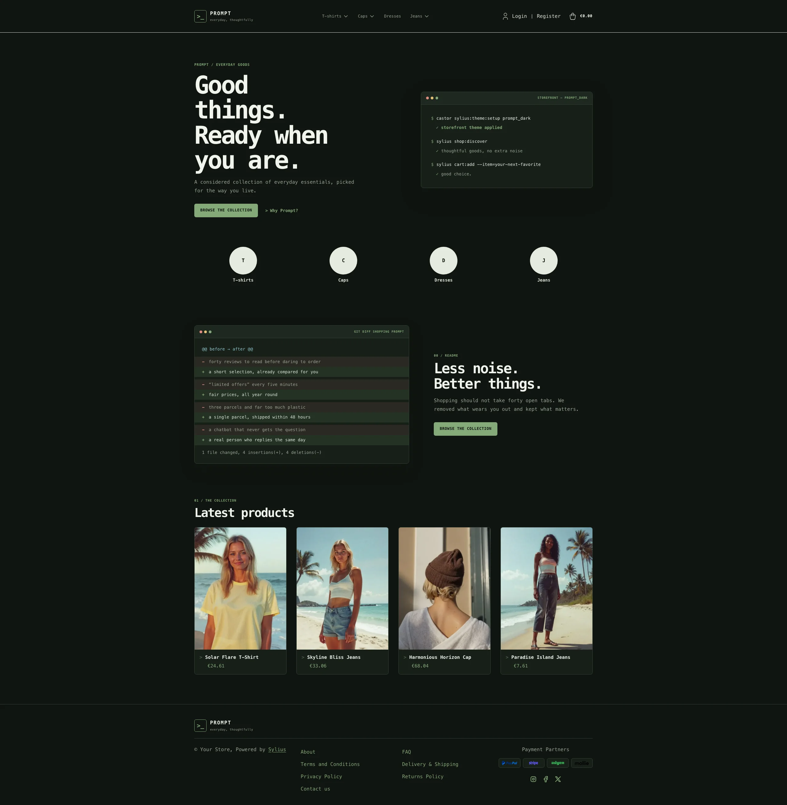</a> | [Prompt Dark](prompt_dark.md) | Terminal-inspired dark workspace with green accents |
| <a href="prompt_light.md">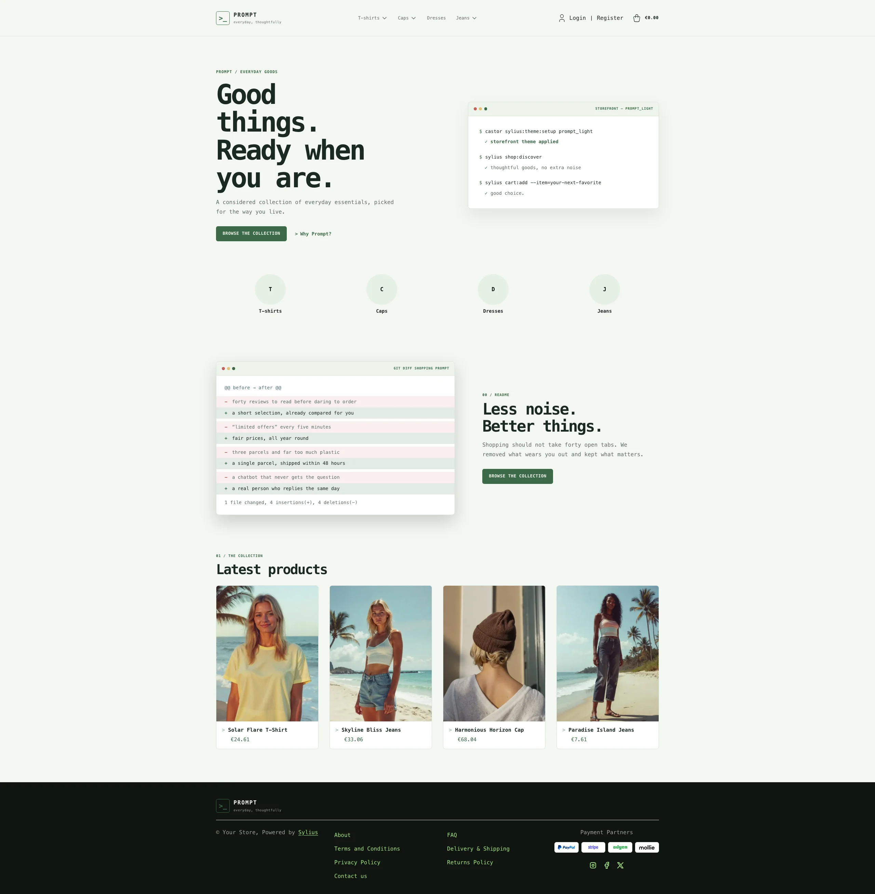</a> | [Prompt Light](prompt_light.md) | Terminal-inspired layout on soft green paper |
