Paws is built for pet shops selling food, treats, toys, accessories, beds and care products for dogs and
cats: a warm, grown-up storefront in oat and collar navy, with tangerine calls to action and soft pastels, one
per aisle. Its house paw has four navy toes around a tangerine pad. The hero opens a round-topped shop window
onto the living room of Biscuit the corgi and Miso the cat, and a few playful details (the paw stamped on the
product cards, the pet passport of the subscription) keep it friendly, while the page speaks of recipes,
portions and subscriptions.

**Desktop** (1440 px)

| Scheme | Homepage | Product page | Cart |
|---|---|---|---|
| Light | 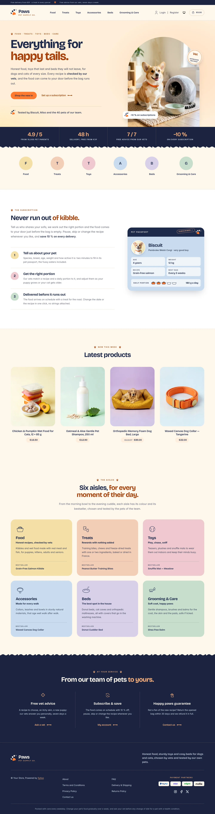 | 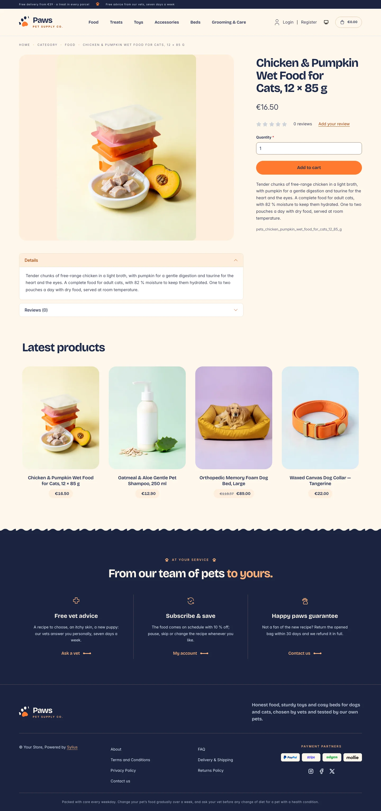 | 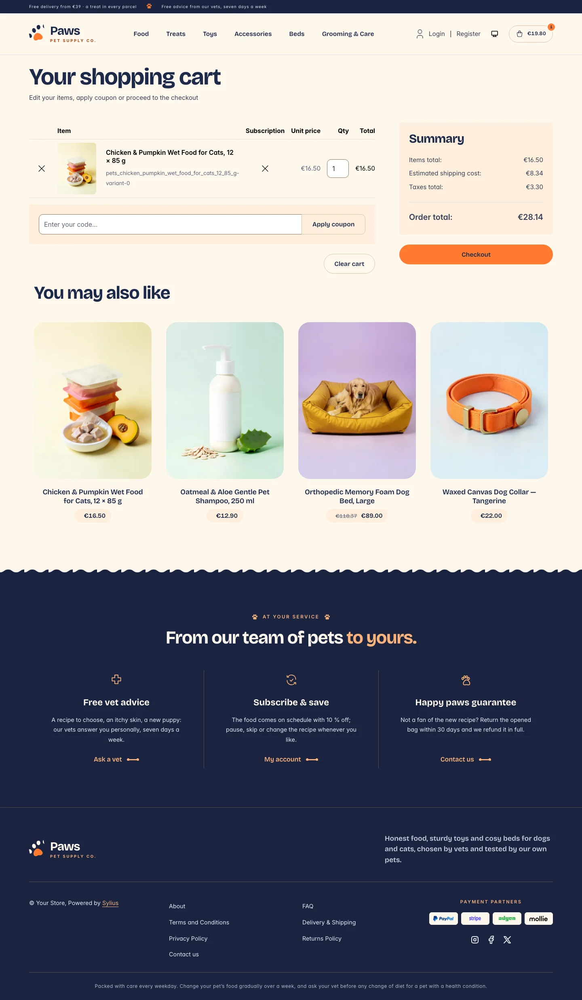 |
| Dark | 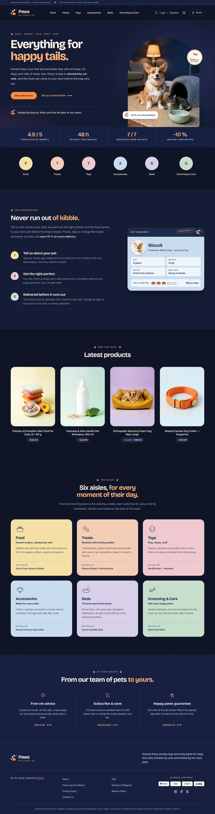 | 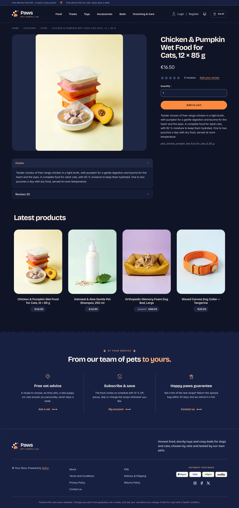 | 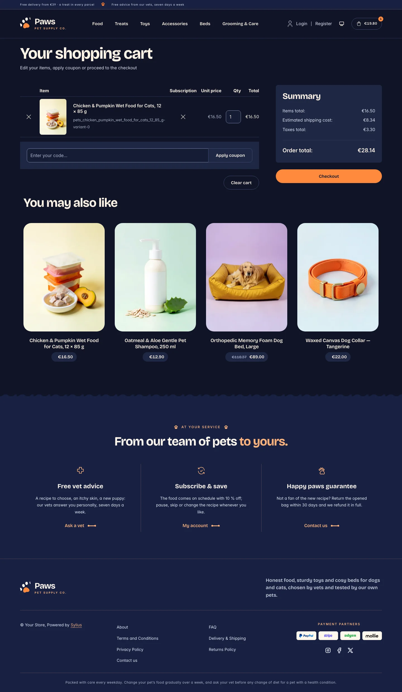 |

**Wide screen** (2560 px)

| Scheme | Homepage | Product page | Cart |
|---|---|---|---|
| Light | 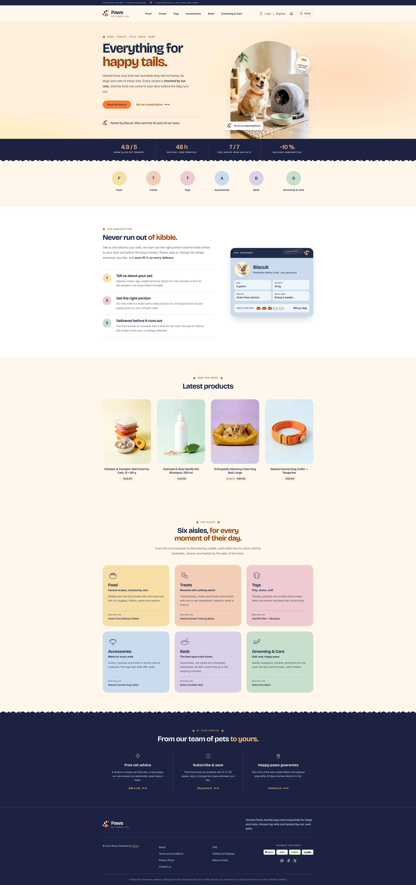 | 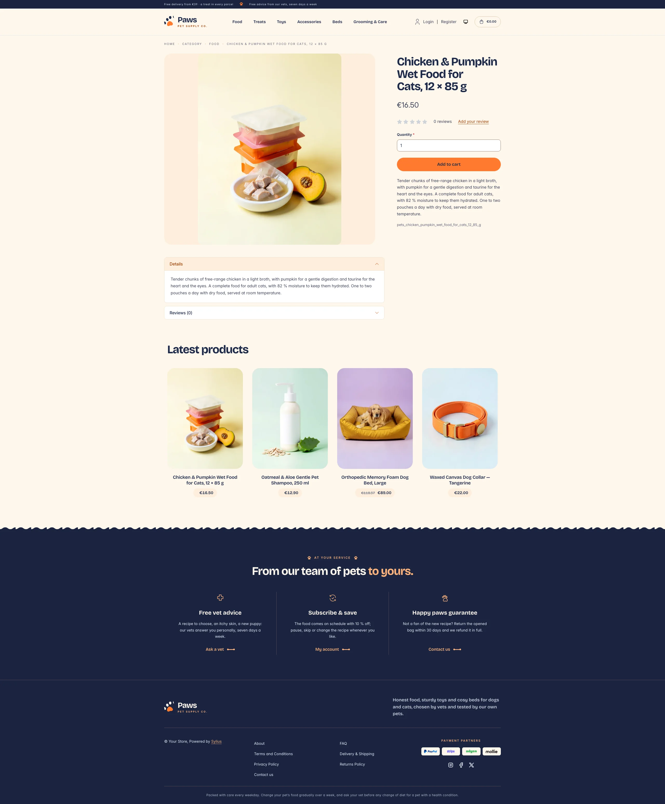 | 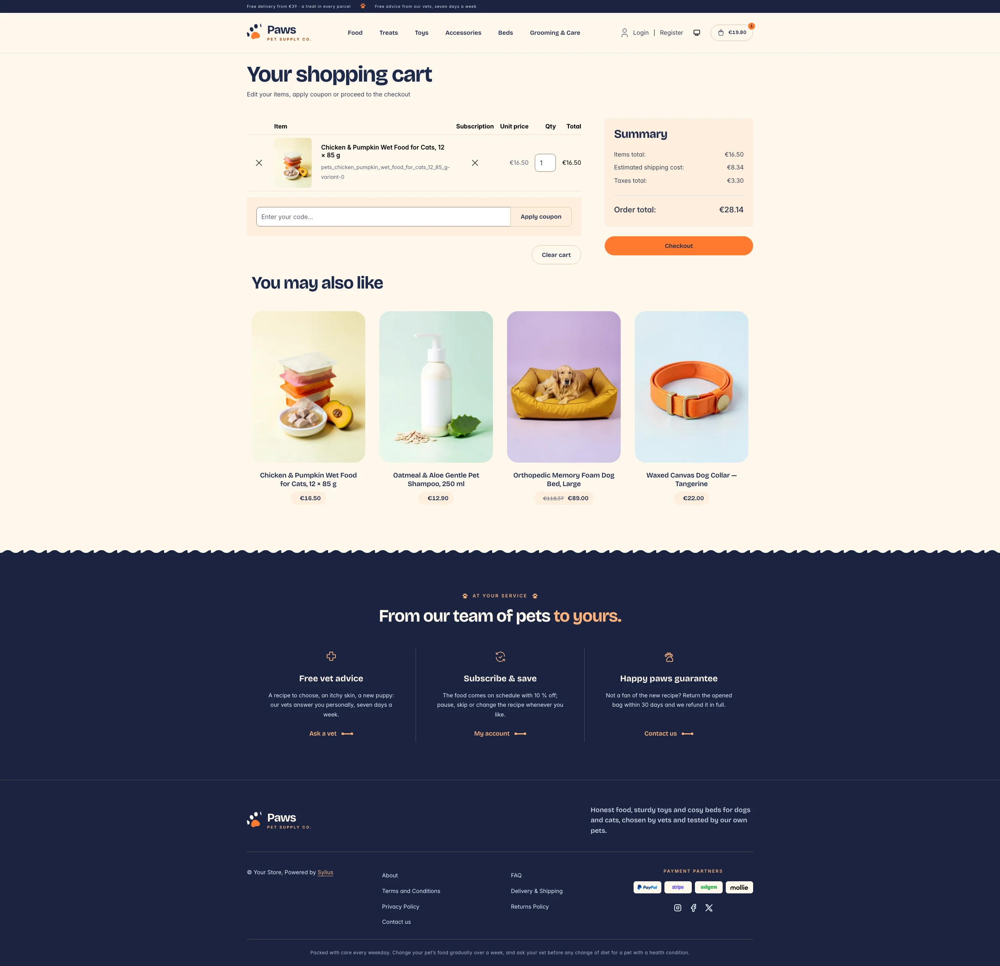 |
| Dark | 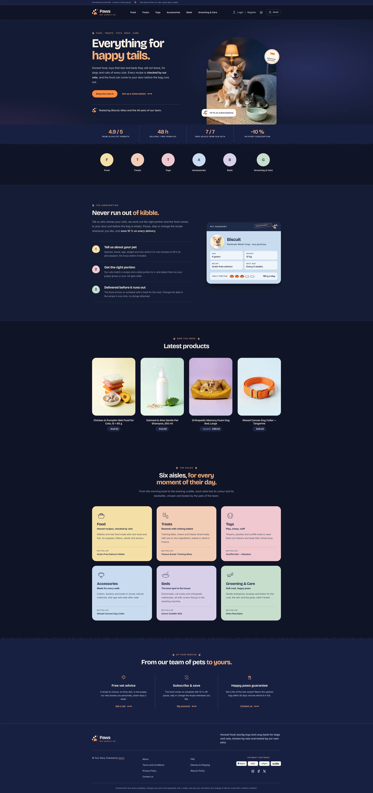 | 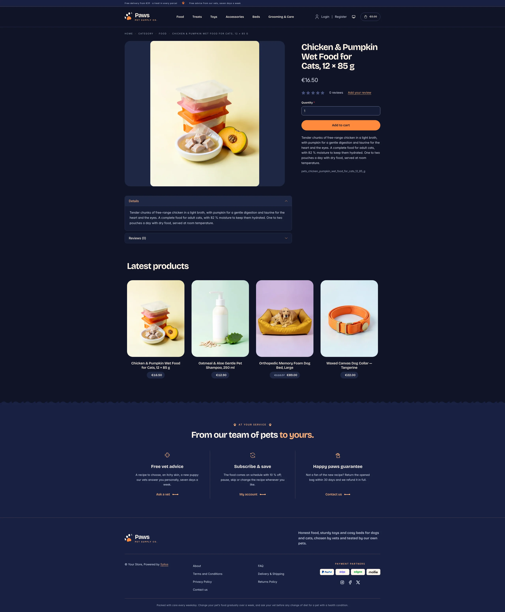 | 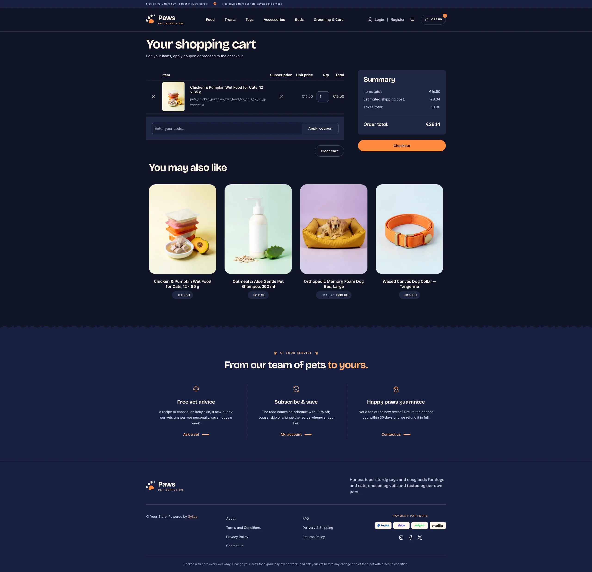 |

**Mobile** (390 px)

| Scheme | Homepage | Product page | Cart |
|---|---|---|---|
| Light |  |  |  |
| Dark |  |  |  |

- **Palette** — collar navy (`#1E2A4A`, bands `#1A2440`) on oat (`#FFF7EC`), white and biscuit (`#FDEEDB`),
  with tangerine (`#FF7A2F`, with navy ink on it) for the calls to action, a burnt orange (`#A8410A`) for links,
  eyebrows and headline accents, and soft pastels that stay the same in both schemes: butter (`#F4E0A6`), peach
  (`#F3CDB5`), rose (`#EFC9CF`), sky (`#C9DCEE`), lilac (`#D8D0EA`) and sage (`#C6DECD`).
- **Dark scheme** — the evening walk: night navy (page `#0F1426`, surfaces `#161D35`), cream type, the same
  tangerine buttons with night ink and a pale apricot (`#FFB27A`) for accent text; the hero photo turns to the
  same living room by lamplight.
- **Typography** — *Bricolage Grotesque* (SIL Open Font License, variable, shipped in `assets/shop/fonts/`)
  for headings, product names, prices and figures, the accent words of a headline in tangerine; *Inter*
  (already shipped by the Sylius shop) for body copy, and spaced uppercase small capitals for eyebrows and
  labels.
- **House motif** — the paw: eyebrows are led by a paw print, the product cards are stamped with it, and the
  navy bands (figures, footer) end in a soft wave like the edge of a dog blanket.
- **Components** — tangerine pill buttons with a soft glow on hover, product cards in a softly rounded biscuit
  niche that lifts on hover while the **house paw** is stamped on its corner in tangerine ink, the price on a
  biscuit pill, links closed by a small bone that stretches on hover, pastel toe-bean numerals and a
  **portion scale** of five bowls filled with kibble.
- **Header** — a navy top bar with the delivery and vet promises, then the **house paw** (its toes wiggle on
  hover) and the *Paws* wordmark, centered category navigation with a biscuit pill behind the hovered link,
  and an outlined cart pill with a tangerine counter.
- **Homepage** — a warm hero: an eyebrow, a headline ending in tangerine, two calls to action and a signature
  with the paw. On the right, the **shop window**: a round-topped photo of the living room of Biscuit the corgi
  and Miso the cat, in the morning sun (by lamplight in the dark scheme), with a round "vet approved" seal and
  a subscription card. A navy band of **house figures** (reviews, delivery, vet advice, subscription) closes
  the hero. Category roundels take a pastel each. The subscription block (`theme_promise` hookable) presents
  the delivery in three steps, next to the **pet passport** of Biscuit (portrait, age, weight, recipe, next
  bag, a "subscribed" stamp and its daily portion). After the four latest products, the **aisles** block
  (`theme_shelves` hookable) shows the six aisles of the shop (food, treats, toys, accessories, beds, grooming
  & care), each on its pastel with a drawing, a promise and its bestseller. The deals and new collection
  blocks are hidden.
- **Footer** — navy, with three **house services** (free vet advice, subscribe & save, happy paws guarantee)
  linking to the contact page and the customer account, the wordmark, the Sylius links and a feeding notice.
- **Photos** — the hero photos (`hero-day.webp`, `hero-night.webp`) and the portrait of the passport
  (`portrait.webp`), in `assets/shop/images/`, are generated with Ollama (x/flux2-klein).
- **Checkout** — the checkout header uses the Paws wordmark and responsive category navigation, the current
  step is ruled in tangerine.
- **Translations** — every Paws-specific text lives in its own `paws` translation domain
  (`translations/paws.en.yaml` and `paws.fr.yaml`).
- **Accessibility** — visible focus rings, navy ink on every pastel and on tangerine, text alternatives for
  the hero photo and the portion scale, and no motion for visitors who prefer reduced motion.

## Demo catalog

The screenshots above show a demo catalog of eighteen products for dogs and cats from a fictional pet supply
house, in six aisles (Food, Treats, Toys, Accessories, Beds, Grooming & Care), shipped as the `pets` dataset of
`sylius-starter/datasets` (`src/Datasets/datasets/pets/`: `products.yaml`, `collections.yaml`, and in `media/`
a photo of each product generated with Ollama on the pastel of its aisle, some with a dog or a cat). The
products are the ones of the homepage (the bestsellers of the six aisles and the recipe of the pet passport),
and descriptions carry what a pet parent looks for: recipe, daily portion, size, materials and care.
Create a shop from it with the [import package](../import/datasets.md), into the default channel:

```bash
castor sylius:import:shop:create pets
castor sylius:import:fixtures:generate --project=pets --subdomain=""
castor sylius:import:fixtures:load --project=pets
```

No AI call is made: `products.yaml` points at the photos of the dataset `media/`. The shop menu then lists the
six aisles; `castor sylius:import:delete pets` removes the catalog. The import keeps the products already in
the channel and gives the items creation dates in the past, so on a store loaded with the default fixtures
the latest products may still show clothing: run `castor app:db:fixtures app` first to start from a store
without products.

Install it with:

```bash
castor sylius:theme:setup paws
```
