Prompt is the terminal-inspired storefront direction: terminal-green accents,
monospaced typography and a command-inspired homepage panel, on a dark workspace
or, in the light scheme, on soft green paper with crisp dark typography. Visitors
switch between both [color schemes](color-schemes.md) from the header.

**Desktop** (1440 px)

| Scheme | Homepage | Product page | Cart |
|---|---|---|---|
| Light | 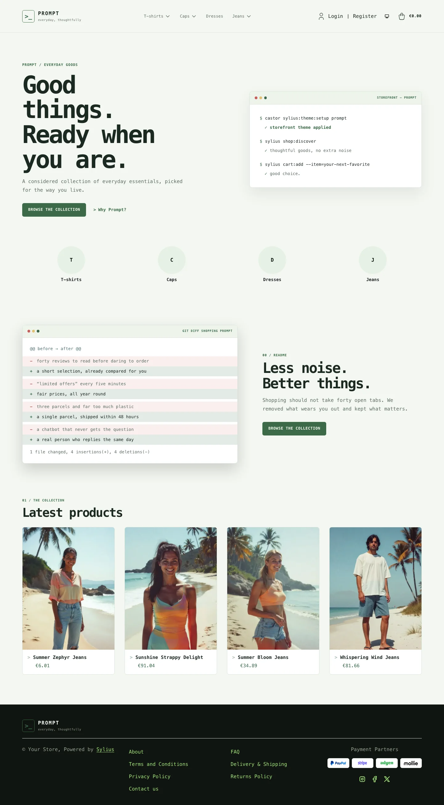 | 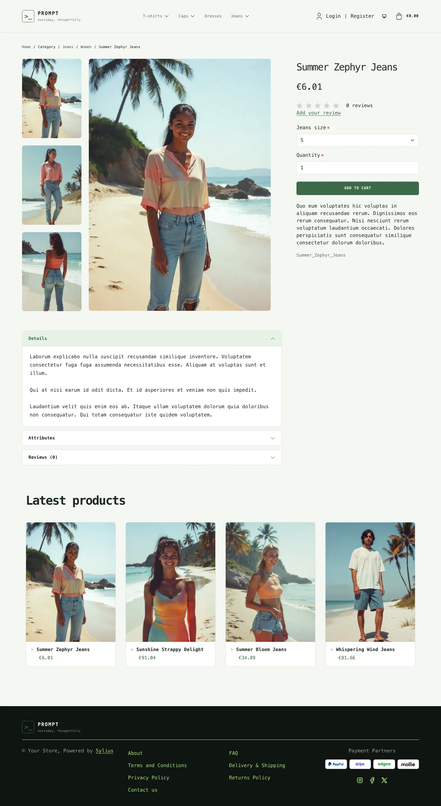 | 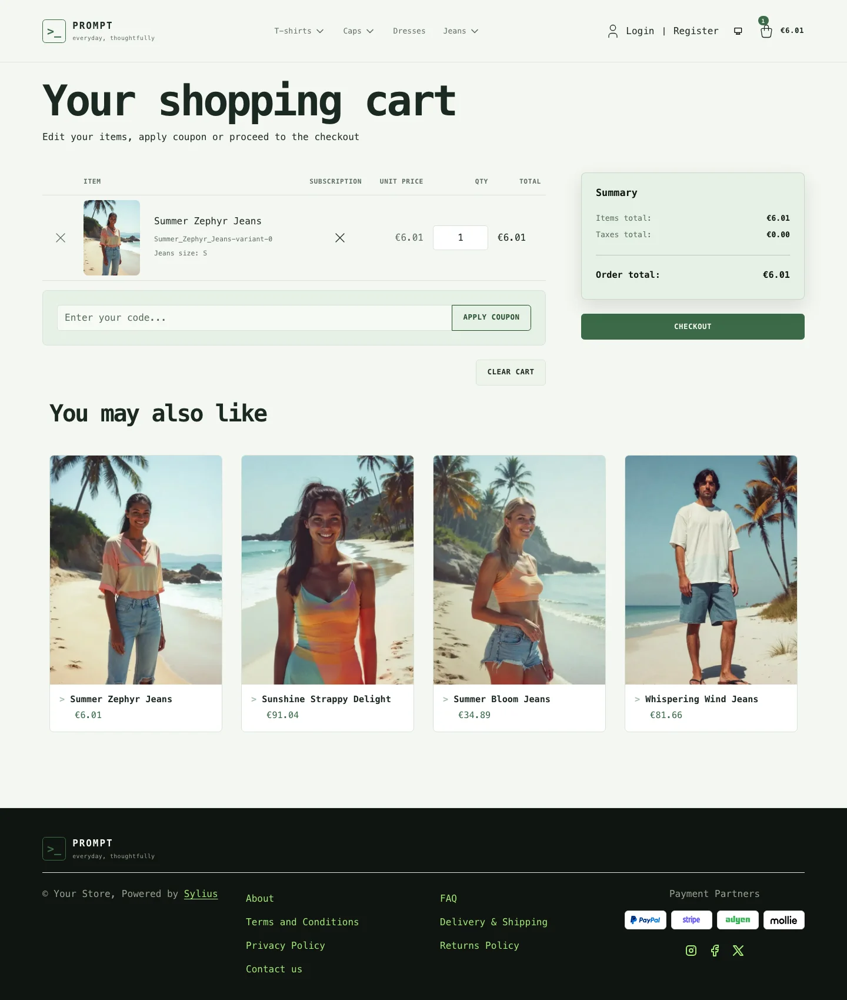 |
| Dark | 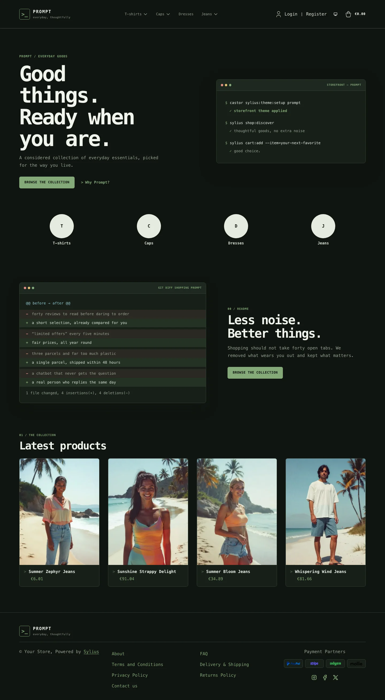 | 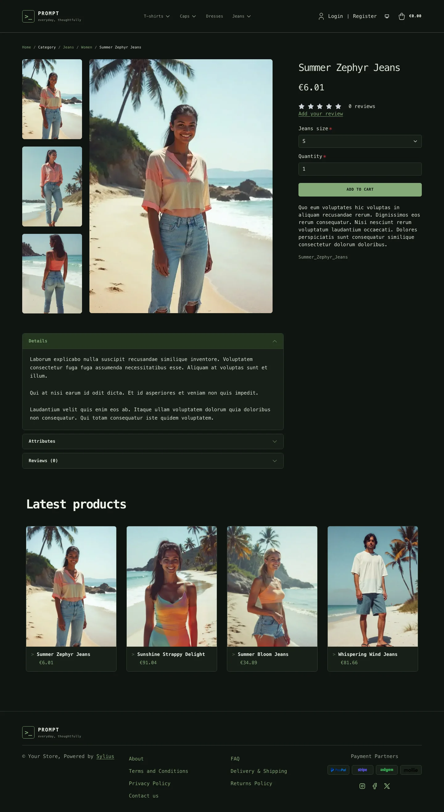 | 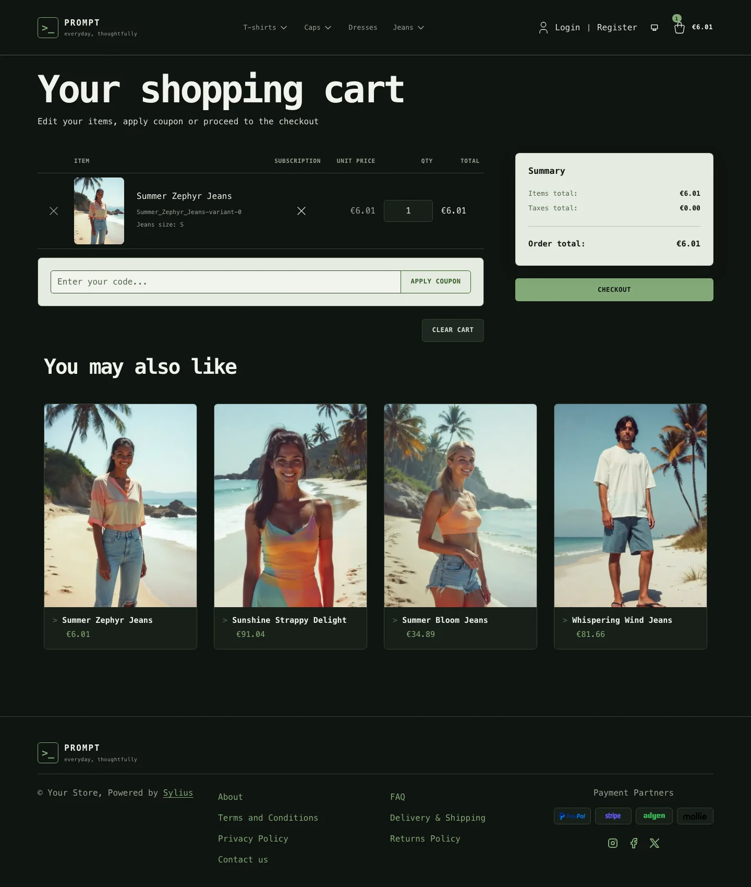 |

**Wide screen** (2560 px)

| Scheme | Homepage | Product page | Cart |
|---|---|---|---|
| Light |  | 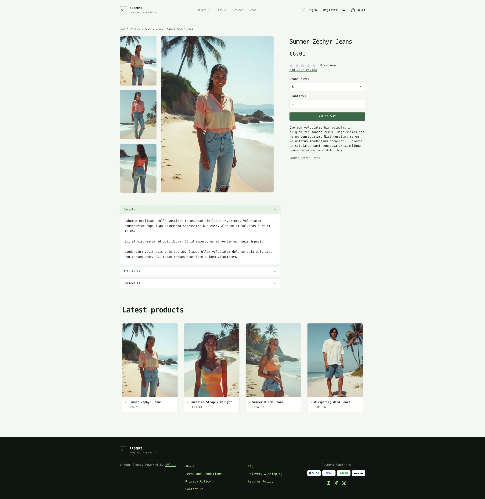 | 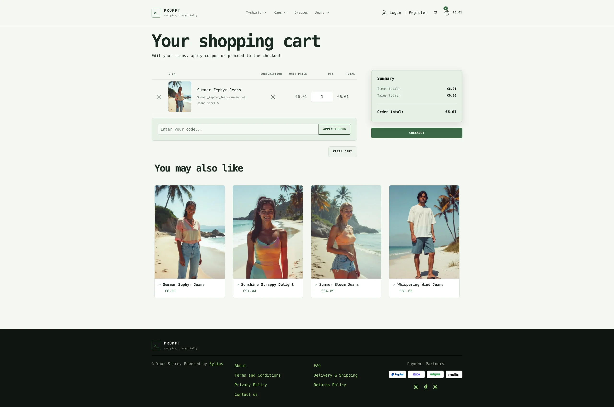 |
| Dark |  | 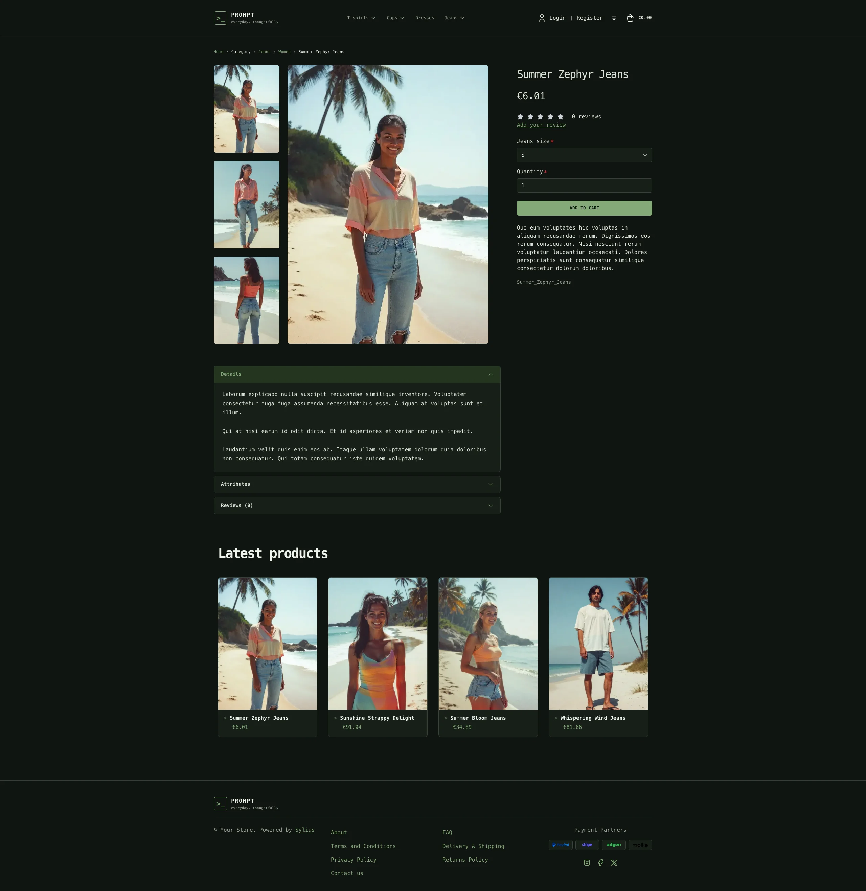 | 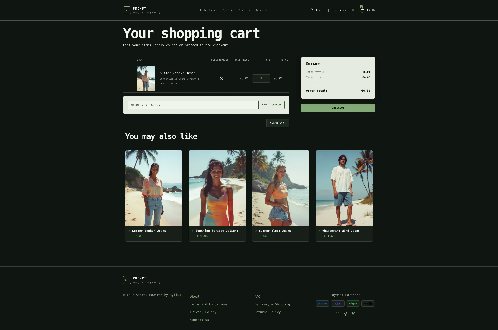 |

**Mobile** (390 px)

| Scheme | Homepage | Product page | Cart |
|---|---|---|---|
| Light |  |  | 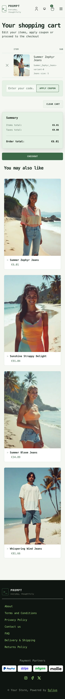 |
| Dark |  |  | 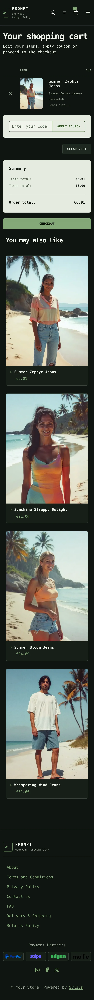 |

- **Palette** — dark scheme: deep green-black surfaces, terminal green highlights
  and muted neutral text; light scheme: pale moss backgrounds, forest-green accents
  and warm neutral text.
- **Components** — compact square-edged controls, a responsive category menu,
  raised product cards, an accessible off-canvas cart and a matching footer.
- **Product cards** — raised cards (white in the light scheme) with a `>` prompt
  before the product name (it lights up on hover), green prices and a green border
  on hover; the whole card is clickable, on the homepage and on category pages alike.
- **Homepage** — a two-column introduction with a terminal-style panel, a
  direct link to the latest products and a link to the promise block; then the
  promise block, a *"before / after"* written as a `git diff` (through the
  `theme_promise` hookable), and the latest products.
- **Shopping flow** — matching cart and checkout styling, with light sage
  summary panels for contrast.
- **Checkout** — the checkout header uses the Prompt wordmark and category navigation.
- **Translations** — the homepage texts live in a `prompt` translation domain
  (`translations/prompt.en.yaml` and `prompt.fr.yaml`).

Install it with:

```bash
castor sylius:theme:setup prompt
```
