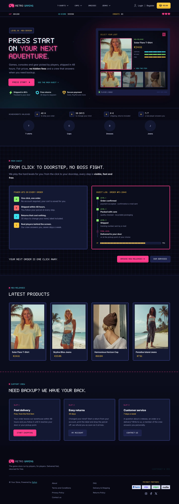
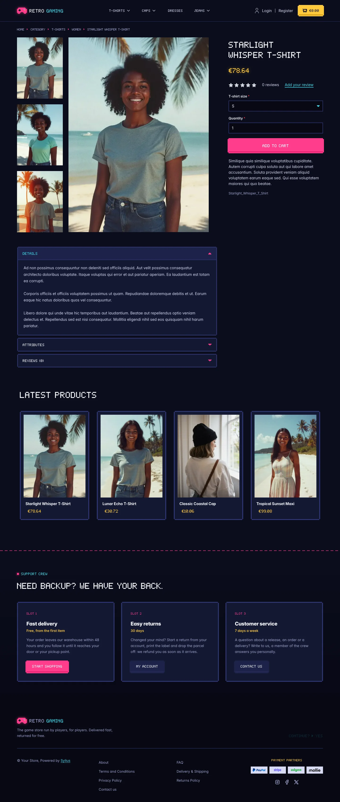
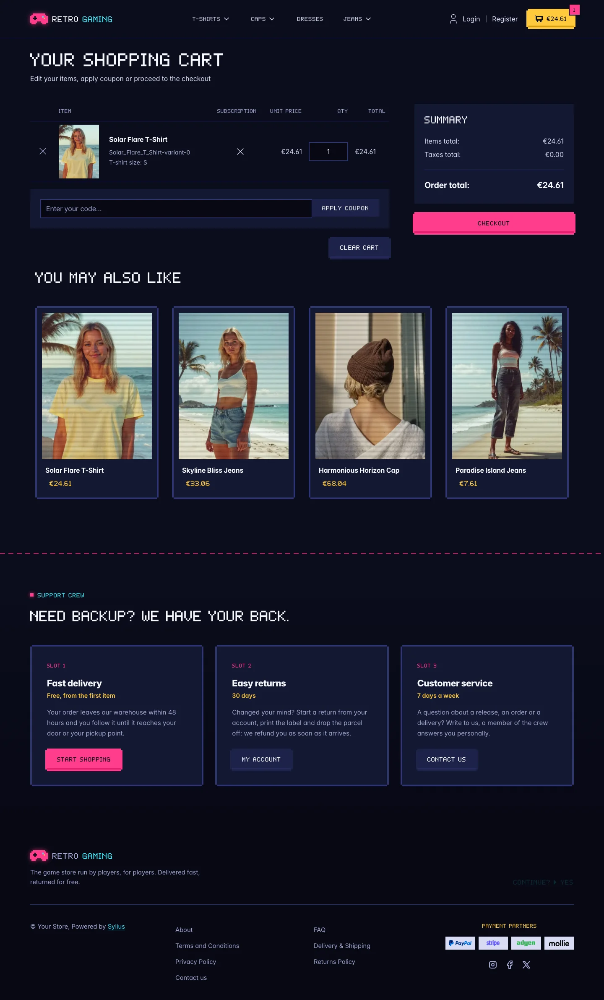
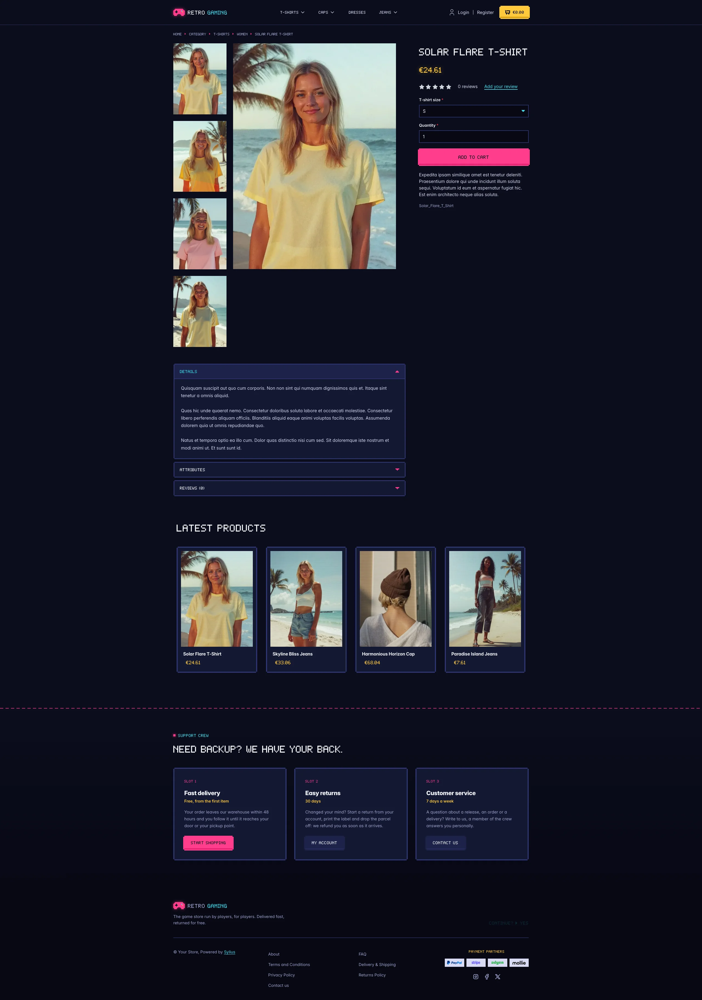
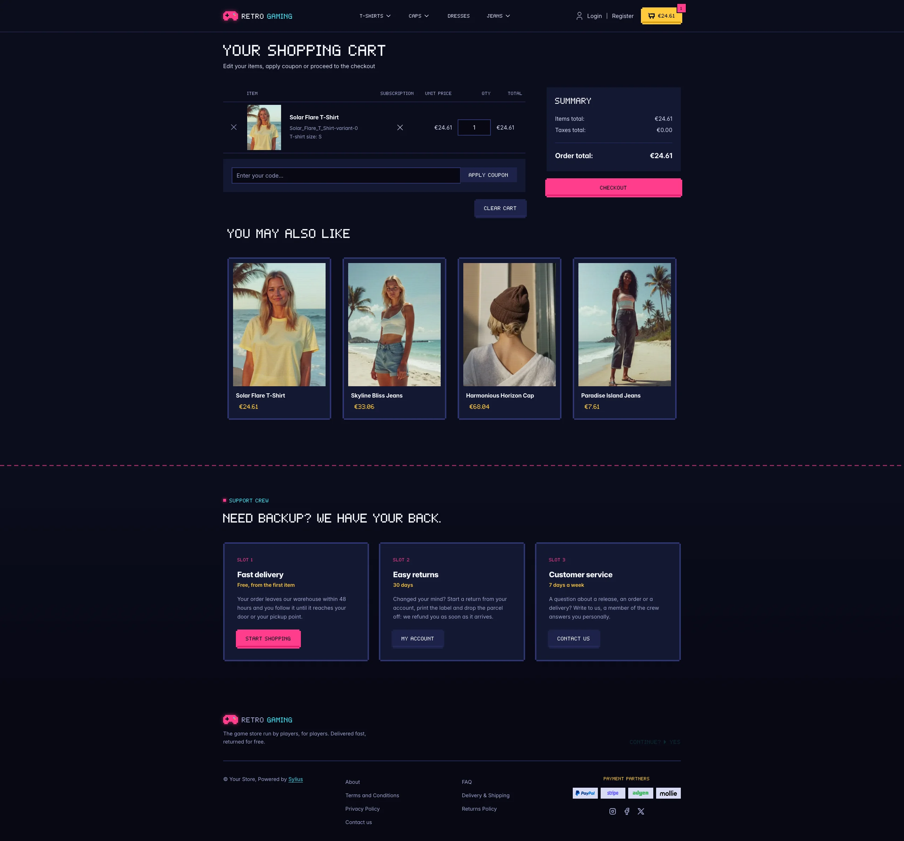

Retro Gaming turns the storefront into a night arcade: a dark console-blue shop lit by neon magenta
(player 1) and cyan (player 2), with coin gold for prices. Headings, labels, buttons and prices are
set in *Pixel Quest*, an original 5x7 bitmap font drawn for this theme (uppercase, digits and French
accents, 3 KB, shipped in `assets/shop/fonts/`); body copy stays in *Inter*, already shipped by the
Sylius shop, so that descriptions and forms remain easy to read.

**Desktop** (1440 px)

| Homepage | Product page | Cart |
|---|---|---|
|  |  |  |

**Wide screen** (2560 px)

| Homepage | Product page | Cart |
|---|---|---|
|  |  |  |

**Mobile** (390 px)

| Homepage | Product page | Cart |
|---|---|---|
|  |  |  |

- **Palette** — deep console blue (`#0B0D1C`, panels `#141833`), neon magenta (`#FF3D8B`), cyan
  (`#3BE2F0`), coin gold (`#FFC93C`) and health-bar lime (`#8CF26B`). The storefront is dark end to
  end: Bootstrap's runtime variables are remapped, so native Sylius components (tables, dropdowns,
  offcanvas, forms, checkout sidebar) follow the palette.
- **Components** — square arcade buttons with stepped "pixel" corners and a darker bottom edge that
  is pushed in on click (magenta for primary actions, console blue for secondary ones), a gold coin
  counter as cart button, product cards framed like cartridges that light up in cyan on hover, with
  scanlines over the picture and the price in gold (the whole card is clickable, on the homepage and
  on category pages alike), pixel breadcrumbs, square form fields with a cyan focus ring, and the
  checkout steps drawn as a level map.
- **Homepage** — a **title screen** hero: a HUD bar (score, hi-score, credits, lives), a pixel
  headline, a blinking *Press start* call to action and three power-ups (shipping, returns, payment)
  over a starfield and a neon grid floor. On the right, a CRT monitor runs a **"select your loot"**
  screen: the three latest products of the channel as character slots, the newest one picked by
  player 1 with its real image, name and price. An **achievements strip** follows (shipping delay,
  return period, fees, support). The promise block (`theme_promise` hookable) is the **main quest**:
  four power-ups mapped to gamepad buttons (A, B, X, Y) and the order as a **quest log**, level by
  level, with an XP bar, followed by two calls to action. Then come the four latest products; the
  deals and new collection blocks are hidden.
- **Footer** — the **support crew**: three save slots (delivery, returns, customer service, each with
  a tag, a description and a button to the storefront, the customer account and the contact page)
  above the footer with the wordmark, a blinking *Continue?* and the Sylius links.
- **Product page** — the price, in gold, sits directly below the product name, before reviews.
- **Checkout** — the checkout header uses the Retro Gaming wordmark and responsive category navigation.
- **Translations** — every theme-specific text lives in its own `retro_gaming` translation domain
  (`translations/retro_gaming.en.yaml` and `retro_gaming.fr.yaml`), so it can be edited or translated
  without touching the templates.
- **Accessibility** — readable Inter for long texts, dark text on the neon buttons, visible cyan
  focus rings, decorative HUD and stats hidden from assistive technologies, and no blinking or motion
  for visitors who prefer reduced motion.

Install it with:

```bash
castor sylius:theme:setup retro_gaming
```
