Retro Gaming turns the storefront into a night arcade: a dark console-blue shop lit by neon magenta
(player 1) and cyan (player 2), with coin gold for prices. Headings, labels, buttons and prices are
set in *Pixel Quest*, an original 5x7 bitmap font drawn for this theme (uppercase, digits and French
accents, 3 KB, shipped in `assets/shop/fonts/`); body copy stays in *Inter*, already shipped by the
Sylius shop, so that descriptions and forms remain easy to read.

**Desktop** (1440 px)

| Scheme | Homepage | Product page | Cart |
|---|---|---|---|
| Light | 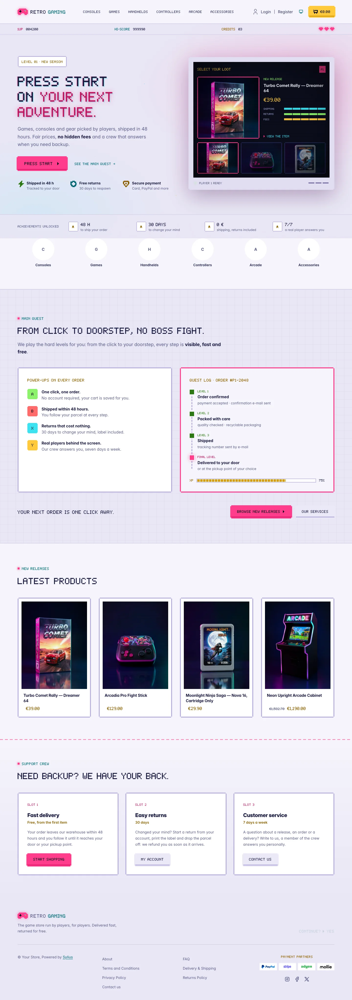 | 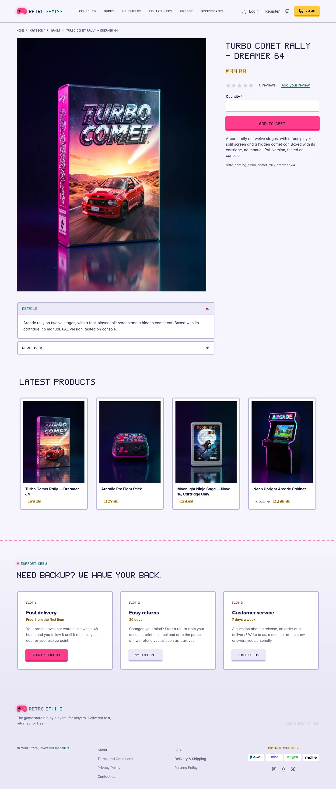 | 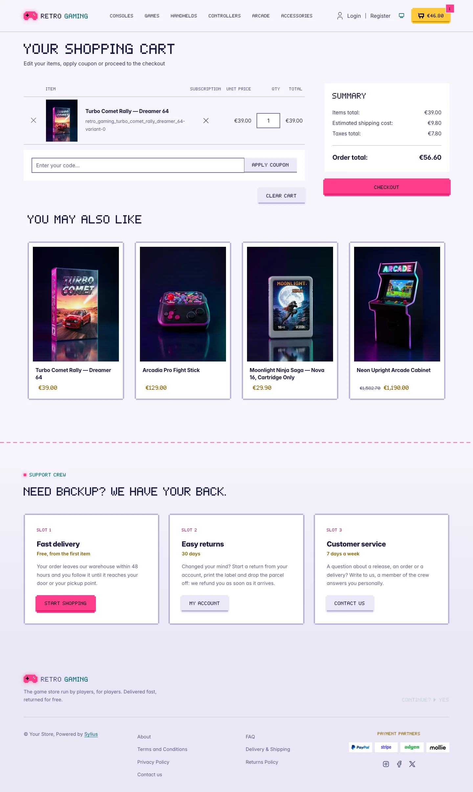 |
| Dark | 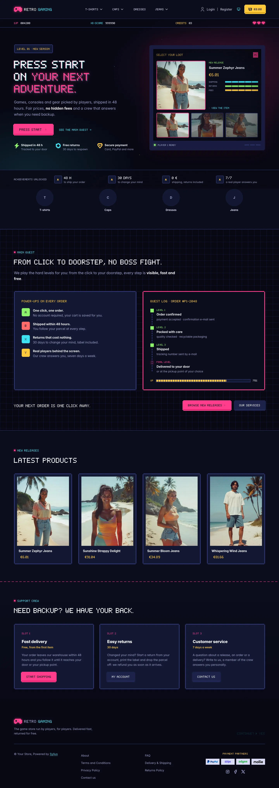 | 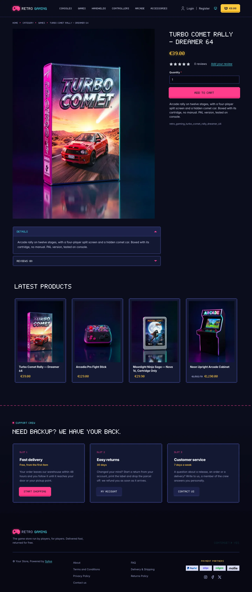 | 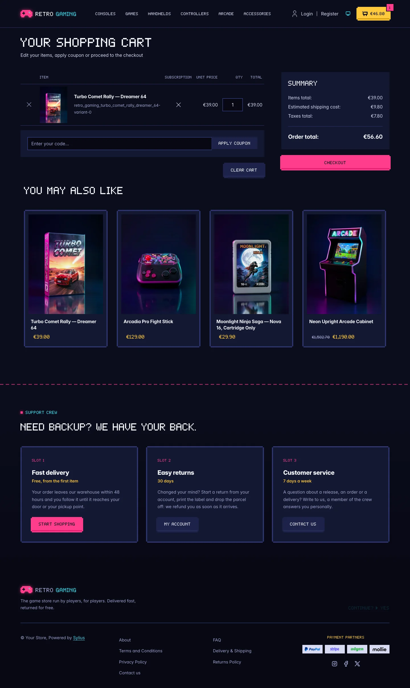 |

**Wide screen** (2560 px)

| Scheme | Homepage | Product page | Cart |
|---|---|---|---|
| Light | 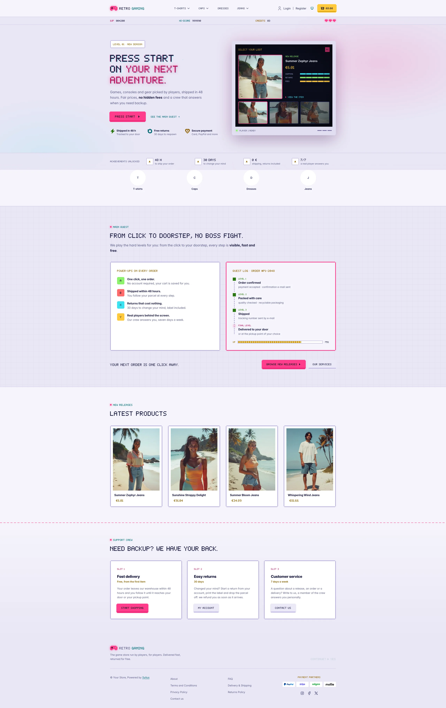 | 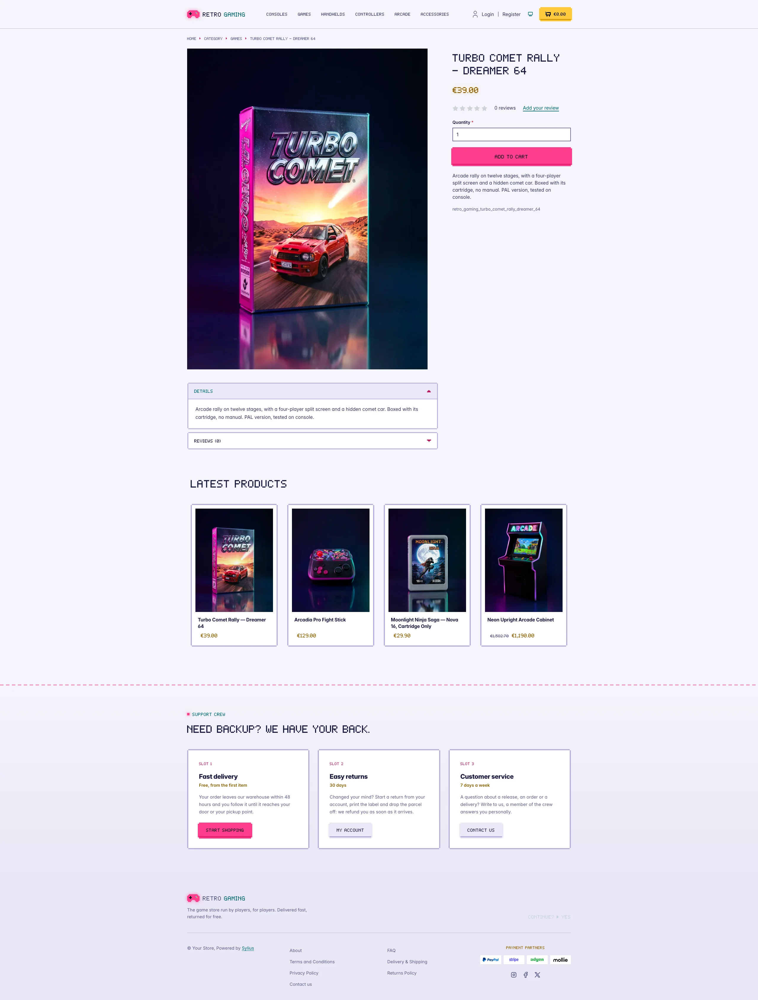 | 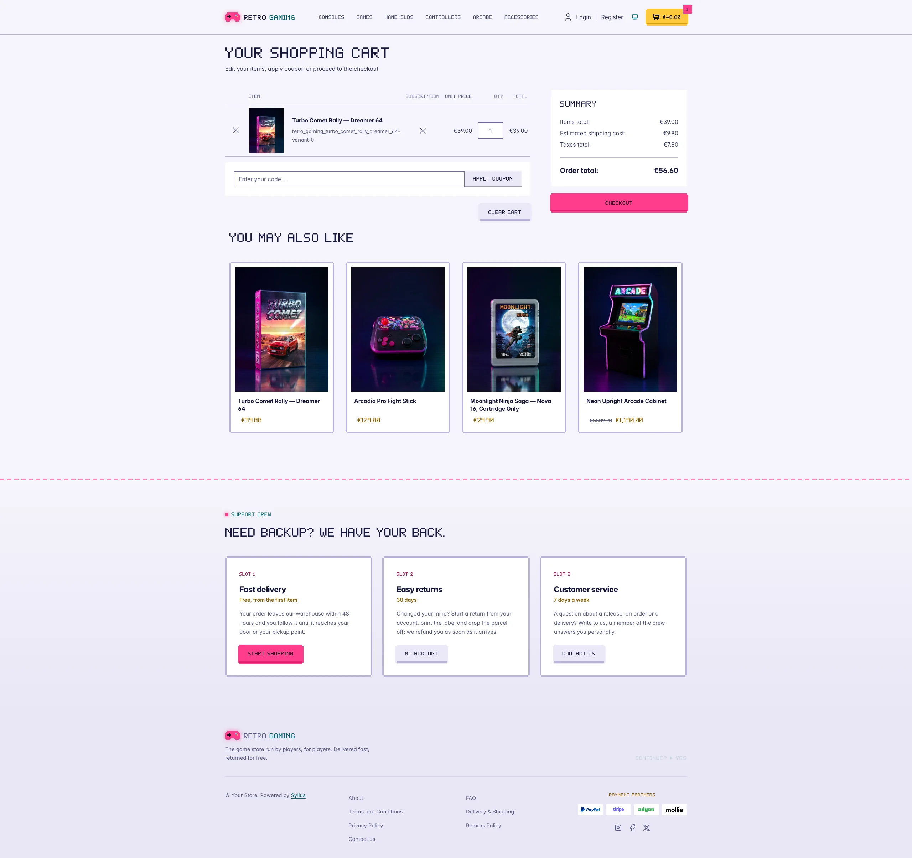 |
| Dark | 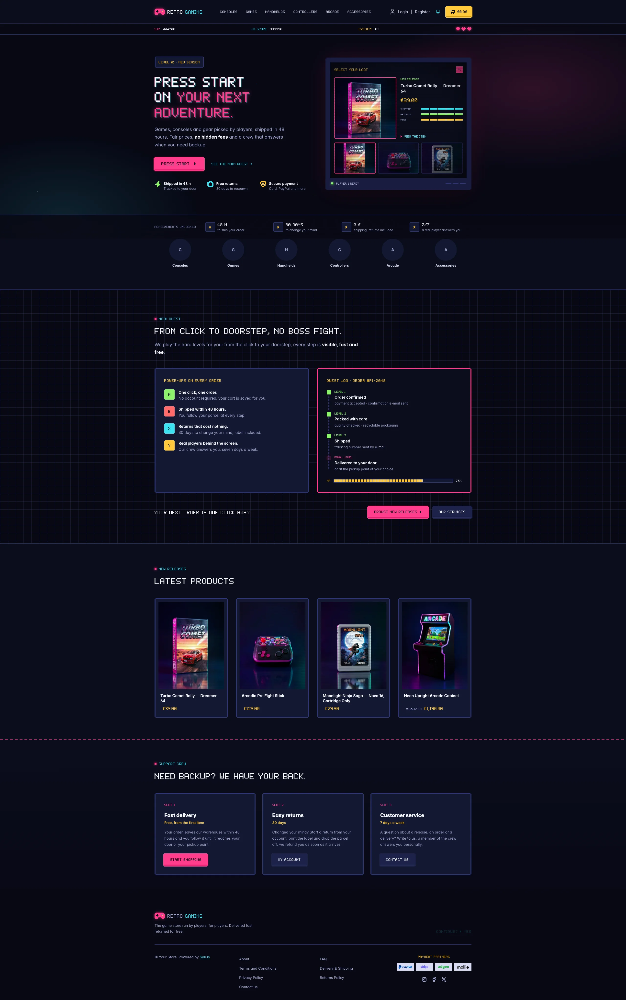 | 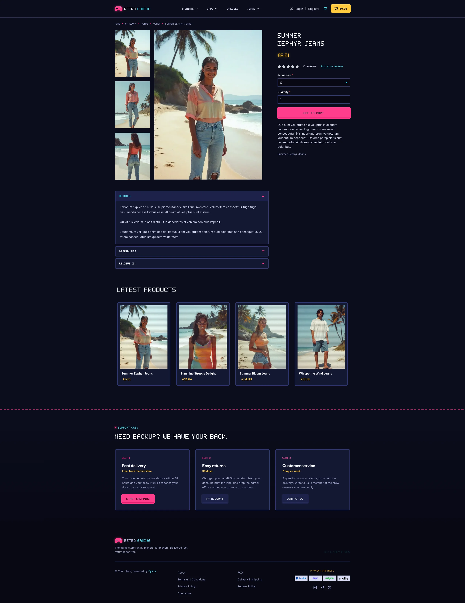 | 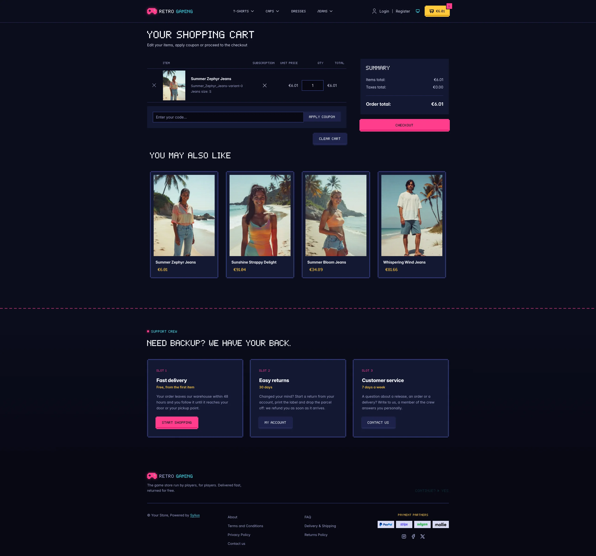 |

**Mobile** (390 px)

| Scheme | Homepage | Product page | Cart |
|---|---|---|---|
| Light |  |  |  |
| Dark |  |  |  |

- **Palette** — deep console blue (`#0B0D1C`, panels `#141833`), neon magenta (`#FF3D8B`), cyan
  (`#3BE2F0`), coin gold (`#FFC93C`) and health-bar lime (`#8CF26B`). The storefront is dark end to
  end: Bootstrap's runtime variables are remapped, so native Sylius components (tables, dropdowns,
  offcanvas, forms, checkout sidebar) follow the palette.
- **Light scheme** — a daylight arcade, like a handheld console: lilac console-plastic shell
  (`#E9E6F5`) around a pale page, navy ink type, the neon colours kept as fills under ink text and
  deep shades of the same hues for text and icons (magenta `#C0135C`, cyan `#006570`); the CRT
  screen of the hero stays dark inside a light bezel.
- **Components** — square arcade buttons with stepped "pixel" corners and a darker bottom edge that
  is pushed in on click (magenta for primary actions, console blue for secondary ones), a gold coin
  counter as cart button, product cards framed like cartridges that light up in cyan on hover, with
  scanlines over the picture and the price in gold (the whole card is clickable, on the homepage and
  on category pages alike), pixel breadcrumbs, square form fields with a cyan focus ring, and the
  checkout steps drawn as a level map.
- **Homepage** — a **title screen** hero: a HUD bar (score, hi-score, credits, lives), a pixel
  headline, a blinking *Press start* call to action and three power-ups (shipping, returns, payment)
  over a starfield and a neon grid floor. On the right, a CRT monitor runs a **"select your loot"**
  screen: the three latest products of the channel as character slots, the newest one picked by
  player 1 with its real image, name and price. An **achievements strip** follows (shipping delay,
  return period, fees, support). The promise block (`theme_promise` hookable) is the **main quest**:
  four power-ups mapped to gamepad buttons (A, B, X, Y) and the order as a **quest log**, level by
  level, with an XP bar, followed by two calls to action. Then come the four latest products; the
  deals and new collection blocks are hidden.
- **Footer** — the **support crew**: three save slots (delivery, returns, customer service, each with
  a tag, a description and a button to the storefront, the customer account and the contact page)
  above the footer with the wordmark, a blinking *Continue?* and the Sylius links.
- **Product page** — the price, in gold, sits directly below the product name, before reviews.
- **Checkout** — the checkout header uses the Retro Gaming wordmark and responsive category navigation.
- **Translations** — every theme-specific text lives in its own `retro_gaming` translation domain
  (`translations/retro_gaming.en.yaml` and `retro_gaming.fr.yaml`), so it can be edited or translated
  without touching the templates.
- **Accessibility** — readable Inter for long texts, dark text on the neon buttons, visible cyan
  focus rings, decorative HUD and stats hidden from assistive technologies, and no blinking or motion
  for visitors who prefer reduced motion.

## Demo catalog

The screenshots above show a demo catalog of sixteen retro consoles, games, handhelds, controllers and arcade parts
from fictional brands, on six shelves (Consoles, Games, Handhelds, Controllers, Arcade, Accessories), shipped as the
`retro-gaming` dataset of `sylius-starter/datasets` (`src/Datasets/datasets/retro-gaming/`: `products.yaml`,
`collections.yaml`, and in `media/` a photo of each item generated with Ollama, under the magenta and cyan neon lights
of the theme on a console-blue backdrop). Descriptions carry what a retro collector looks for: condition and grading,
region, what is in the box and the refurbishing done. Create a shop from it with the
[import package](../import/datasets.md), into the default channel:

```bash
castor sylius:import:shop:create retro-gaming
castor sylius:import:fixtures:generate --project=retro-gaming --subdomain=""
castor sylius:import:fixtures:load --project=retro-gaming
```

No AI call is made: `products.yaml` points at the photos of the dataset `media/`. The shop menu then lists the six
shelves; `castor sylius:import:delete retro-gaming` removes the catalog. The import keeps the products already in the
channel and gives the items creation dates in the past, so on a store loaded with the default fixtures the latest
products may still show clothing: run `castor app:db:fixtures app` first to start from a store without products.

Install it with:

```bash
castor sylius:theme:setup retro_gaming
```
