Roastery is built for specialty coffee roasters selling beans, blends and brewing gear: an
editorial storefront in espresso brown and kraft-cream paper, set with the soft, high-contrast
Fraunces serif and struck with copper fillets, like a stamped coffee bag. It shares Cellar's
premium positioning with a warmer personality: the drum roaster, origins, roast levels and
roast curves are part of the page.

**Desktop** (1440 px)

| Scheme | Homepage | Product page | Cart |
|---|---|---|---|
| Light | 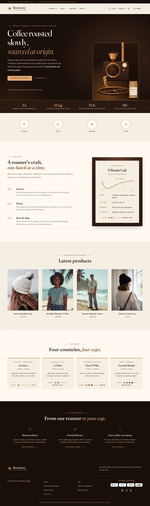 | 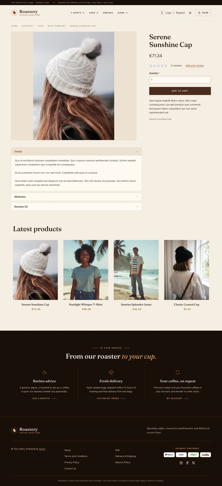 | 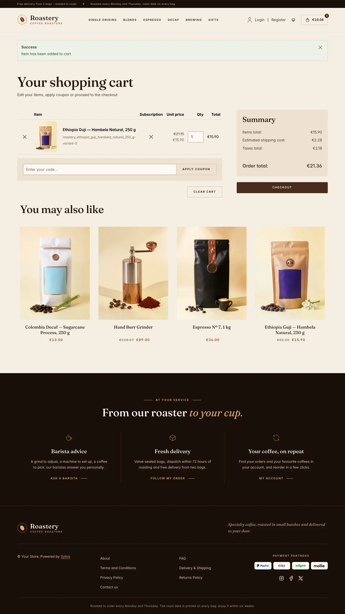 |
| Dark | 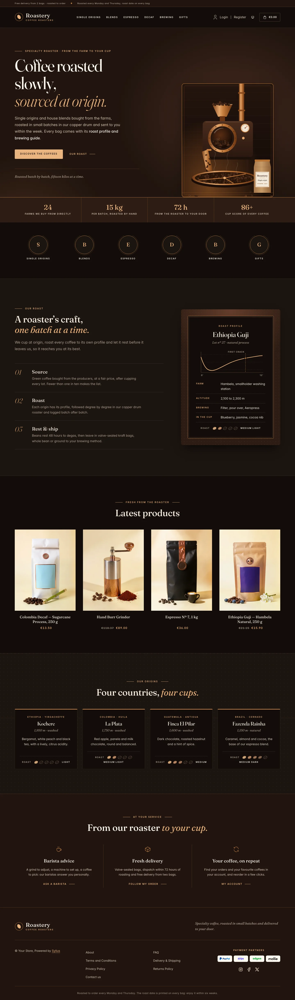 | 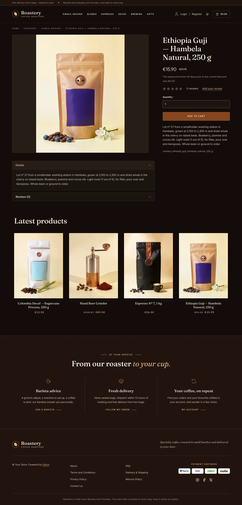 | 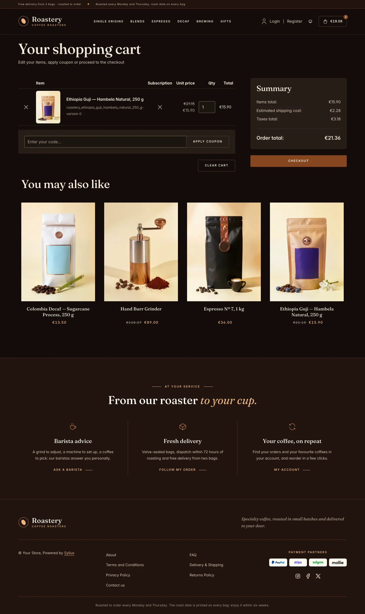 |

**Wide screen** (2560 px)

| Scheme | Homepage | Product page | Cart |
|---|---|---|---|
| Light | 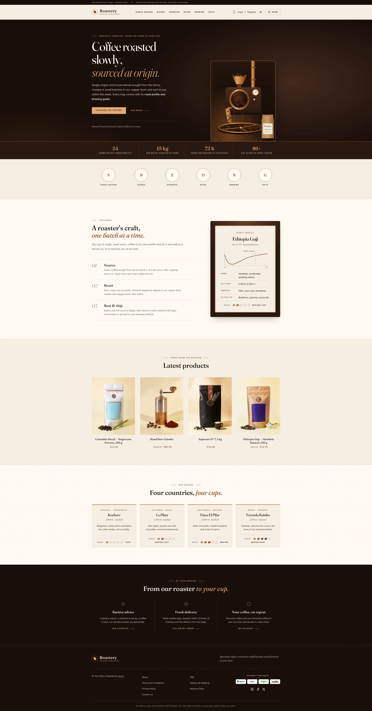 | 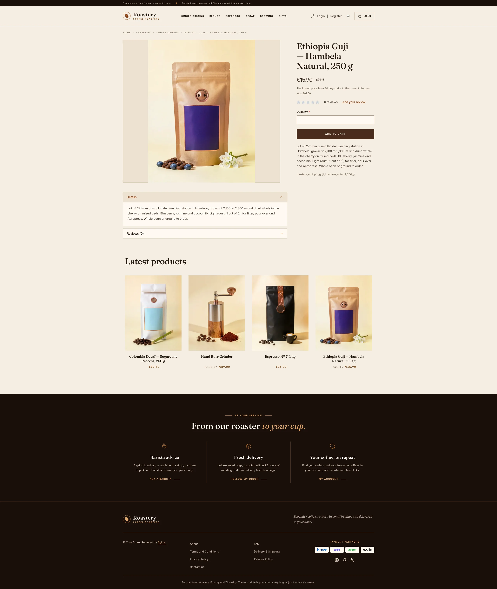 | 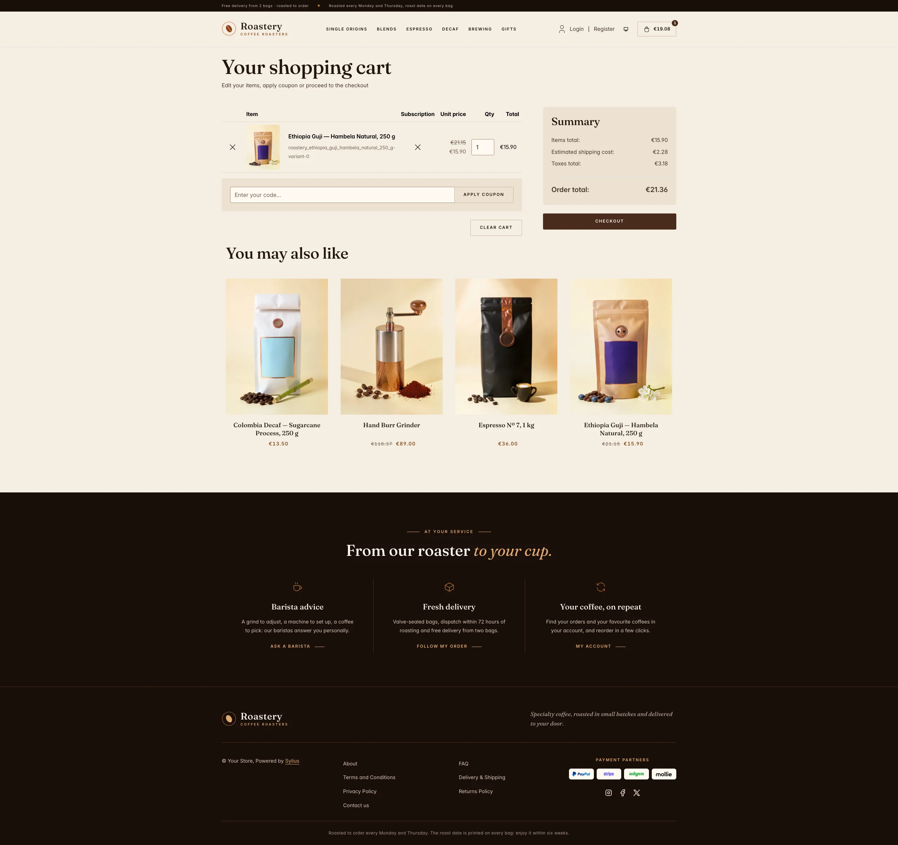 |
| Dark | 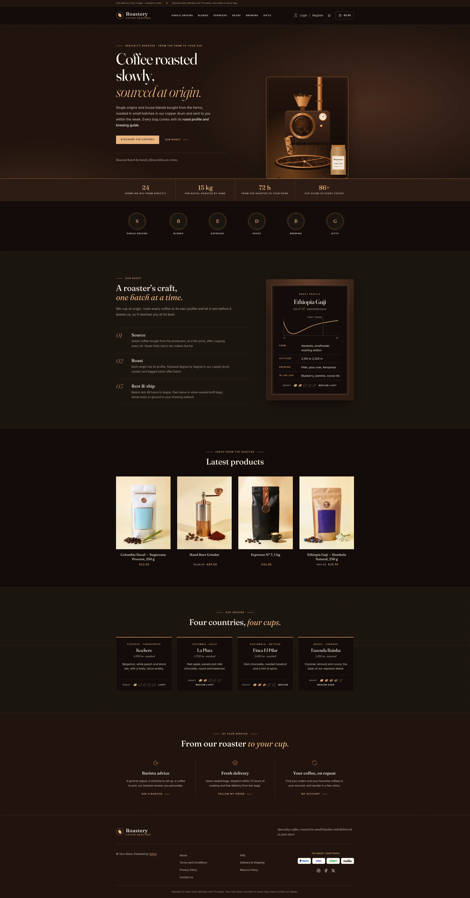 | 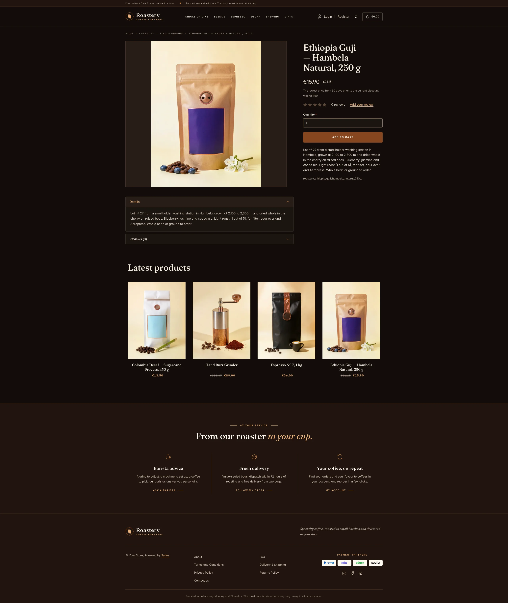 | 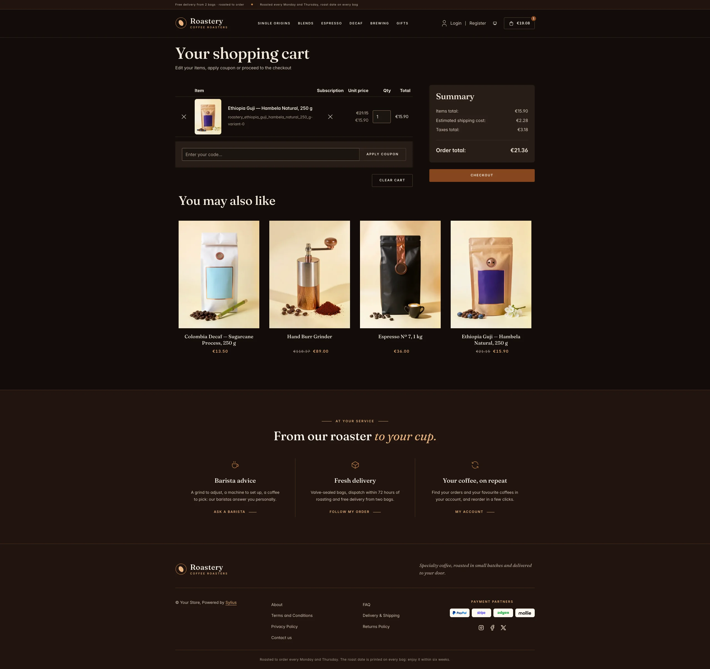 |

**Mobile** (390 px)

| Scheme | Homepage | Product page | Cart |
|---|---|---|---|
| Light |  |  |  |
| Dark |  |  |  |

- **Palette** — espresso (`#1A0F0A`, `#2A1911`), roast brown (`#4A2C1D`) and mocha (`#6E4330`) on
  kraft-cream paper (`#F5EEE3`) and cream (`#FFFAF2`), with copper (`#B87333`, `#E3AA72`) for fillets,
  numerals and accents, and a burnt sienna (`#8A4219`) for accent text.
- **Dark scheme** — the roasting room after hours: charred-oak black (page `#120D0A`, surfaces `#1B1410`),
  cream type, a roasted copper (`#85461F`) for buttons and a pale caramel (`#EBB27D`) for accent text, a
  brighter copper and copper hairlines on the espresso bands.
- **Typography** — *Fraunces* (SIL Open Font License, variable weight and optical size, roman and italic,
  shipped in `assets/shop/fonts/`) for headings, product names and figures, set at its display optical
  size in the hero, with light copper italics; *Inter* (already shipped by the Sylius shop) for body copy,
  and spaced uppercase small capitals for eyebrows, navigation, buttons and breadcrumbs.
- **Components** — espresso buttons with spaced capitals (copper on the dark panels), product cards on a
  cream niche with a copper fillet on hover, an outlined cart button with an espresso counter, and a
  **roast level scale**: five beans darkening from a cinnamon light roast to an espresso dark roast.
- **Header** — an espresso top bar with the delivery and roasting days, then a coffee bean seal and the
  *Roastery* wordmark, centered category navigation underlined in copper.
- **Homepage** — an espresso hero: an eyebrow ruled in copper, a Fraunces headline ending in copper
  italic, two calls to action and a signature line. On the right, the **roasting room**: a copper drum
  roaster (hopper of green beans, sight glass full of tumbling beans, thermometer, chimney) pouring into
  its cooling tray, next to a kraft bag of single origin, in a panel with a copper double fillet. A band
  of **house figures** (partner farms, batch size, delivery time, cup score) closes the hero. The promise
  block (`theme_promise` hookable) presents the craft in three numbered batches (source, roast, rest &
  ship), next to a **roast profile card** printed like a bag label (roast curve with the first crack,
  farm, altitude, brewing, cup notes and roast level). After the four latest products, the **origins**
  block (`theme_origins` hookable) shows four single origins on a dotted coffee-belt map, each with its
  region, altitude, process, cup and roast level. The deals and new collection blocks are hidden.
- **Footer** — espresso, with three **house services** (barista advice, fresh delivery, your coffee on
  repeat) linking to the contact page and the customer account, the wordmark, the Sylius links and the
  roast date notice.
- **Checkout** — the checkout header uses the Roastery wordmark and responsive category navigation, the
  current step is ruled in copper.
- **Translations** — every Roastery-specific text lives in its own `roastery` translation domain
  (`translations/roastery.en.yaml` and `roastery.fr.yaml`).
- **Accessibility** — visible copper focus rings, text alternatives for the hero illustration, the roast
  curve and the roast levels, and no motion for visitors who prefer reduced motion.

## Demo catalog

The screenshots above show a demo catalog of sixteen specialty coffees and brewing tools from a fictional roaster, on
six shelves (Single Origins, Blends, Espresso, Decaf, Brewing, Gifts), shipped as the `roastery` dataset of
`sylius-starter/datasets` (`src/Datasets/datasets/roastery/`: `products.yaml`, `collections.yaml`, and in `media/` a
photo of each item generated with Ollama, on the cream paper and copper of the theme). The single origins are the ones
of the homepage (Ethiopia Guji and Yirgacheffe, Colombia Huila, Guatemala Antigua, Brazil Cerrado), and descriptions
carry what a coffee lover looks for: farm, altitude, process, cup notes, roast level out of five and brewing advice.
Create a shop from it with the [import package](../import/datasets.md), into the default channel:

```bash
castor sylius:import:shop:create roastery
castor sylius:import:fixtures:generate --project=roastery --subdomain=""
castor sylius:import:fixtures:load --project=roastery
```

No AI call is made: `products.yaml` points at the photos of the dataset `media/`. The shop menu then lists the six
shelves; `castor sylius:import:delete roastery` removes the catalog. The import keeps the products already in the
channel and gives the items creation dates in the past, so on a store loaded with the default fixtures the latest
products may still show clothing: run `castor app:db:fixtures app` first to start from a store without products.

Install it with:

```bash
castor sylius:theme:setup roastery
```
