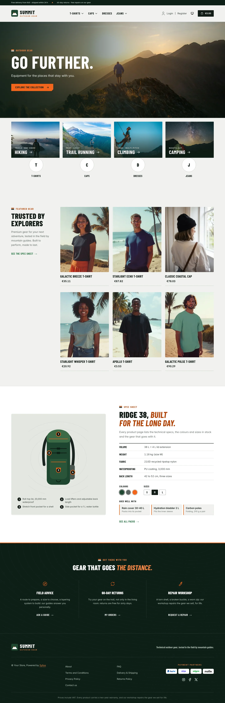
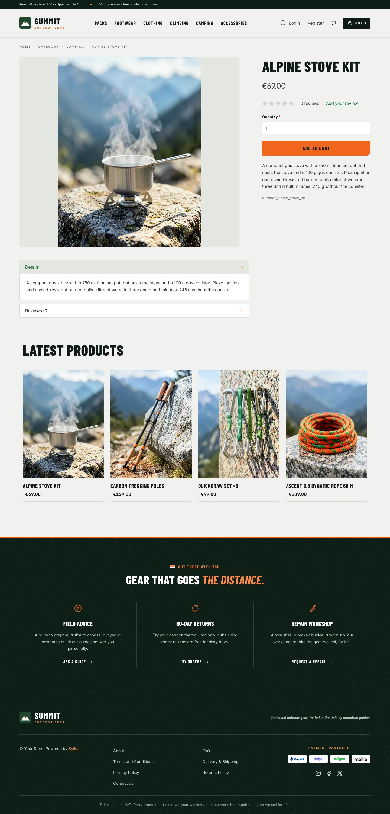
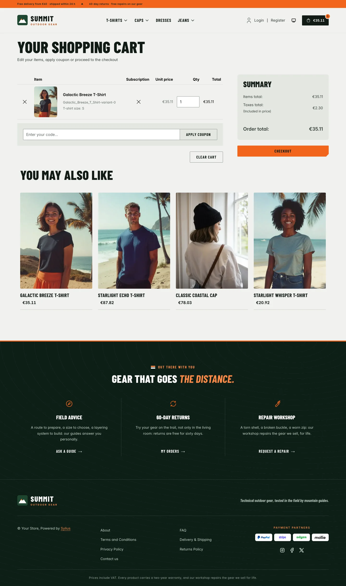
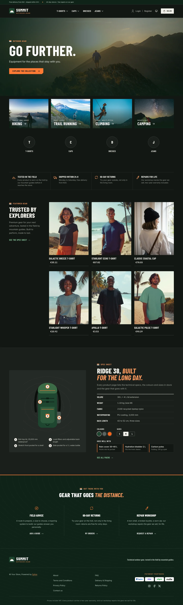
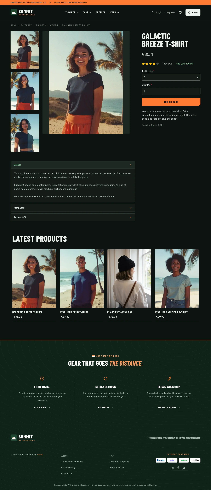
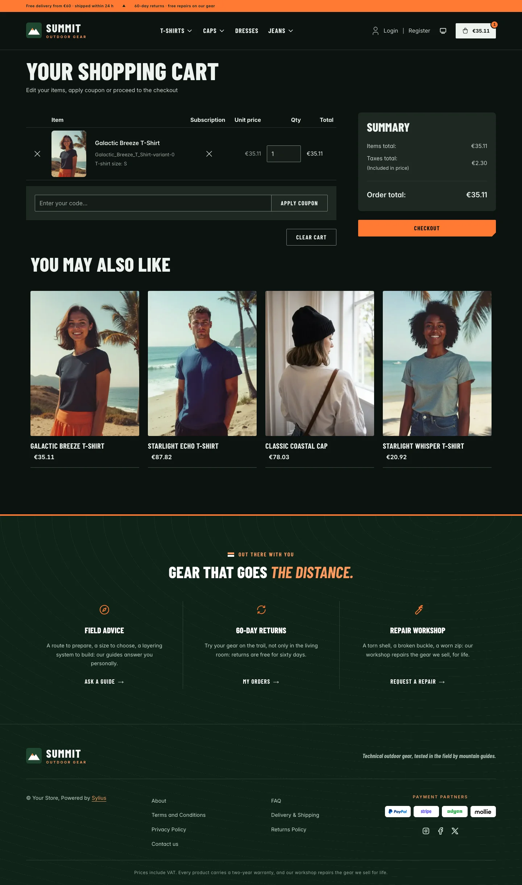
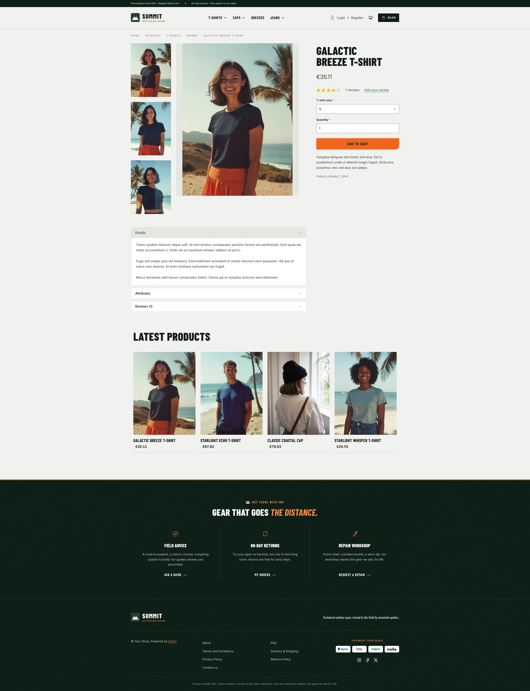
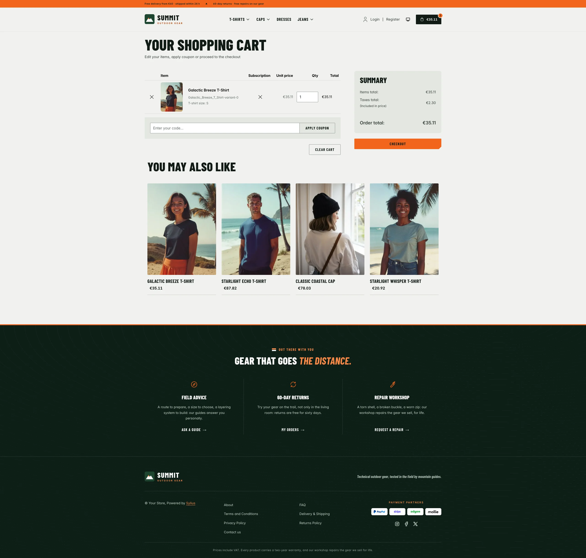
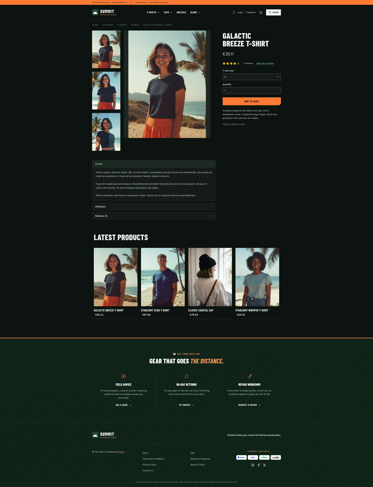
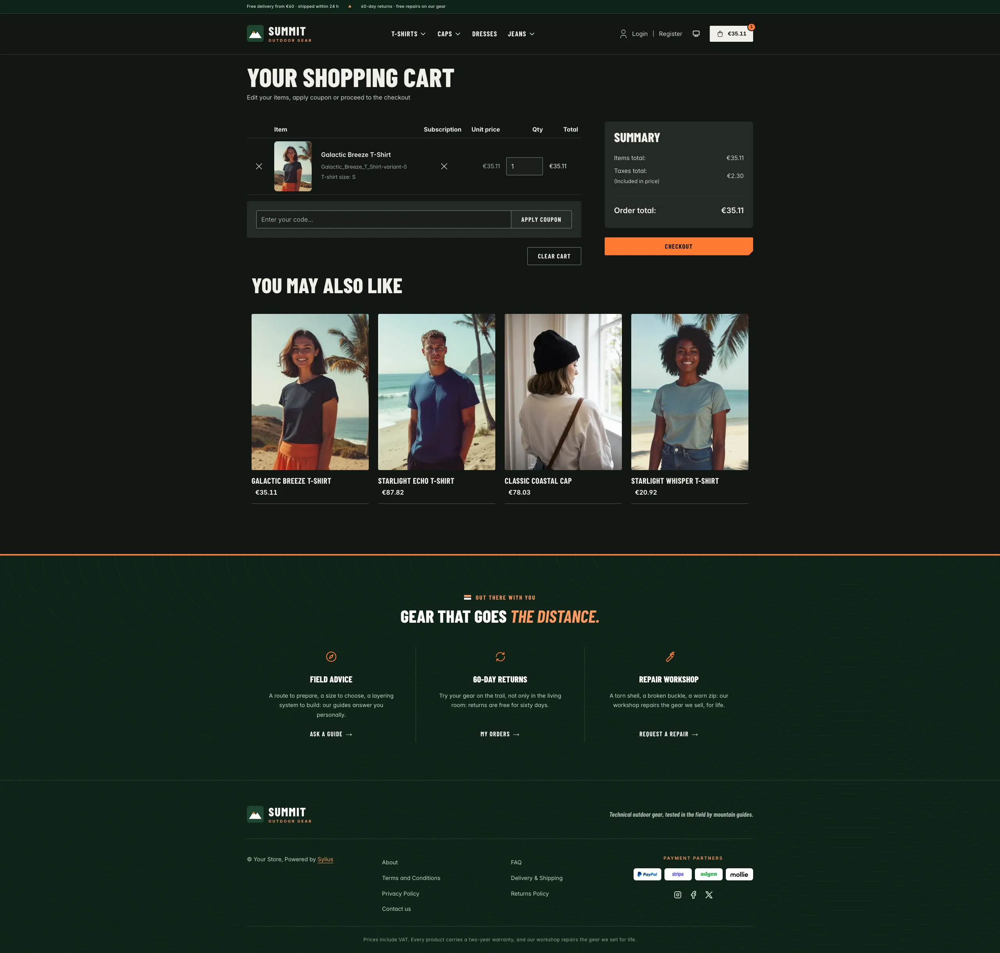

Summit is built for outdoor and adventure shops selling hiking, trail and mountaineering gear: packs,
technical clothing, footwear and accessories. Where Cellar is quiet and warm, Summit is photographic and
editorial: full-bleed mountain photography, condensed capitals like trailhead signs, forest green and mineral
grey, and signal orange kept as an accent. Its homepage puts forward what Sylius does well for gear:
navigation by activity, technical attributes, variants (colours and sizes) and associated products.

**Desktop** (1440 px)

| Scheme | Homepage | Product page | Cart |
|---|---|---|---|
| Light |  |  |  |
| Dark |  |  |  |

**Wide screen** (2560 px)

| Scheme | Homepage | Product page | Cart |
|---|---|---|---|
| Light |  |  |  |
| Dark |  |  |  |

**Mobile** (390 px)

| Scheme | Homepage | Product page | Cart |
|---|---|---|---|
| Light |  |  |  |
| Dark |  |  |  |

- **Palette** — forest (`#0E1F16`, `#1F4630`) and moss (`#3C6B47`) on mineral grey (`#F1F2EF`, `#E4E7E2`) and
  white, with signal orange (`#F2661C`) as an accent: the main call to action (ink text on it, 6.2:1), rules,
  arrows and hovers; a darker orange (`#B4440B`) for orange text and focus rings, a deep green (`#1F6A3A`) for links.
- **Dark scheme** — an outdoor store at dusk: dark pine and slate (page `#121613`, surfaces `#1A1F1B`), warm
  mineral type, a brighter signal orange (`#FF7A33`) and lichen-green links (`#8FD6A3`); the photographs stay
  the same, under a deeper shade.
- **Typography** — *Barlow Condensed* (SIL Open Font License, 600, 700, 800 and 700 italic, shipped in
  `assets/shop/fonts/`) in capitals for headings, product names, figures, buttons and navigation, with
  orange italic accents; *Inter* (already shipped by the Sylius shop) for body copy.
- **Components** — signal orange buttons with a cut corner like a trail tag, outlined ink buttons that fill on
  hover; product cards with the photo edge to edge, a zoom and an orange corner tag on hover, an orange rule
  under the card, the name in condensed capitals and the price in bold; an ink cart button with an orange
  counter; eyebrows opened by a trail blaze (the two painted bars that mark a hiking path).
- **Header** — a forest top bar with the delivery and returns promises and the locale / currency switchers,
  then a peak badge and the *Summit* wordmark, and category navigation in condensed
  capitals over a thick orange bar.
- **Homepage** — a full-bleed **photograph** (a hiker on a ridge at sunset), shaded on the copy side: an
  eyebrow, a condensed headline, a short lead and one orange call to action. Right under it, **shop by
  activity** (`theme_activities` hookable): four large photo tiles (hiking, trail running, climbing, camping),
  each with its terrain, its name in capitals, an arrow and an orange rule on hover. The promise block
  (`theme_promise` hookable) lines up four commitments (field-tested, 24 h dispatch, 60-day returns, repairs
  for life) in a light band. Then the **featured gear**:
  an editorial intro next to the six latest products, and the **gear spotlight** (`theme_gear` hookable): a
  technical backpack with numbered call-outs, its spec sheet, its colours and sizes, and the gear that goes
  with it. The deals and new collection blocks are hidden.
- **Footer** — forest, drawn with contour lines under an orange rule, with three house services (field
  advice, 60-day returns, repair workshop) linking to the contact page and the customer account, the
  wordmark, the Sylius links and the warranty notice.
- **Product page** — the main picture stands whole on a mineral grey tile; the attributes table reads like a
  spec sheet, with condensed labels and zebra rows; the price sits directly below the product name.
- **Checkout** — the checkout header uses the Summit wordmark and responsive category navigation, the current
  step is ruled in orange.
- **Translations** — every Summit-specific text lives in its own `summit` translation domain
  (`translations/summit.en.yaml` and `summit.fr.yaml`).
- **Accessibility** — orange focus rings dark enough for 3:1, ink text on the orange buttons, a shaded copy
  side on the hero photograph and a shaded foot on the activity tiles, text alternatives for the backpack illustration and the colour
  swatches, and no motion for visitors who prefer reduced motion.

The activity tiles and the gear spotlight link to the latest products: point them at your activity taxons
and a real product in `templates/shop/homepage/activities.html.twig` and `gear.html.twig`. A hero image
contributed through the core hero slot replaces the default photograph.

Photographs from [Unsplash](https://unsplash.com/license) (Unsplash License), shipped in `assets/shop/images/`:
hero by Adrià Sánchez Roqué, hiking by Alex Gruber, trail running by Brian Erickson, climbing by Patrick Hendry,
camping by Frank Zinsli.

## Demo catalog

The screenshots above show a demo catalog of eighteen pieces of fictional outdoor gear in six categories (Packs,
Footwear, Clothing, Climbing, Camping, Accessories), shipped as the `outdoor` dataset of `sylius-starter/datasets`
(`src/Datasets/datasets/outdoor/`: `products.yaml`, `collections.yaml`, and in `media/` a 3:4 photograph of each
product out in the mountains, generated with Ollama). Descriptions carry what a hiker or a climber looks for: weight,
capacity, materials, sizes and certifications. The dataset names no activity of the theme, so it suits any outdoor
or mountain sports store. Create a shop from it with the [import package](../import/datasets.md), into the default
channel:

```bash
castor sylius:import:shop:create outdoor
castor sylius:import:fixtures:generate --project=outdoor --subdomain=""
castor sylius:import:fixtures:load --project=outdoor
```

No AI call is made: `products.yaml` points at the photographs of the dataset `media/`. The shop menu then lists the
six categories; `castor sylius:import:delete outdoor` removes the catalog. The import keeps the products already in
the channel and gives the gear creation dates in the past, so on a store loaded with the default fixtures the latest
products may still show clothing: run `castor app:db:fixtures app` first to start from a store without products.

Install it with:

```bash
castor sylius:theme:setup summit
```
