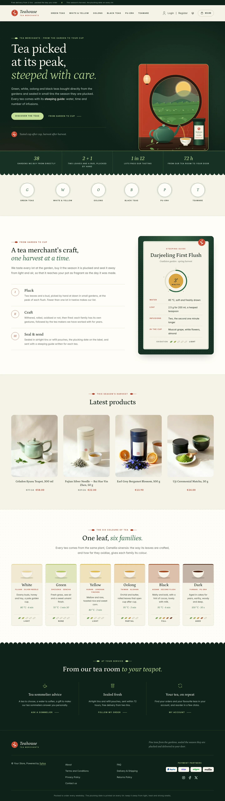
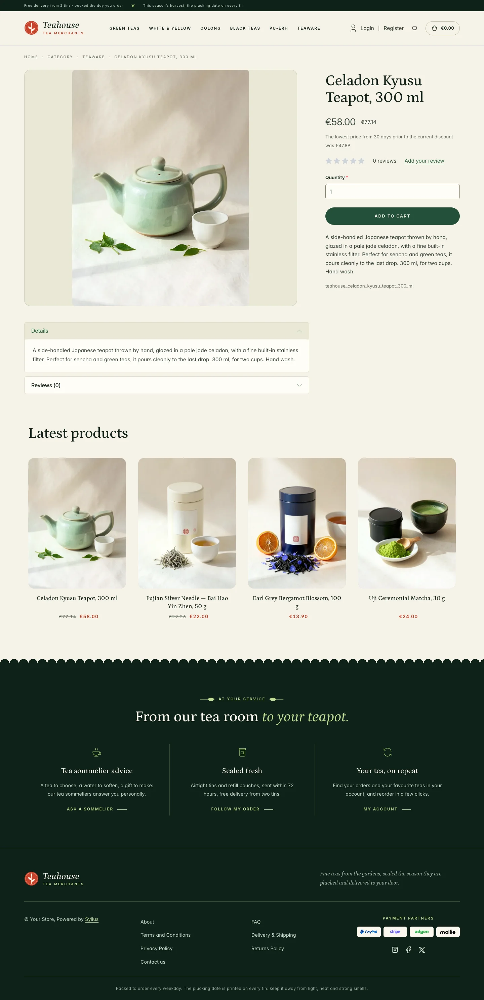
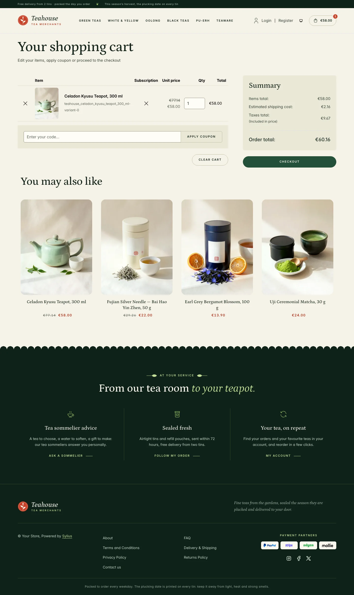
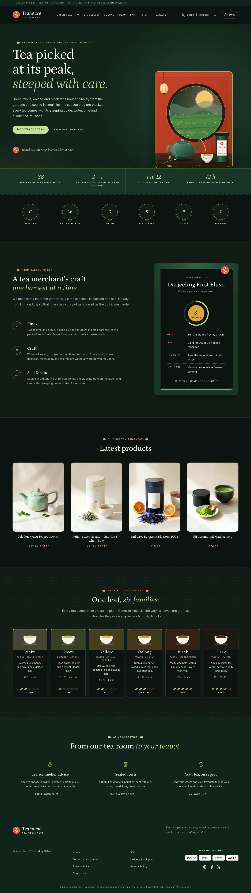
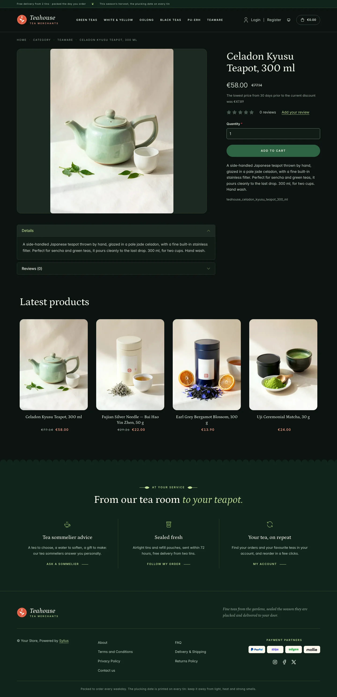
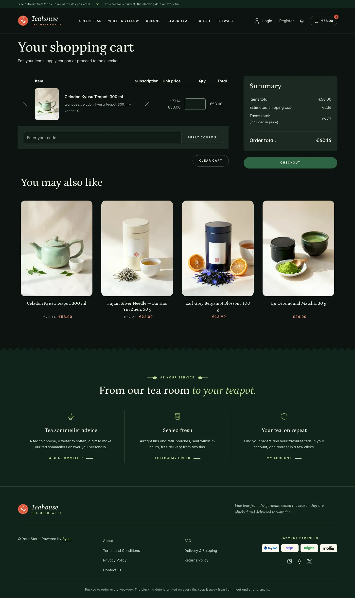
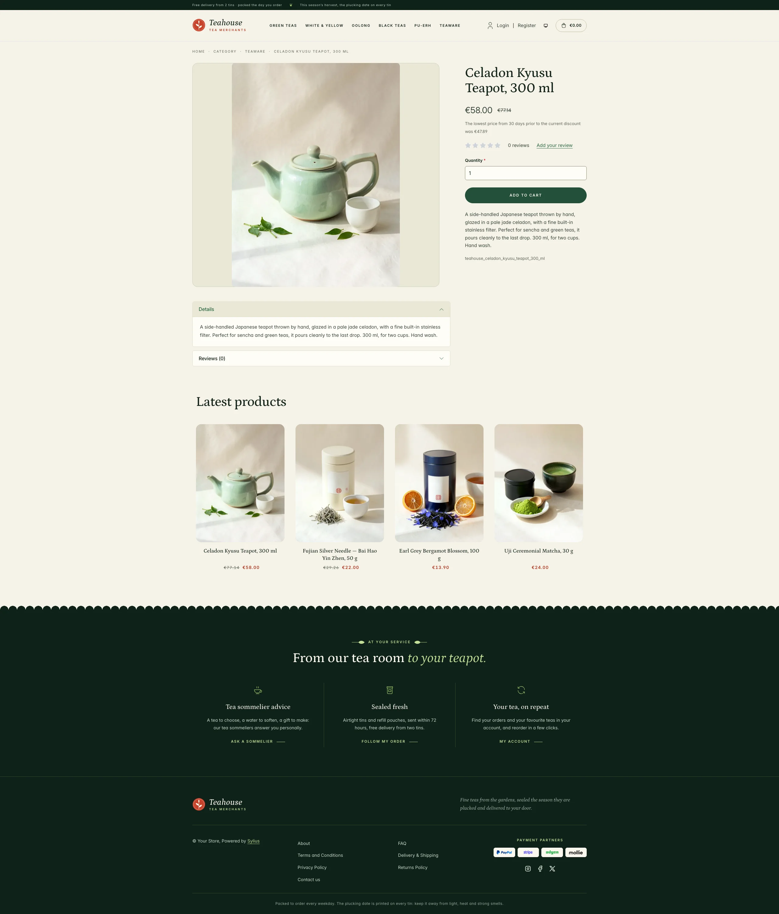
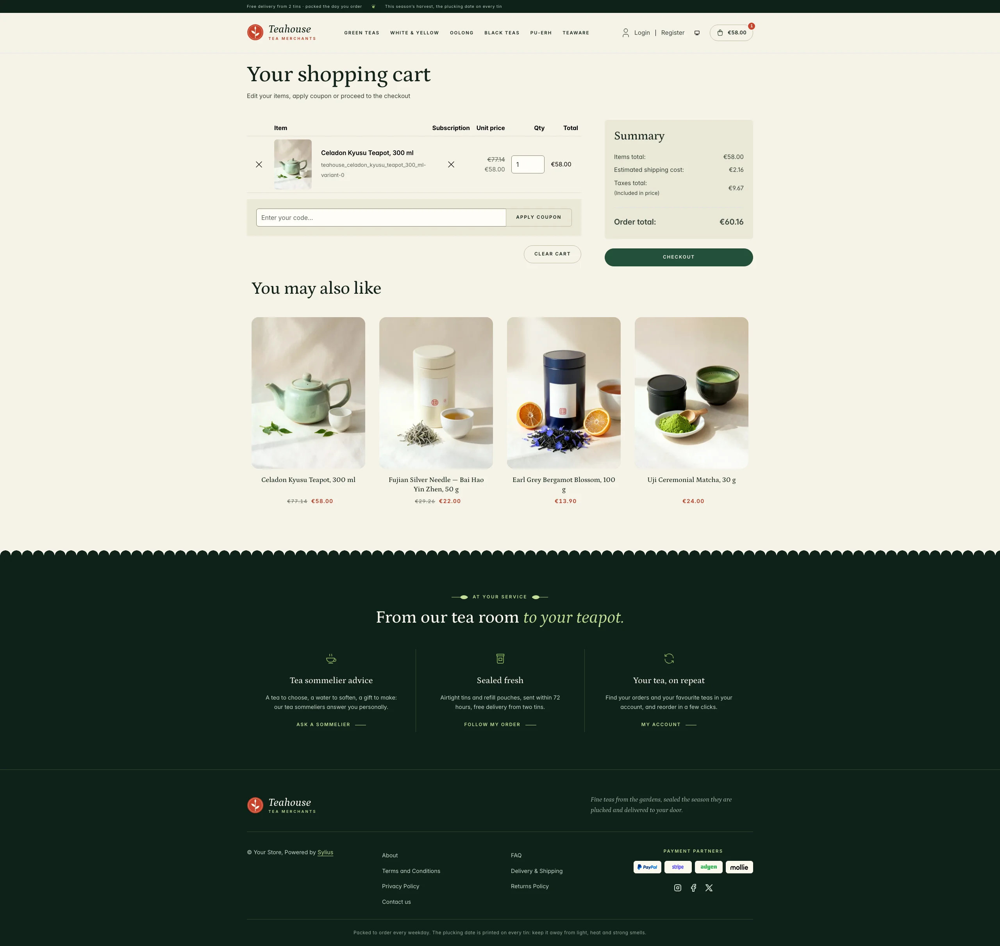
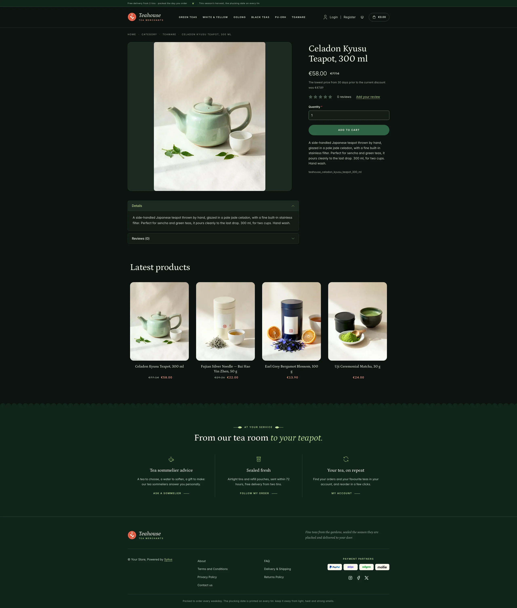
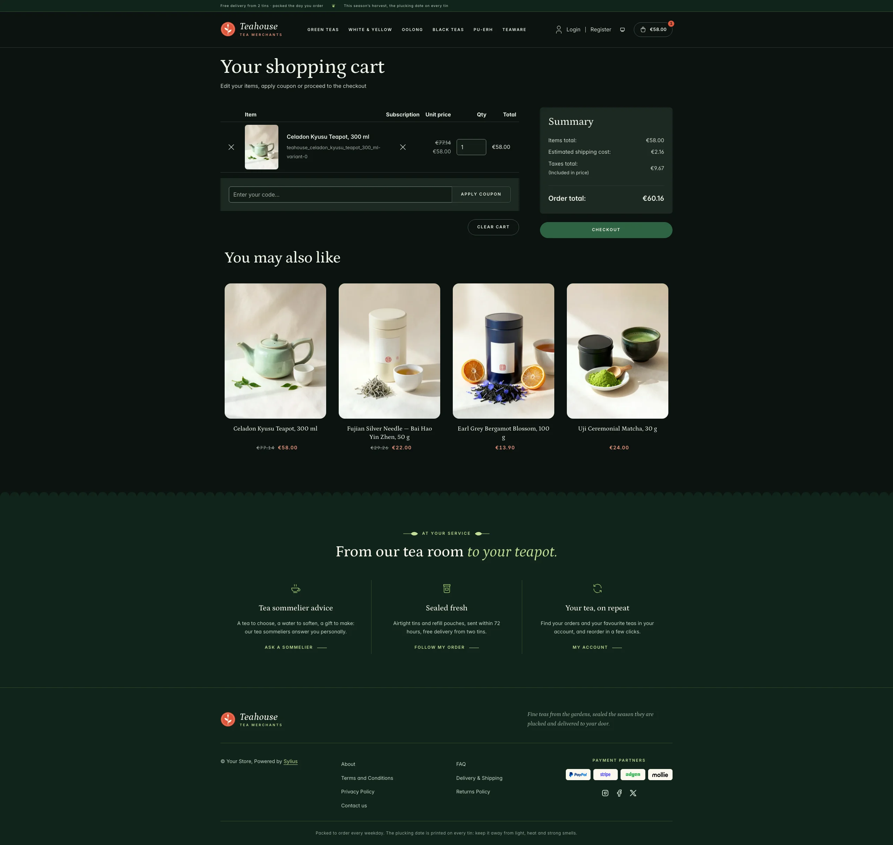

Teahouse is built for tea merchants and tea rooms selling loose leaf teas, matcha and teaware: a
calm storefront in rice paper and jade night, set with the calligraphic Petrona serif and stamped with
a vermilion house seal of two leaves and a bud. It is Roastery's tea counterpart, lighter and greener:
tea gardens, steeping guides, liquor colours and oxidation levels are part of the page.

**Desktop** (1440 px)

| Scheme | Homepage | Product page | Cart |
|---|---|---|---|
| Light |  |  |  |
| Dark |  |  |  |

**Wide screen** (2560 px)

| Scheme | Homepage | Product page | Cart |
|---|---|---|---|
| Light |  |  |  |
| Dark |  |  |  |

**Mobile** (390 px)

| Scheme | Homepage | Product page | Cart |
|---|---|---|---|
| Light |  |  |  |
| Dark |  |  |  |

- **Palette** — jade night (`#0F2219`, `#173325`), jade (`#24503A`) and moss (`#3F6B4C`) on rice paper
  (`#F5F2E7`) and porcelain (`#FFFDF6`), with matcha (`#9CC46B`, `#C4DE97`) on the jade bands, a vermilion
  seal (`#C8432B`, `#B03A23` as text) for eyebrows, prices and numerals, and a sencha green (`#2C6642`) for
  accent text.
- **Dark scheme** — the tea room at night: lacquer black (page `#0C1310`, surfaces `#131C17`), rice paper
  type, a garden green (`#2E6343`) for buttons, a pale matcha (`#B7D98C`) for accent text and a lantern
  red (`#F59A80`) for the seal text, with matcha hairlines on the jade bands.
- **Typography** — *Petrona* (SIL Open Font License, variable weight, roman and italic, shipped in
  `assets/shop/fonts/`) for headings, product names and figures, with brushed matcha italics; *Inter*
  (already shipped by the Sylius shop) for body copy, and spaced uppercase small capitals for eyebrows,
  navigation, buttons and breadcrumbs.
- **House motif** — a row of clipped tea bushes: the jade bands (figures, footer) end in a scalloped tea
  hedge edge. Eyebrows are ruled by a fine stem ending in a tea leaf.
- **Components** — pill-shaped jade buttons (matcha on the dark panels), product cards on a rounded rice
  paper niche with a leaf fillet and the vermilion house seal stamped on hover, an outlined cart button with a vermilion counter, and an
  **oxidation scale**: five leaves turning from fresh green to deep amber brown.
- **Header** — a jade top bar with the delivery promise and the plucking dates, then the vermilion **house
  seal** (two leaves and a bud) and the *Teahouse* wordmark, centered category navigation underlined in
  leaf green.
- **Homepage** — a jade hero: an eyebrow, a Petrona headline ending in matcha italic, two calls to action
  and a signature stamped with the seal. On the right, the **moon gate**: through the round opening of a
  vermilion lacquer tea house wall, terraced tea gardens at dawn under a golden sun, a swaying paper
  lantern, and on the tea table a celadon teapot pouring amber tea into a steaming porcelain cup, a jade tin
  of first flush and a sprig of two leaves and a bud, in a panel with a matcha double fillet. A band of **house
  figures** (partner gardens, plucking standard, tasting selection, delivery time) closes the hero. The
  promise block (`theme_promise` hookable) presents the craft in three steps numbered in Roman numerals
  (pluck, craft, seal & send), next to a **steeping guide** printed like a tin label (steeping dial, water,
  leaf, infusions, cup notes and oxidation). After the four latest products, the **families** block
  (`theme_families` hookable) shows the six colours of tea (white, green, yellow, oolong, black and dark),
  each card tinted with its liquor colour behind a cup that tips on hover, an origin, its cup notes, its steeping and its oxidation. The
  deals and new collection blocks are hidden.
- **Footer** — jade, with three **house services** (tea sommelier advice, sealed fresh, your tea on repeat)
  linking to the contact page and the customer account, the wordmark, the Sylius links and the plucking
  date notice.
- **Checkout** — the checkout header uses the Teahouse wordmark and responsive category navigation, the
  current step is ruled in leaf green.
- **Translations** — every Teahouse-specific text lives in its own `teahouse` translation domain
  (`translations/teahouse.en.yaml` and `teahouse.fr.yaml`).
- **Accessibility** — visible leaf green focus rings, text alternatives for the hero illustration, the
  steeping dial and the oxidation levels, and no motion (rising steam, swaying lantern) for visitors who prefer reduced
  motion.

## Demo catalog

The screenshots above show a demo catalog of sixteen fine teas and pieces of teaware from a fictional tea merchant, on
six shelves (Green Teas, White & Yellow, Oolong, Black Teas, Pu-erh, Teaware), shipped as the `teahouse` dataset of
`sylius-starter/datasets` (`src/Datasets/datasets/teahouse/`: `products.yaml`, `collections.yaml`, and in `media/` a
photo of each item generated with Ollama, on the rice paper of the theme, each tea in a tin of its own lacquer colour).
The teas are the ones of the homepage (the Darjeeling First Flush of the steeping guide, and the six families from
Silver Needle to the Yunnan pu-erh), and descriptions carry what a tea lover looks for: garden, harvest, cup notes,
oxidation and steeping advice.
Create a shop from it with the [import package](../import/datasets.md), into the default channel:

```bash
castor sylius:import:shop:create teahouse
castor sylius:import:fixtures:generate --project=teahouse --subdomain=""
castor sylius:import:fixtures:load --project=teahouse
```

No AI call is made: `products.yaml` points at the photos of the dataset `media/`. The shop menu then lists the six
shelves; `castor sylius:import:delete teahouse` removes the catalog. The import keeps the products already in the
channel and gives the items creation dates in the past, so on a store loaded with the default fixtures the latest
products may still show clothing: run `castor app:db:fixtures app` first to start from a store without products.

Install it with:

```bash
castor sylius:theme:setup teahouse
```
