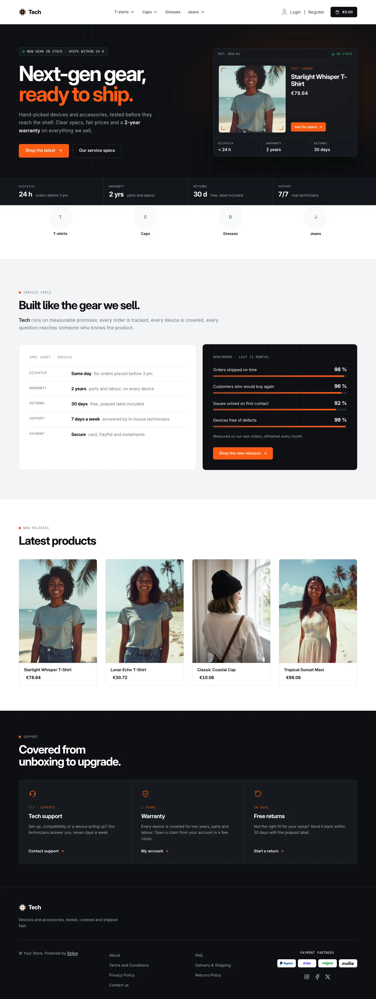
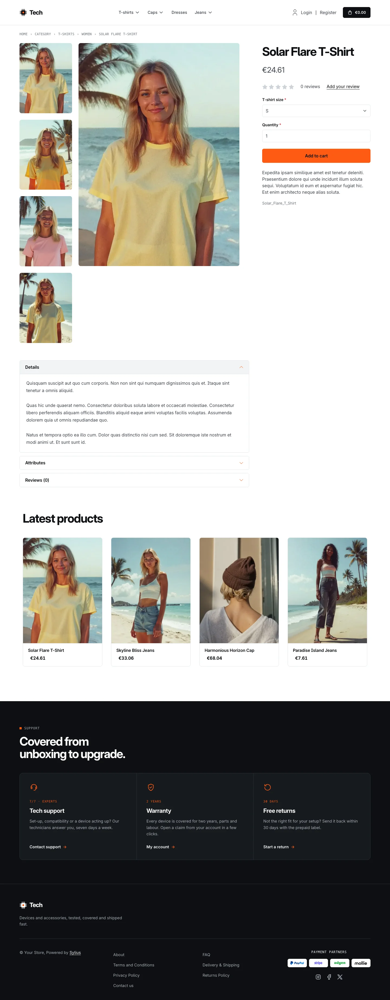
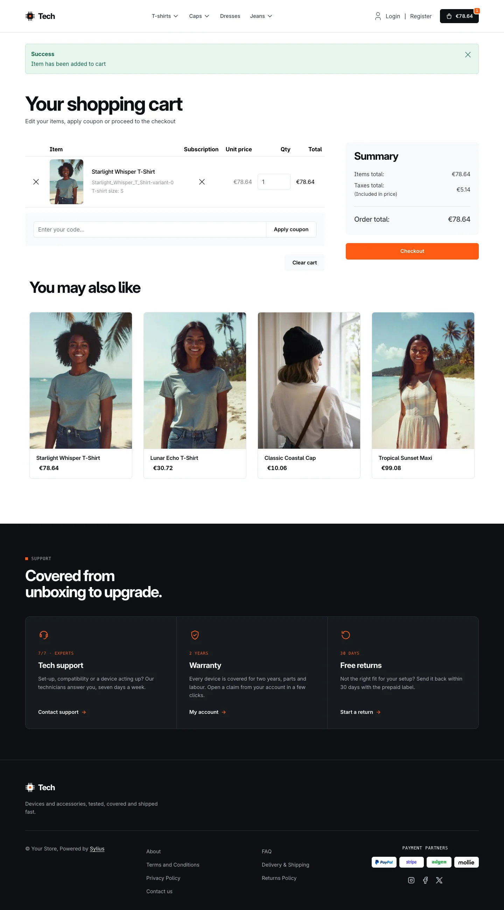
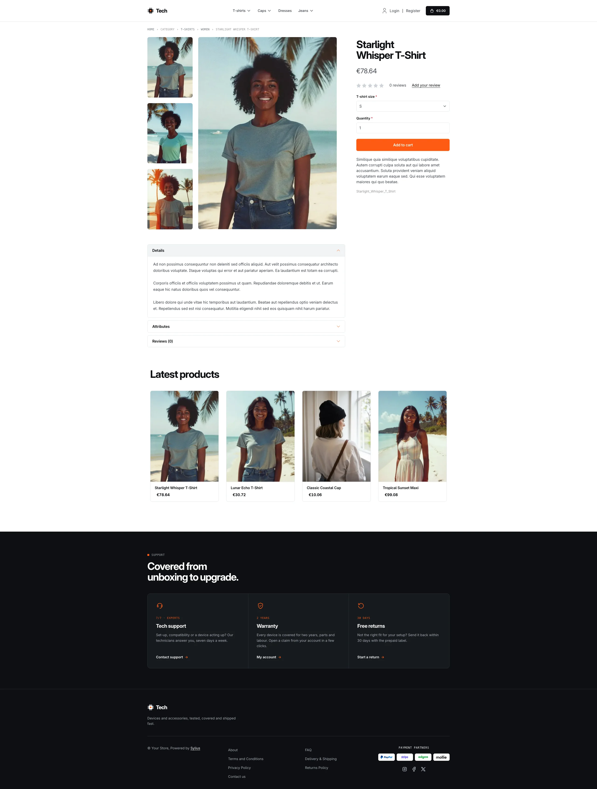
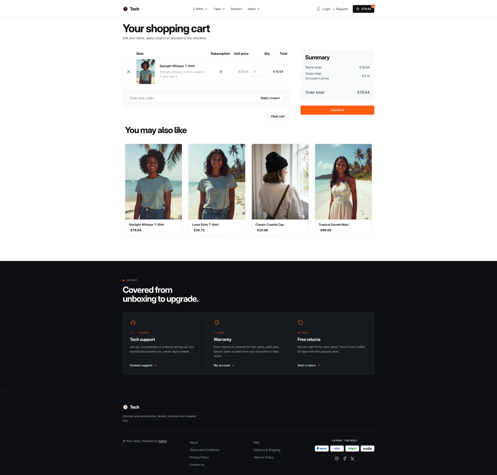

Tech is built for high-tech and gadget stores: a crisp, product-led storefront
in carbon black and aluminium grey, lit by a single signal-orange accent. Machined
corners, monospace spec labels and datasheet layouts make it read like a modern
electronics shop. It is set in *Inter* (already shipped by the Sylius shop) with
the system monospace font for labels, so no extra font file is needed.

**Desktop** (1440 px)

| Homepage | Product page | Cart |
|---|---|---|
|  |  |  |

**Wide screen** (2560 px)

| Homepage | Product page | Cart |
|---|---|---|
|  |  |  |

**Mobile** (390 px)

| Homepage | Product page | Cart |
|---|---|---|
|  |  |  |

- **Palette** — carbon (`#0D0F12`), graphite (`#171A1F`), aluminium
  (`#F2F3F5`) and signal orange (`#FF5B14`) on a white background, with a
  green status LED (`#2ED47A`) for "in stock" indicators.
- **Typography** — tightly-tracked *Inter* for headings and prices (tabular
  figures), uppercase monospace for eyebrows, breadcrumbs and spec labels.
- **Components** — square-cornered signal-orange buttons (outlined carbon for
  secondary actions), white product cards on an aluminium image tray whose
  border turns carbon on hover while an orange rule slides along the top (the
  whole card is clickable, on the homepage and on category pages alike), a
  carbon cart button with an orange item counter, a full-width orange
  add-to-cart button, and no default header top bar.
- **Homepage** — a carbon hero over a fine engineering grid: a white headline
  ending in signal orange, a blinking stock LED and two calls to action. On the
  right, the newest product of the channel sits on a **measuring bench**:
  viewfinder corners around its real image, its name, price and three spec
  callouts (dispatch, warranty, returns). A **spec bar** of key figures closes
  the hero. The promise block (`theme_promise` hookable) presents the service
  as a **spec sheet** next to a **benchmark** of measured figures drawn as
  orange gauges on carbon. Then come the four latest products; the deals and
  new collection blocks are hidden.
- **Footer** — a carbon footer with three **support modules** (tech support,
  warranty, returns) linking to the contact page and the customer account,
  above the Tech chip wordmark and the Sylius links.
- **Product page** — the price sits directly below the product name, before reviews.
- **Checkout** — the checkout header uses the Tech wordmark and responsive
  category navigation.
- **Translations** — every Tech-specific text lives in its own `tech`
  translation domain (`translations/tech.en.yaml` and `tech.fr.yaml`), so it
  can be edited or translated without touching the templates.
- **Accessibility** — visible orange focus rings, decorative bench details
  hidden from assistive technologies, and no motion (blinking LED included)
  for visitors who prefer reduced motion.

Install it with:

```bash
castor sylius:theme:setup tech
```
