Torque is built for car parts and equipment shops: mechanical parts, tyres, accessories, tools and workshop
equipment. A complex catalogue in which customers search by **part reference** or by **dimension**, and where
garages buy at **trade prices**. The storefront is white with cool grey tiles, a midnight navy and a signal
orange, set in a squared *Saira* that reads like the lettering of a dashboard.

**Desktop** (1440 px)

| Scheme | Homepage | Product page | Cart |
|---|---|---|---|
| Light | 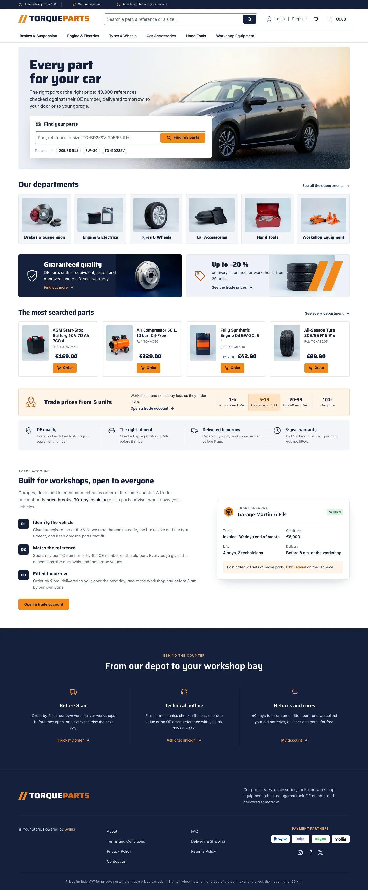 | 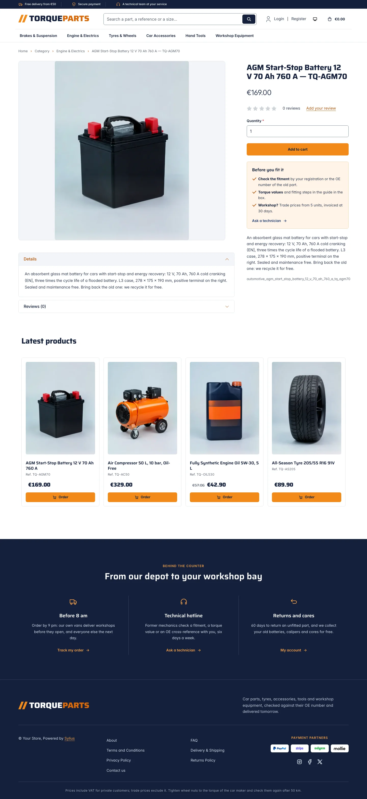 | 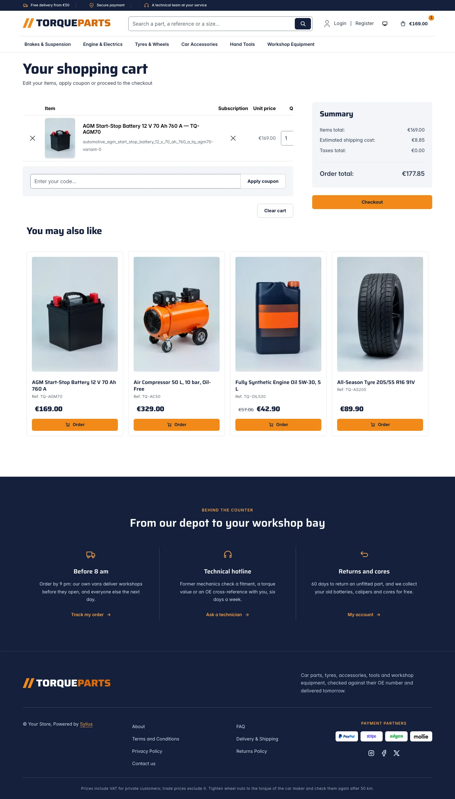 |
| Dark | 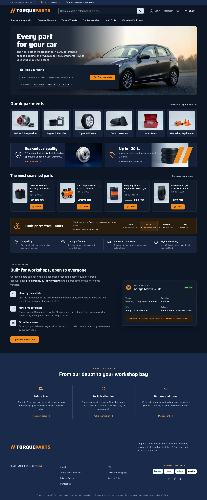 | 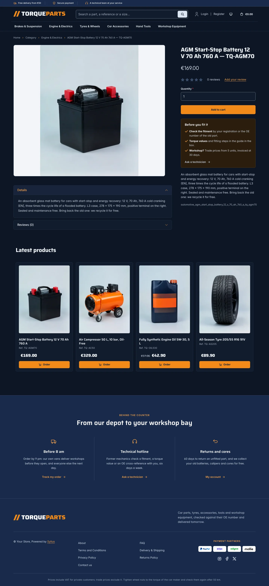 | 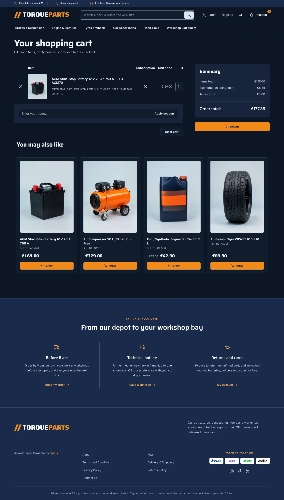 |

**Wide screen** (2560 px)

| Scheme | Homepage | Product page | Cart |
|---|---|---|---|
| Light | 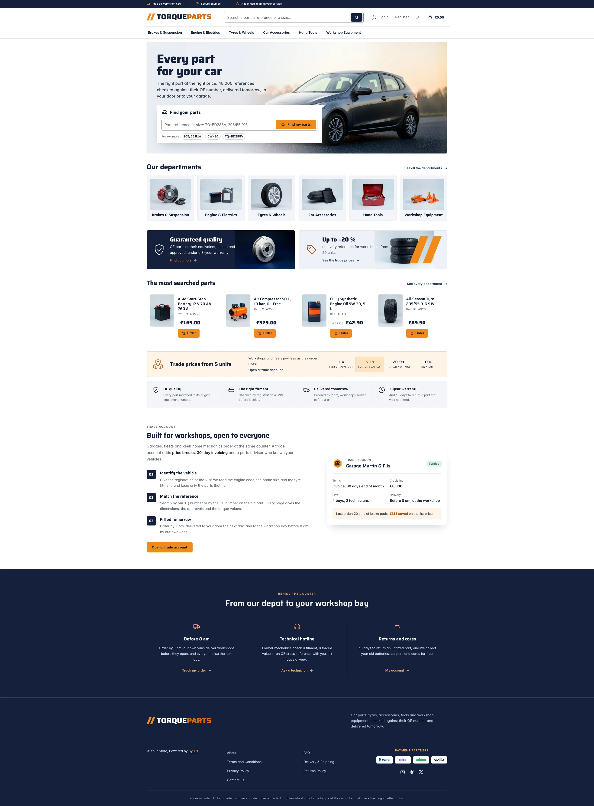 | 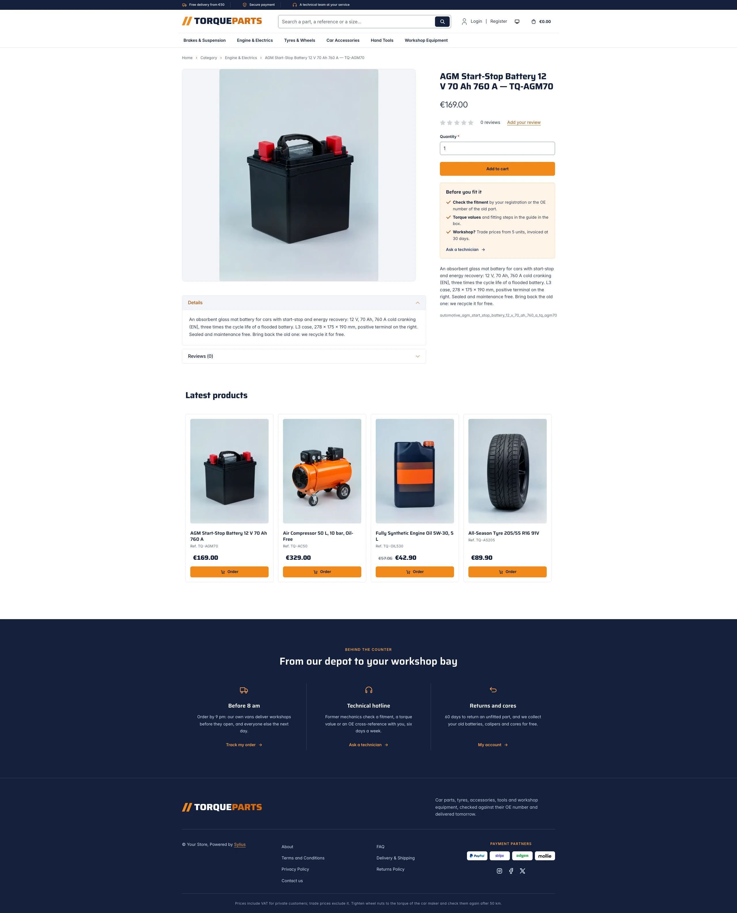 | 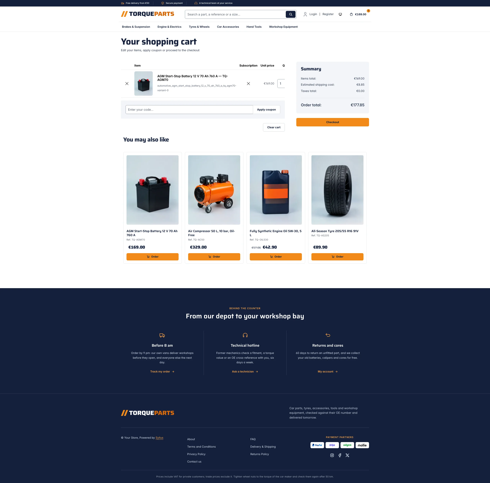 |
| Dark | 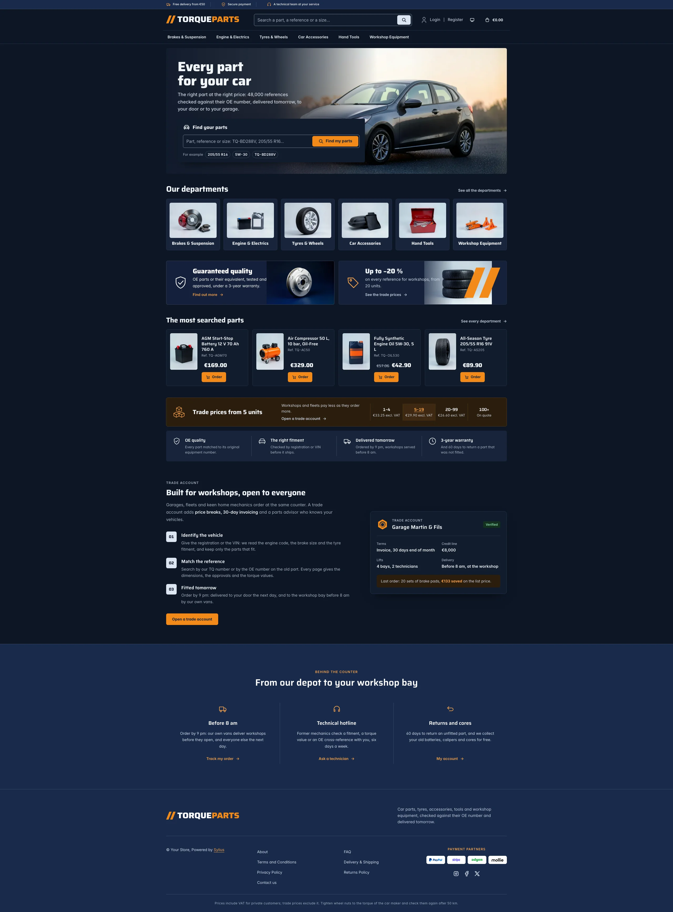 | 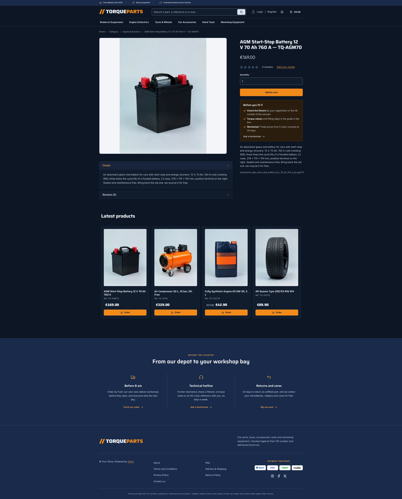 | 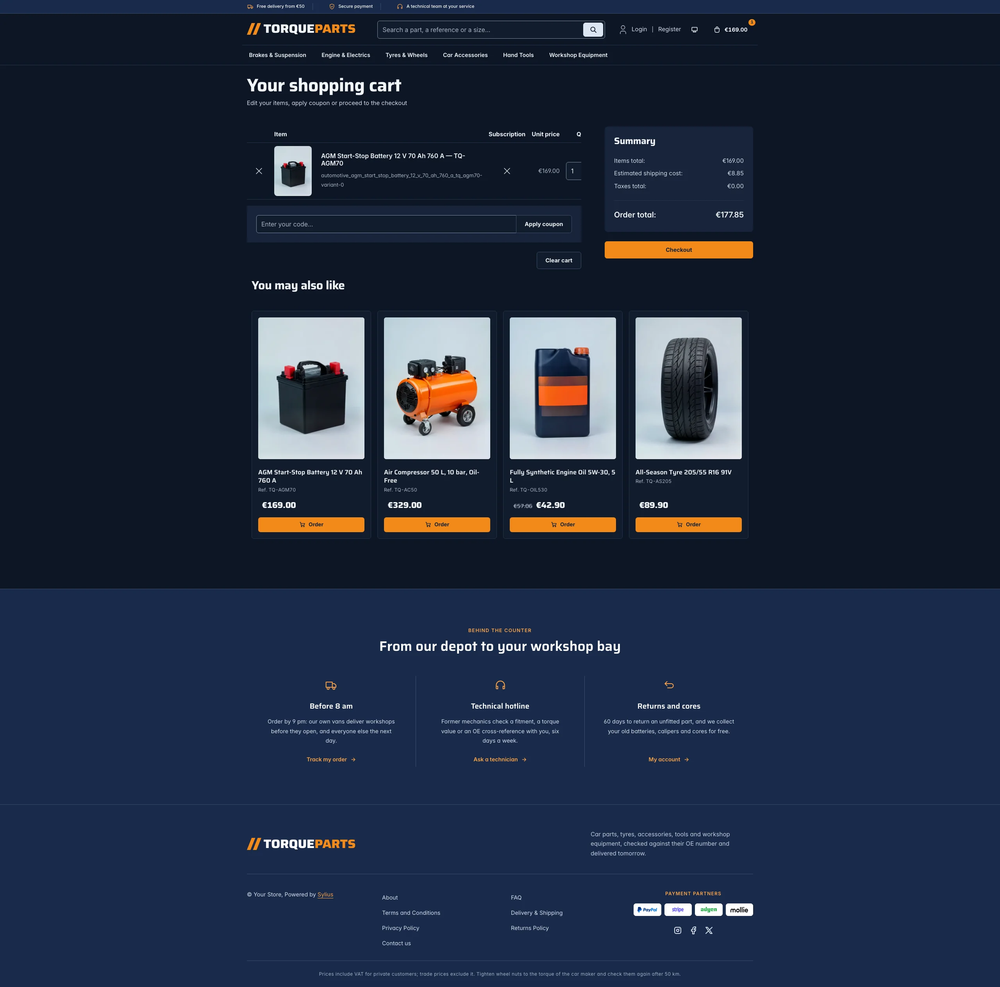 |

**Mobile** (390 px)

| Scheme | Homepage | Product page | Cart |
|---|---|---|---|
| Light |  |  |  |
| Dark |  |  |  |

- **Palette** — white pages and cool grey tiles (`#F3F5F8`), a midnight navy (`#13203A`) for the top bar, the
  quality banner and the footer, and a signal orange (`#F28A1A`) for the calls to action and the order buttons,
  with a navy ink on it (6.5:1). As text on white, the orange turns to a burnt orange (`#B4500A`), and the orange
  half of the wordmark to `#D96A0B` (large text, 3.5:1).
- **Dark scheme** — the workshop at night: midnight surfaces (page `#0D1626`, surfaces `#121C2D`), pale steel
  type, the same orange buttons, a paler orange (`#FFA347`) for links and focus rings; the navy bands are a
  shade lighter than the page.
- **Typography** — *Saira* (SIL Open Font License, variable width and weight, the file Arena ships, in
  `assets/shop/fonts/`) for the headings, the wordmark, product names and prices; *Inter* (already shipped by
  the Sylius shop) for body copy.
- **House motif** — two slanted orange strokes, like a speed mark, before the *TorqueParts* wordmark and across
  the trade offer banner; an orange wheel nut turned by a torque arrow stands in for a missing taxon image and
  marks the trade account card.
- **Header** — a navy top bar with the delivery, payment and service promises (orange icons), then the wordmark,
  a **search field** across the middle, the account links and the cart, and the category navigation on a row
  of its own, underlined in orange on hover. On phones the search takes a row under the logo.
- **Search** — the header field and the parts finder of the hero list the menu taxon with Sylius' own
  `criteria[search][value]` filter, which matches product names, descendants included
  (`sylius_shop.product_grid.include_all_descendants`): a reference (`TQ-BD288V`), a size (`205/55 R16`) or a
  grade (`5W-30`) finds the part. No search engine is needed.
- **Homepage** — a **photo banner** in the container: the headline and the lead on a hazy sky fading into a
  photo of a car at sunset, and the **parts finder**, a white card with the search field, its orange button and
  three example searches. The **departments** (`theme_aisles` hookable, the `sylius_shop:common:taxon_menu`
  component) show the menu taxons as tiles with their image, in one row on desktops; they replace the
  roundels of the imported collections (`import_collections` is disabled). Two **offer banners**
  (`theme_offers` hookable): the OE quality promise on navy with a brake disc, and the trade prices on a pale
  panel with a stack of tyres. The four latest products are presented as **the most searched parts**,
  catalogue lines with the picture beside the details. The **trade price band** (`theme_promise` hookable)
  gives the unit price of a set of brake pads at each quantity step, followed by four promises (OE quality,
  fitment check, next-day delivery, 3-year warranty). The **trade account** block (`theme_account` hookable)
  explains it in three steps next to the account card of a garage. The deals and new collection blocks are
  hidden.
- **Product cards** — a framed tile with the picture on pale grey, the name, the **part reference**, a large
  price and an orange **order button**. The reference is the end of the product name after a dash
  (`Ceramic Brake Pads, Front Axle Set — TQ-BP4021C`), the product code otherwise; the card prints the name
  without it.
- **Product page** — the picture on pale grey and, under the add to cart button, the notes **before fitting**
  (fitment check, torque values, trade prices) with a link to the contact page.
- **Footer** — navy, with three **services** (delivery before 8 am, a technical hotline, returns and cores),
  the wordmark, the Sylius links and a VAT and torque notice.
- **Checkout** — the checkout header uses the Torque wordmark and responsive category navigation, the current
  step is ruled in orange.
- **Translations** — every Torque-specific text lives in its own `torque` translation domain
  (`translations/torque.en.yaml` and `torque.fr.yaml`).
- **Accessibility** — visible orange focus rings, both search forms as named `search` landmarks with a label,
  the price break band as a table with a caption, decorative photos and icons hidden from assistive
  technologies.

## Demo catalog

The screenshots above show a demo catalog of eighteen car parts and pieces of equipment from a fictional parts
house, in six departments (Brakes & Suspension, Engine & Electrics, Tyres & Wheels, Car Accessories, Hand Tools,
Workshop Equipment), shipped as the `automotive` dataset of `sylius-starter/datasets`
(`src/Datasets/datasets/automotive/`: `products.yaml`, `collections.yaml`, and in `media/` a photo of each product
and of each department, generated with Ollama on a pale grey studio backdrop: the department photos become the
taxon images of the tiles). Each title ends with its part reference (`— TQ-BD288V`), and the descriptions carry
what a mechanic looks for: dimensions, bolt pattern, load and speed ratings, approvals (ECE R90, ACEA, EN),
fitment notes and trade pack sizes.
Create a shop from it with the [import package](../import/datasets.md), into the default channel:

```bash
castor sylius:import:shop:create automotive
castor sylius:import:fixtures:generate --project=automotive --subdomain=""
castor sylius:import:fixtures:load --project=automotive
```

No AI call is made: `products.yaml` points at the photos of the dataset `media/`. The shop menu then lists the
six departments; `castor sylius:import:delete automotive` removes the catalog. The import keeps the products
already in the channel, so on a store loaded with the default fixtures the latest products may still show
clothing: run `castor app:db:fixtures app` first to start from a store without products.

Install it with:

```bash
castor sylius:theme:setup torque
```
