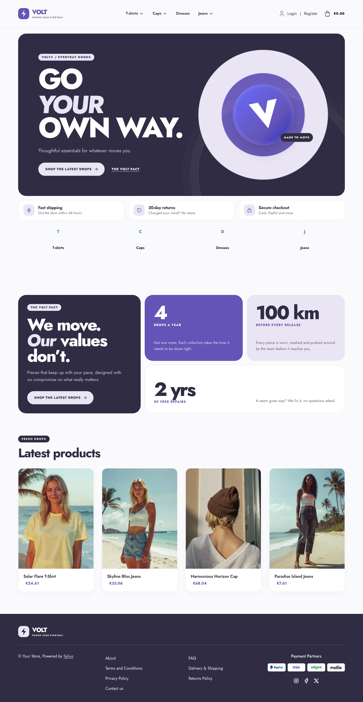
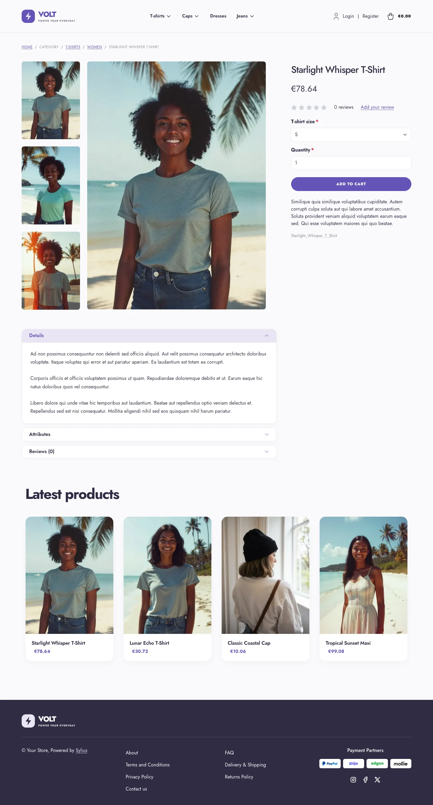
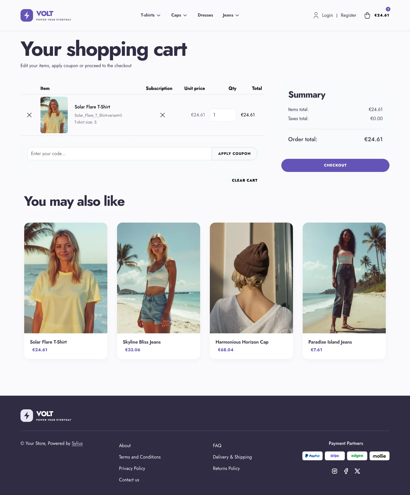
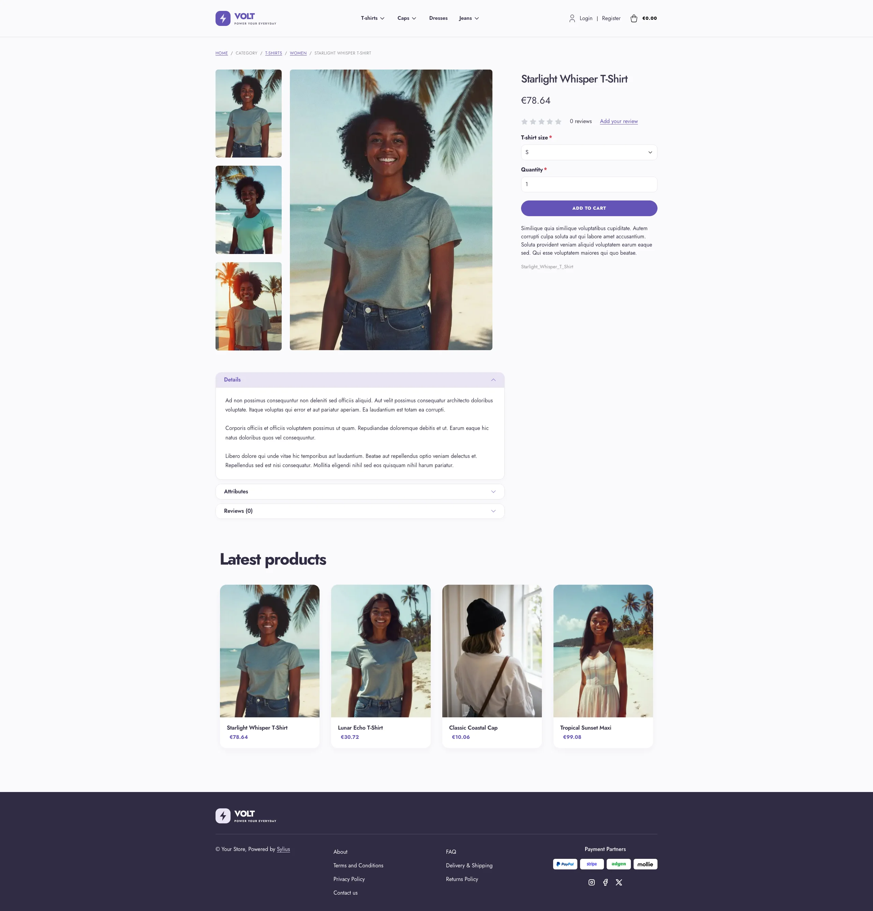
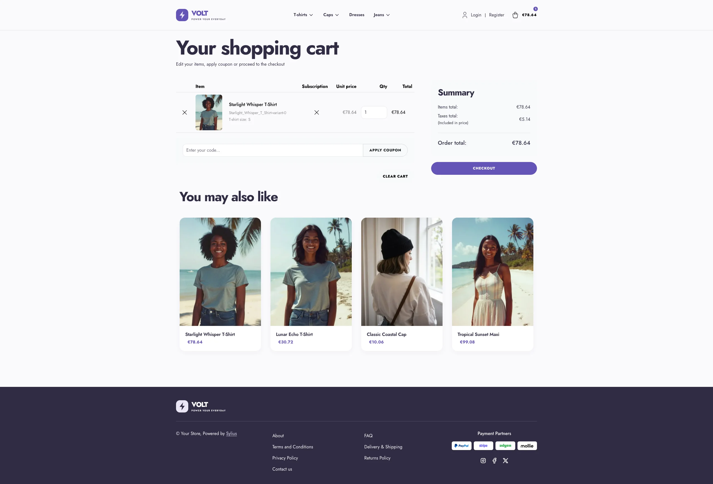
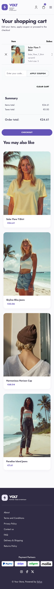

Volt takes the opposite route: a high-energy, sport-tech storefront with electric
violet, soft-lavender accents, rounded components and bold Jost typography. Its
custom homepage banner uses layered CSS artwork, so it needs no additional image
assets.

**Desktop** (1440 px)

| Homepage | Product page | Cart |
|---|---|---|
|  |  |  |

**Wide screen** (2560 px)

| Homepage | Product page | Cart |
|---|---|---|
|  |  |  |

**Mobile** (390 px)

| Homepage | Product page | Cart |
|---|---|---|
|  |  |  |

- **Palette** — plum ink (`#302B43`), electric violet (`#6554B8`) and soft
  lavender (`#E9E5F4`) over a subtle, near-white background.
- **Components** — pill-shaped buttons, soft rounded cards, pale high-contrast
  breadcrumbs, a custom Volt logo and a responsive category menu in the header,
  a dark footer with white links and light-backed payment logos, a full-width
  add-to-cart button, and no default header top bar.
- **Product page** — the price sits directly below the product name, before reviews.
- **Product cards** — rounded white cards with a lavender image well, electric
  prices and a stronger lift on hover; the whole card is clickable, on the
  homepage and on category pages alike.
- **Homepage** — an oversized, responsive graphic hero aligned on the page
  grid, a strip of three perks (shipping, returns, secure checkout), the
  *"Volt pact"* bento with three bold figures (the promise block, through the
  `theme_promise` hookable, linked from the hero), then the four latest products with a large heading; the deals and new collection
  blocks are hidden.
- **Typography** — Jost is loaded as a variable font (100–900), so bold
  headings use the real weights instead of synthesized ones.
- **Translations** — the Volt-specific texts live in a `volt` translation
  domain (`translations/volt.en.yaml` and `volt.fr.yaml`).
- **Checkout** — the checkout header uses the Volt wordmark and responsive
  category navigation.

Install it with:

```bash
castor sylius:theme:setup volt
```
